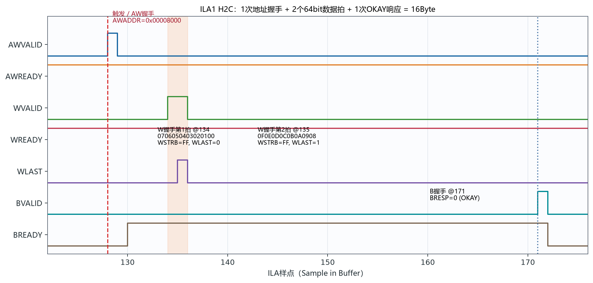
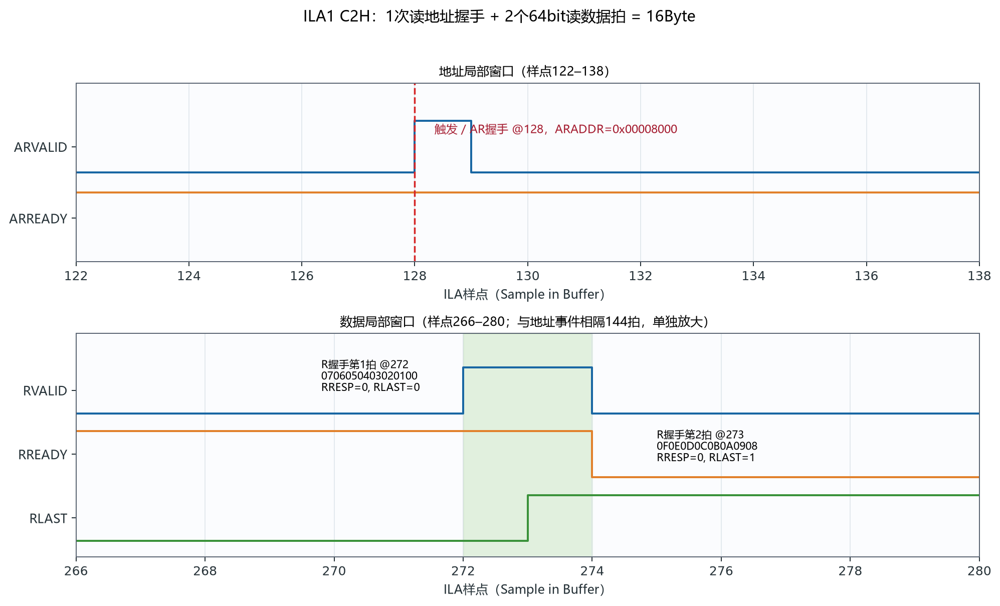
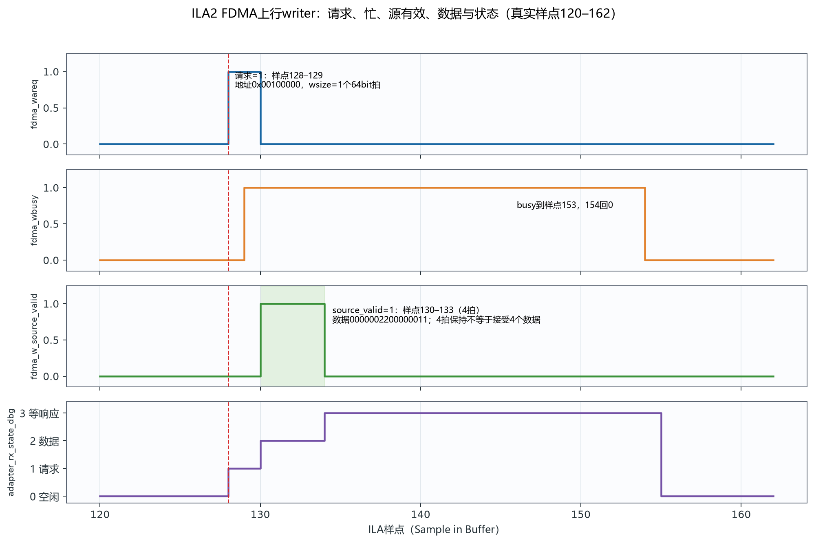
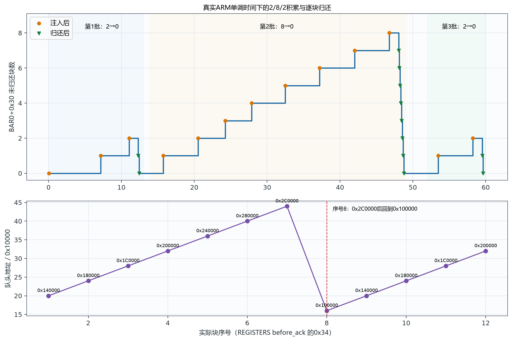

# RTDS ILA/VIO实测波形判读附册

**日期：2026-10-19**  
**适用范围：RX_VIO_TEST_ENABLE=1 的当前调试构建；保存波形和快照的离线判读。**

> 结论先行：在 VIO 测试模式下，单主机基础应用数据通路与队列协议已经完成联调。H2C 的16Byte写入、C2H的16Byte读回、VIO固定8Byte上行块、2/8/2队列积累与归还、8槽环回都已有闭环证据。本结论不等于全部RTL、真实Aurora收发、对端业务或完整系统验收。

## 1. 证据时刻、来源与阅读边界

本附册只解释已经保存到文件的证据。ILA是历史捕获，VIO是逐项刷新状态，两者不是同一时钟拍的原子快照；现场现在看到的值不得反推为下列捕获时刻的值。

| 证据 | 对应时刻/范围 | 本附册用途 |
|---|---|---|
| `gui_native_20261019_091031_1792372231992.csv` | 09:10:31，2048点，触发128 | ILA1 H2C 16Byte写 |
| `gui_native_20261019_091042_1792372242631.csv` | 09:10:42，2048点，触发128 | ILA1 C2H 16Byte读 |
| `gui_fdma_20261019_091109_1792372269768.csv` | 09:11:09，1024点，触发128 | ILA2 VIO固定数据写入DDR |
| `vio_20261019_091234_1792372354569.txt` | 09:12:34，顺序JTAG读取 | VIO1/VIO2最终状态表 |
| `result.json` | ARM单调时间0.00–63.23s | 2/8/2队列、逐块归还、环回与比较 |
| `capture_decode.json` | 对上述三份CSV逐拍解码 | 握手数、地址、数据、响应与错误探针复核 |

完整信号定义可查：`E:/PCIE-CPU/outputs/pcie_debug_manual_20261015/RTDS_现有VIO_ILA全部信号速查_20261015.md`。本附册的图均由上述真实CSV/JSON直接生成，图注给出样点窗口；没有补画臆造波形。

## 2. 现场先看哪里

| 当前编号 | 实例路径 | 用途 | 本轮证据状态 |
|---|---|---|---|
| `hw_vio_1` | `u_pcie/G_RX_VIO.U_VIO_RX_START` | 上行测试注入和块队列 | 09:12:34快照 |
| `hw_vio_2` | `u_pcie/U_PCIE_LINK_DEBUG/vio` | 链路、复位、时钟、DMA摘要 | 09:12:34快照 |
| `hw_ila_1` | `u_pcie/U_PCIE_LINK_DEBUG/ila` | XDMA AXI H2C/C2H | 写、读各一份 |
| `hw_ila_2` | `u_pcie/ila_FDMA_inst` | VIO数据写入DDR业务通路 | 一份 |
| `hw_ila_3` | `u_temp_rd/ila_temp_inst` | 温度采集 | 本轮未重新采集 |
| `hw_ila_4` | `ila_pcie_phy` | PHY建链排查 | 本轮未重新采集 |

编号会随Vivado会话变化，应按实例路径识别。推荐：状态寄存器、地址和数据总线用 **Hex**；块数、字数、busy、计数器用 **Unsigned Decimal**；单bit握手信号用 Binary。`ila_axi[215:0]` 必须按字段拆解，不能把整个216bit十六进制数当成一个寄存器。

## 3. ILA1：怎样从写波形看出16Byte

源文件：`validation/20261019/captures/gui_native_20261019_091031_1792372231992.csv`。图1显示样点122–176；触发为128。只有 VALID 和 READY 同时为1才计一次握手。



**图1　ILA1 H2C真实局部波形，样点122–176。** 红色虚线为触发128。地址、数据、响应相隔较远，因此保留完整局部范围而不横向压扁。

判读链条如下：

1. 样点128，AWVALID=1且AWREADY=1，地址握手正好1次，`AWADDR=0x00008000`。
2. 样点134和135，WVALID=1且WREADY=1，共接受2个64bit拍。第1拍 `0706050403020100`，第2拍 `0F0E0D0C0B0A0908`。
3. 两拍 `WSTRB=FF`，每拍8个字节全部有效；2拍×8Byte=16Byte。
4. `WLAST` 在第1拍为0、最后一拍为1，突发数据边界闭合。
5. 样点171，BVALID=1且BREADY=1，写响应握手1次，`BRESP=0`（OKAY）。

以小端字节顺序展开，两拍合并为 `00 01 02 03 04 05 06 07 08 09 0A 0B 0C 0D 0E 0F`。这就是“16Byte写入”的逐拍证据。

## 4. ILA1：怎样从读波形看出16Byte

源文件：`validation/20261019/captures/gui_native_20261019_091042_1792372242631.csv`。AR事件在128，R事件在272–273，相隔144拍。图2分成两个真实局部窗口，避免把关键两拍压成一条线。



**图2　ILA1 C2H真实局部波形。** 上图样点122–138，下图样点266–280。

1. 样点128，ARVALID=1且ARREADY=1，地址握手正好1次，`ARADDR=0x00008000`。
2. 样点272和273，RVALID=1且RREADY=1，共接受2个64bit拍。
3. 第1拍 `0706050403020100`，`RRESP=0`、`RLAST=0`；第2拍 `0F0E0D0C0B0A0908`，`RRESP=0`、`RLAST=1`。
4. 2拍×8Byte=16Byte，末拍标记正确，两拍响应均为OKAY。

两份ILA1的 `ila_errors[8:0]` 在全部2048个样点中均为0。`ila_ltssm=0x10`、link/AXI复位/PERST#/PLL探针为1，speed编码2、width编码2；这些是本次保存波形的上下文，不应被写成当前实时值。

## 5. ILA1的216bit字段速判

| 位 | 字段 | 本轮有效事件 |
|---|---|---|
| 0/1 | AWVALID/AWREADY | 写样点128，同时为1 |
| 2/3 | WVALID/WREADY | 写样点134、135，同时为1 |
| 4/5 | BVALID/BREADY | 写样点171，同时为1 |
| 6/7 | ARVALID/ARREADY | 读样点128，同时为1 |
| 8/9 | RVALID/RREADY | 读样点272、273，同时为1 |
| 11:10 / 13:12 | BRESP / RRESP | 有效响应均0 |
| 14 / 15 | WLAST / RLAST | 各自最后数据拍为1 |
| 23:16 | WSTRB | 两个写拍均FF |
| 55:24 / 87:56 | AWADDR / ARADDR | 握手时均00008000 |
| 151:88 / 215:152 | WDATA / RDATA | 两个方向均为相同的两拍16Byte |

数据总线在非握手拍显示0或旧值不构成错误。该ILA看的是XDMA DMA AXI，不包含BAR AXI-Lite访问。

## 6. ILA2：FDMA请求、busy、source_valid、数据与状态

源文件：`validation/20261019/captures/gui_fdma_20261019_091109_1792372269768.csv`。图3显示样点120–162，触发128，条件是 `fdma_wareq=1`。



**图3　ILA2 FDMA writer真实局部波形，样点120–162。**

| 信号 | 实测 | 正确解释 |
|---|---|---|
| `fdma_waddr` | `00100000` | 该块DDR起始字节地址 |
| `fdma_wareq` | 样点128–129为1 | writer请求发起写 |
| `fdma_wbusy` | 129起为1，154回0 | 事务进行中，含等待响应 |
| `fdma_wsize` | `0001` | 一个64bit拍，即8Byte，不是1Byte |
| `fdma_wdata` | `0000002200000011` | 两个32bit字0x11、0x22，小端字节为11 00 00 00 22 00 00 00 |
| `fdma_w_source_valid` | 样点130–133为1 | 源数据保持有效4拍；没有直接接受探针，不能解释为接受4个数据 |
| `adapter_rx_state_dbg` | 0→1→2→3→0 | 空闲→请求→数据→等最终响应→空闲 |

`rx_test_accepted_r=2` 指接受了两个32bit字，不是两个块。仅靠busy回0或状态回0也不能证明DDR写成功；闭环证据还包括块登记、ARM C2H逐字节比较和确认归还。

## 7. VIO1：动态值、保持值和控制输出

下表对应 **09:12:34** 快照。VIO输入是逻辑送给VIO的观察量，VIO输出是VIO驱动逻辑的控制量。

| 方向 | 信号 | 快照值 | 动态/历史属性与解释 |
|---|---|---|---|
| IN | `rx_test_busy_r` | 0 | 动态状态；注入已结束，短暂的1可能被刷新漏过 |
| IN | `rx_test_accepted_r` | 2 | 本次保持结果；两个32bit字，共8Byte，不是2块 |
| IN | `rx_test_blocks_r` | 0 | 动态队列深度；已完成、尚未归还的块数，与BAR0+0x30一致 |
| IN | `rx_test_status_r` | 3 | bit0 DDR ready、bit1 link、bit2 fault、bit3通知；0x3为空闲健康 |
| OUT | `rx_test_start` | 1 | 控制输出；保持高不重发，下一次需提交0再提交1 |

`rx_test_status_r=0xB` 表示DDR/link就绪且通知为1，若按十进制显示会是11，不是0x11。

## 8. VIO2：当前、历史、累计和控制项

下表同样只对应 **09:12:34**。VIO逐项JTAG读取，不是同拍原子快照。

| 类型 | 信号 | 快照值 | 解释 |
|---|---|---|---|
| 当前位图 | `live_vio` | 00BF | PERST#/QPLL1/时钟/link/AXI复位释放/DDR/settled为1，board reset/IRQ为0 |
| 历史位图 | `history_vio` | E | 曾见PLL、时钟、link；settle后未记录PERST#低，不是故障码 |
| 累计 | `ups_vio` / `downs_vio` | 0001 / 0000 | 观察到一次link 0→1，未记录1→0 |
| 累计 | `persts_vio` / `pll_losses_vio` / `ar_falls_vio` | 0 / 0 / 0 | 未记录PERST#下降、PLL丢锁、axi_aresetn下降；这里ar不是AXI读地址 |
| 动态 | `uptime_vio` | 0015DEBC | 业务复位释放后的毫秒计数，可回绕 |
| 动态 | `seq_vio` / `age_vio` | 436E / 00000000 | 快照更新序号 / 距上次更新毫秒 |
| 首次事件 | `first_link_vio` | 00000F56 | 首次link=1时uptime=3926ms |
| 首次事件 | `first_perst_vio` | 00000000 | 首次观察PERST#高的uptime，不是低脉宽 |
| 原生摘要 | `snapshot_vio_1` | 0001E490 | LTSSM=0x10、speed=2、width=2、link/复位/PERST#/PLL为1、错误0 |
| 历史位图 | `snapshot_vio_2` | 0000000000017FF7 | 曾经过的LTSSM状态集合，不表示同时停在多个状态 |
| 累计 | `snapshot_vio_3` | ...000E00000001 | 保存时AW握手1、AR握手14，错误周期0；不是字节数，也不是当前实时计数 |
| 原生扩展 | `snapshot_vio` | FFFFFFFF00000000029E6D78DE66 | ticks=1836637798、LTSSM跳变670、B/R错误0、停留计数饱和 |
| OUT | `clear_vio` | 0 | 清历史控制；本轮未拉高 |
| OUT | `capture_axi_vio` | 0 | AXI活动是否参与capture_event，不是DMA开关 |

`live_vio=0x00BF` 的bit0–5和bit7为1；bit6板载业务复位为0是正常状态，bit8业务IRQ为0表示快照时空队列。`snapshot_vio_3` 的AR=14来自一次DDR C2H加13个上行块；不包含BAR AXI-Lite事务。

## 9. 真实2/8/2队列、归还与8槽环回

源文件：`validation/board_runs/20261019_091120_multi_01905/result.json`。横轴采用ARM单调时间，避免ARM错误墙钟。队列点取 `REGISTERS after_inject_N` 的0x30与 `BLOCK_ACK_CONFIRMED remaining`，地址点取 `REGISTERS before_ack` 的0x18/0x34。



**图4　真实2/8/2队列趋势和队头地址环回。** 三批是独立的0→2→0、0→8→0、0→2→0，不是最终积压12块。

| 批次 | 积累 | 逐块比较并归还 | 实际序号 |
|---|---|---|---|
| 2块 | 0→1→2 | 2→1→0 | 1、2 |
| 8块 | 0→1→…→8 | 8→7→…→0 | 3～10 |
| 再2块 | 0→1→2 | 2→1→0 | 11、12 |

第二批地址依次为0x1C0000、0x200000、0x240000、0x280000、0x2C0000、0x100000、0x140000、0x180000；0x2C0000→0x100000证明8槽环回。第三批继续0x1C0000、0x200000。每个块的ARM记录均为 `requested=16`、`completed=16`，但上行有效长度为8，只比较前8Byte `1100000022000000`；请求16Byte是DMA调用长度，不能把后8Byte当成有效业务载荷。

## 10. 现场只读观察方法

ARM root窗口当前使用的只读命令是：

```text
watch -n 0.5 'io -4 -r 0xf0200030'
```

单次只读命令：

```text
io -4 -r 0xf0200030
```

它读取BAR0+0x30的未归还块数。自动处理较快，0可能表示队列已被及时排空，不能据此否定曾到达8；需要结合 `result.json` 的逐步记录。为了纯观察，**禁止额外读取0x10**（读清通知），也**禁止写0x14**（归还块），否则会改变被观察状态。需要看地址、有效长度、序号时，应结合既有程序记录中的0x18、0x1C、0x34，而不要用软件推算地址替代硬件读取。

补充的多寄存器实时监视器已经部署：在现有ARM root窗口按Ctrl+C退出watch，再执行：

```text
python3 /root/rtds_joint_lab_20261016/arm/rtds_regs_watch.py
```

监视器后台每0.5秒采样，首屏显示13个重点寄存器的HEX/DEC和R/RW属性，随后仅追加业务寄存器旧值→新值及新的测试写入/归还日志，不清屏、不重复打印相同状态；默认忽略温度噪声作为追加触发。可用--mode periodic --interval 5每5秒追加完整快照。0x24/0x28为RW配置；0x20标为R/W1P，硬件写1会触发下行，但监视器不写。0x10读清、0x14归还不参与轮询。RW列是硬件属性，监视器始终只读，不会自动执行写入；日志只覆盖测试程序记录的操作，不是对所有手动io写操作的硬件抓取。详细表见RTDS_ARM重点寄存器实时监视说明_20261019.md。

## 11. ILA3、ILA4和本轮结论边界

ILA3用于温度采集，本轮没有重新采集，不能画成今日实测波形。ILA4用于PHY排查，本轮也没有重新采集；用户现场看到 `pcie_diag_phy_value_5=0`，它是lane1 CPLLLOCK，而当前配置使用QPLL1，因此不要求该位为1。主要联合检查 `value_6=1`（QPLL1LOCK）、`value_7/8/9=1`（硬核相关复位释放）、VIO link以及实际DMA事务。即使十位全为1，也不能单独证明完成建链或业务收发。

已完成的范围是：VIO测试模式下，单主机的基础应用数据通路、DDR写入/C2H读回、块队列协议和环形地址行为。已有本机经Windows中转的一轮与远程Windows直接发起的两轮通过记录；本附册波形只引用09:10–09:12这组有真实ILA/VIO证据的保存文件。当前 `RX_VIO_TEST_ENABLE=1`，真实Aurora输入未参与，因此不能声称Aurora、全部RTL或完整业务系统已经通过。

## 12. 快速故障分层

| 现象 | 优先核对 | 不应直接下的结论 |
|---|---|---|
| VIO1 accepted=2、blocks=0 | 是否已被ARM快速归还；查result.json | 不能说“没注入”或“完成2块” |
| source_valid保持4拍 | 看数据、状态与后续C2H比较 | 不能说接受了4个数据 |
| ILA1数据有值但无握手 | VALID与READY是否同时为1 | 不能把非握手拍算进传输 |
| C2H请求16、有效长度8 | 只比较前8Byte | 不能把后8Byte当有效载荷 |
| ILA4 value5=0 | QPLL1的value6、复位、link、DMA | 不能要求CPLLLOCK十位全1 |
| 当前watch读到0 | 查看历史逐步日志和峰值8 | 不能否定队列曾积累 |

---

生成与校验：`pc/build_waveform_appendix.py`。DOCX只做ZIP/XML和图片关系完整性检查，没有渲染为PDF/PNG；四幅PNG是从真实CSV/JSON生成的技术图，不是DOCX页面渲染。
