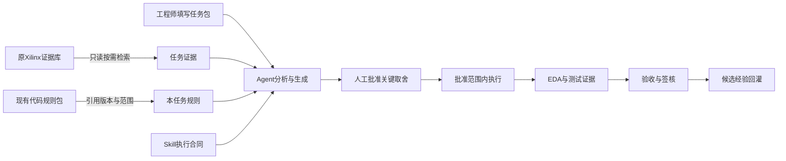
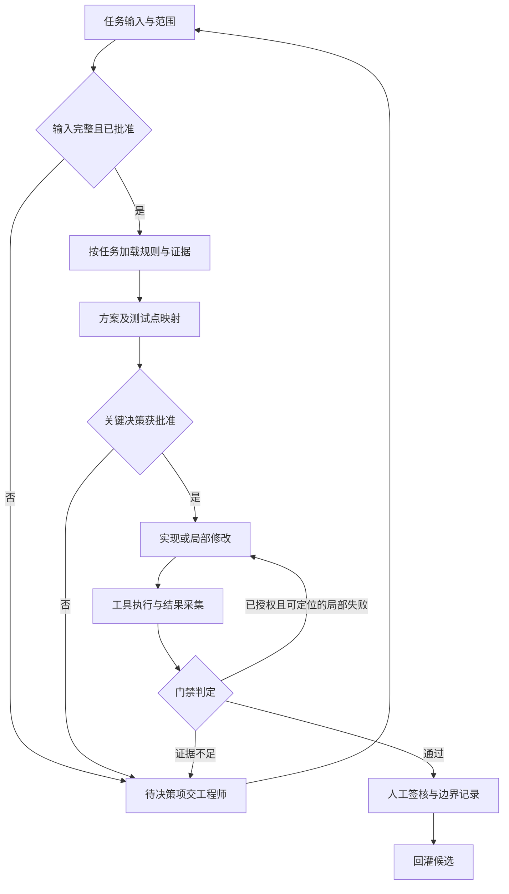

# 工程实现视图：知识对象怎样参与任务

## 文件结构

```text
V2展示样板包
  governance         权威、状态、信息安全、发布规则
  rules              现有规则包的引用与适用范围
  document_rules     五类文档模板和填写示例
  approved_examples  最终输出候选及差异原因
  objects            JSON字段合同和知识对象样例
  task_pack          历史复盘与留出任务
  skill              未安装的执行合同
  eda_gates          门禁定义及运行记录
  cases              八个工程故事
  evaluation         对照试验、空结果矩阵
  feedback           审核与回灌样例
  index              资产、证据、需求和测试关联
  tools              展示包只读校验
```

知识库本体主要包含规则、文档规范、验收知识、批准输出及证据入口。任务包是项目输入，Skill是流程载体，Agent和EDA位于执行侧。为展示关联，它们在同一包内出现，职责仍分别记录。

## 图一：职责边界



模型品牌不进入验收定义。案例可由获得公司授权、具备所需工具能力的执行器完成；本包没有证明Codex与Trae功能或结果等价。

## 图二：任务闭环



失败循环受任务预算限制。默认不允许自动重写规格、放宽scoreboard或扩大修改范围。基础设施重试不能覆盖原失败记录；工具通过也不能自动授予设计签核。

## 一个实填入口

打开[TASK-AUR-001](task_pack/TASK-AUR-001.json)，可以看到只修改wrapper的范围和必须检查的512 B、IRQ结果。它对应CASE-002、SRC-PCIE和G0～G7。运行字段尚为空，当前只是复盘准备包。

打开[TASK-HO-001](task_pack/TASK-HO-001.json)，会看到复位包语义待批准。该任务在G0停止是预期行为；结构完整不意味着规格决策已经完成。

## 增量加载

每次先读任务包中的配置和规则引用，再读取匹配规则正文。涉及版本、FIFO时序、接口历史语义时才检索对应证据。无关PG/UG、教程及整段历史聊天不进入默认上下文。

代码规范中的ASIC约束仅用于明确批准的配置。不得把SV/UVM类、interface等验证语法混入ASIC RTL，也不能把FPGA XPM自动认作ASIC批准单元。纯FPGA项目是否采用ASIC书写风格由项目profile说明。

## 接通后端前的实际工作

后续仍需实现源访问控制、按版本和项目过滤检索、运行目录隔离、EDA启动器、结果解析及中断恢复。当前只有相应合同与样例，校验工具不会冒充这些能力。

[返回入口](README.md)

