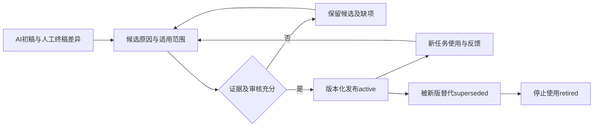

# 治理、证据与状态规则

状态：V2建议规则，待项目负责人批准。本文提供工程组织方式，不代表已经获得企业信息安全或设计签核授权。

## 四个独立维度

| 维度 | 枚举 | 解释 |
|---|---|---|
| authority | official / verified_project / current_project / process_history | 来源属于哪一类；规范与实际工程回答不同问题 |
| verification_level | not_run / static_check / compile_elab / module_sim / integration_sim / implementation_sta / board_system | 证据实际覆盖哪一层，不是自动递增的质量评分 |
| lifecycle | candidate / reviewed / active / superseded / retired | 该知识条目处于何种维护状态 |
| causality | pre_kb_historical / post_kb_asset / post_kb_supported / planned_holdout | 与8月20日知识库快照的关系；post_kb_asset不证明使用过知识库 |

运行状态另用 not_run、pass、fail、inconclusive。签核另存 reviewer、approved_at 和 scope；没有批准记录不得填approved。已通过仿真、未通过批准的输出可以作为候选例子，不能进入自动签核白名单。

## 冲突处理

语言与协议规范解释语义；当前项目任务包定义经批准的需求；代码规则包定义适用配置下的写法。项目豁免必须有明确范围、理由和批准人，不能覆盖语言语义或掩盖功能不满足。

当前RTL证明“现在做了什么”，并不自动证明“应该这样做”。文档与RTL不一致时，同时保留需求、实现和验证三份信息，形成待决策项。历史案例不可覆盖当前项目正式规格。

## 信息安全

全部本轮引用均为本地只读处理。使用外部模型前，应按企业现行政策确认数据和工具的授权。本地资料的位置不能说明外部发送权限，模型供应商或国产标签也不能代替准入判断。

演示状态统一为 pending_review。正式展示前逐项确认：受众范围、可用代码片段、客户/项目名称、主机地址、路径、账号与许可证信息、原始日志中敏感参数。公开官方资料也应记录版本与来源。

本地证据索引含真实路径，只供内部复核；PPT和摸排Word使用证据编号、脱敏摘要及批准后的片段。不把索引整体转换进Office文件。脱敏前后应保留对应关系；脱敏可能改变技术语义时须重新核对。

## 网络与现场演示

展示前检查模型网络、账号、EDA许可与工程快照。现场模型调用连续30秒无有效响应，转入静态任务包、历史差异及证据摘要讲述，明确这是历史记录。仿真超出分配时间时呈现已归档运行，不伪装成当前现场结果。

## 图三：从修改到规则

不能让Agent从自己的回答直接回灌生产规则。修改只表达个人偏好时，记录为项目偏好；具有重复价值、范围明确、证据充分且经人工批准后，才能升级为团队规则。旧版本和失败原因保留，更新发生在另行授权的资产维护任务中。

[返回入口](../README.md)

