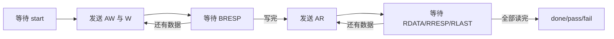

# DDR_AXI_SIM_VALIDATION_AND_CONVERSATION_SUMMARY

- Category: `ddr`
- Source: `R:\DDR\axi_ddr4_min_2020_2\docs\DDR_AXI_SIM_VALIDATION_AND_CONVERSATION_SUMMARY.md`
- SHA-256: `c9470b3973b481ae196f8fe54b357a8d4bebba89574fdb98d96d8b9fe65fe570`
- Extractor: `text`
- Tags: `ddr4, mig, validation`
- Duplicate sources:
  - none

# KU040 DDR4 AXI 最小通路：仿真验证与对话总结

更新日期：2026-07-24
最终工程版本：Vivado 2020.2
目标器件：`xcku040-ffva1156-2-i`

## 1. 当前结论

已完成一个由 Vivado 2020.2 全新生成的 KU040 DDR4 AXI4 最小验证工程，并完成 AXI BIST 的行为级仿真。

当前验证结论分为三个层级：

| 验证层级 | 状态 | 能证明什么 |
|---|---|---|
| AXI BIST 行为级仿真 | PASS | BIST 的 AXI 单拍写入、回读、握手等待、响应检查和错误检测逻辑正确 |
| MIG/DDR4 器件模型联合仿真 | 未执行 | 尚未用 DDR4 memory model 验证 MIG 初始化和仿真校准 |
| FPGA 板级验证 | 未执行 | 尚未验证真实 DDR4 校准、引脚、电气、时序和板上读回 |

不能把第一层 PASS 等同于 DDR4 板级通过。实际上板还需要：

1. 使用 Vivado 2020.2 完成综合、实现、DRC、时序和 bitstream。
2. 板卡上电，并让远程 PC 的 Hardware Manager 检测到 JTAG。
3. 下载 bitstream，观察校准和 BIST 结果。

## 2. 对话与任务演进总结

### 2.1 初始目标

用户要求建立一个基础 DDR 读写通路，检查 `RTDS/DDR` 中已有工程能否直接使用，并完成从工程分析到上板验收的完整步骤。

已确认的远程环境：

- SSH 主机：`vivado-srv`
- SSH 密钥登录成功，无需远端密码
- 远端身份：`DESKTOP-H0AB0MD\vivadoagent`
- 远端工程目录：`C:\project\RTDS`
- 已验证映射盘与远端目录指向同一位置
- Vivado 2020.2：
  `C:\Xilinx\Vivado\2020.2\bin\vivado.bat`
- 远端同时安装 Vivado 2024.2

### 2.2 参考资料要求

用户要求分析：

- `Kintex Ultrascale之FPGA开发指南 V1.0.pdf` 第 32 章，约第 910 页开始
- `RTDS/02_example_mig_ddr-35t/01_mig_ddr_test`
- `RTDS/02_example_mig_ddr-35t/02_mig_3buf_test`
- 米联客 DDR 相关内容
- `RTDS/DDR` 中的 KU040 DDR4 工程

分析结论：

- 第 32 章和 `26_top_ddr4_rw` 使用 MIG Native APP 接口。
- `01_mig_ddr_test` 是 Artix-7、16-bit DDR3、Native APP 接口的简单先写后读测试。
- `02_mig_3buf_test` 在 DDR3 Native APP 基础上增加 DMA、FIFO、三帧缓存和视频链路，不属于最小 DDR 通路。
- 用户明确要求使用 AXI 端口，因此最终工程不照搬这些工程的用户接口，只复用它们的验证思路和已验证板级参数。

### 2.3 Vivado 版本结论

旧 KU040 工程的 XPR 元数据实际来自 Vivado 2023.1，不是 2024.2。

- Vivado 2024.2 可以只读打开旧工程，但需要升级旧 IP。
- Vivado 2020.2 不能直接读取旧工程中的 2023.1 DCP。
- 用户最终要求除允许用 2024.2 查看旧 2023 工程外，最终工程必须由 2020.2 生成。

因此采用：

- 旧工程仅作为板级参数、XDC 和历史结果参考。
- 不复用 2023.1/2024.2 的 DCP、IP 产物或工程缓存。
- 在 Vivado 2020.2 中全新创建 XPR 和 DDR4 MIG IP。

### 2.4 最终架构选择

最终选择：

```text
KU040 DDR4 物理接口
        │
Vivado 2020.2 DDR4 MIG
        │ AXI4 Slave，64-bit
自研 axi_ddr_bist AXI Master
        │
状态/结果寄存器和 LED
```

没有加入以下模块：

- Native APP 接口适配器
- 64-bit/512-bit 宽度转换 FIFO
- DMA
- 三帧缓存
- HDMI/视频链路
- MicroBlaze 软件测试程序

这样可把故障范围限制在时钟、复位、MIG、AXI BIST、DDR4 和板级约束。

### 2.5 当前执行结果

已完成：

- Vivado 2020.2 工程创建
- DDR4 MIG AXI IP 生成
- IP 状态检查
- 顶层与 MIG 端口模板核对
- RTL 语法检查
- AXI BIST 正常场景仿真
- AXI BIST 注入错误场景仿真
- JTAG 可见性检查
- 综合许可问题定位

未完成：

- 综合
- 实现
- DRC 和时序签核
- bitstream
- 下载
- DDR4 实际校准
- 板上写入/回读

综合尝试的唯一直接错误：

```text
A valid license was not found for feature 'Synthesis'
and/or device 'xcku040'.
```

用户随后说明可以在本地完成综合。用户提供的许可证文件位置为：

```text
C:\TOOL\vivado 2024.2\xxx.lic
```

该文件尚未在远端 SSH 环境中设置为 `XILINXD_LICENSE_FILE`，但这不影响已经完成的 XSim 行为级仿真。

远端 Hardware Manager 实测：

```text
HW_TARGET_COUNT=0
HW_DISCOVERY_RESULT=NO_TARGET
```

说明当前远程 PC 未发现 JTAG 目标。

## 3. 工程和仿真环境

### 3.1 远端环境

| 项目 | 值 |
|---|---|
| 操作系统 | Windows 64-bit |
| 主机 | `DESKTOP-H0AB0MD` |
| 用户 | `vivadoagent` |
| Vivado | 2020.2 64-bit |
| Vivado SW Build | 3064766 |
| Vivado IP Build | 3064653 |
| 仿真器 | Vivado Simulator / XSim 2020.2 |
| 编译器 | `xvlog.bat` |
| 展开器 | `xelab.bat` |
| 仿真器 | `xsim.bat` |
| 仿真时间精度 | 1 ps |

远端工程根目录：

```text
C:\project\RTDS\DDR\axi_ddr4_min_2020_2
```

本地暂存目录：

```text
E:\ddr_proc\staging_axi_ddr4_min_2020_2
```

### 3.2 MIG 配置

| 参数 | 配置 |
|---|---|
| FPGA | `xcku040-ffva1156-2-i` |
| IP | DDR4 SDRAM MIG 2.2 Rev.10 |
| IP 生成版本 | Vivado 2020.2 |
| 用户接口 | AXI4 |
| AXI 数据宽度 | 64 bit |
| AXI 地址宽度 | 32 bit |
| AXI ID 宽度 | 4 bit |
| DDR4 物理数据宽度 | 64 bit |
| Memory Type | Components |
| Memory Part | `MT40A512M16HA-083E` |
| DDR 周期 | 833 ps |
| 输入时钟 | 100 MHz 差分，配置周期 9996 ps |
| PHY/UI 比率 | 4:1 |
| CAS Latency | 16 |
| CAS Write Latency | 12 |
| 电压 | 1.2 V |
| ECC | 未启用 |

工程检查实际输出：

```text
VIVADO_VERSION=2020.2
PART=xcku040-ffva1156-2-i
TOP=top_axi_ddr4_bist
IP_LOCKED=0
IP_GENERATE_SYNTH_CHECKPOINT=1
DDR4_INTERFACE_AXI=true
DDR4_AXI_DATA_WIDTH=64
DDR4_AXI_ADDR_WIDTH=32
DDR4_MEMORY_PART=MT40A512M16HA-083E
DDR4_PHY_DATA_WIDTH=64
PROJECT_CHECK_RESULT=PASS
```

## 4. 行为级仿真是如何进行的

### 4.1 仿真对象

仿真对象只有：

- `axi_ddr_bist.v`
- `tb_axi_ddr_bist.sv` 中实现的 AXI 行为内存模型

本次仿真没有实例化：

- `ddr4_axi_0` MIG
- DDR4 PHY
- DDR4 器件模型
- 板级时钟和引脚

因此这是对自研 AXI Master/BIST 的隔离验证。这样可以在进入 MIG 和板级流程前，先排除 BIST 状态机、AXI 握手和数据比较逻辑的问题。

### 4.2 仿真命令

统一入口：

```bat
C:\project\RTDS\DDR\axi_ddr4_min_2020_2\run_bist_sim_2020_2.bat
```

脚本实际依次执行：

```bat
C:\Xilinx\Vivado\2020.2\bin\xvlog.bat --sv ^
  ..\rtl\axi_ddr_bist.v ^
  tb_axi_ddr_bist.sv

C:\Xilinx\Vivado\2020.2\bin\xelab.bat ^
  tb_axi_ddr_bist ^
  -s tb_axi_ddr_bist_sim

C:\Xilinx\Vivado\2020.2\bin\xsim.bat ^
  tb_axi_ddr_bist_sim ^
  -runall

C:\Xilinx\Vivado\2020.2\bin\xsim.bat ^
  tb_axi_ddr_bist_sim ^
  -runall ^
  -testplusarg INJECT_ERROR
```

任意一步返回非零值，批处理就输出：

```text
BIST_SIM_RESULT=FAIL
```

两次运行均成功才输出：

```text
BIST_SIM_RESULT=PASS
```

### 4.3 BIST 设计行为

板级配置中：

```text
TEST_WORDS = 4096
DATA_WIDTH = 64 bit
测试容量 = 4096 × 8 byte = 32768 byte = 32 KiB
BASE_ADDR = 0x00000000
```

每个测试数据使用：

```verilog
{~index, index}
```

例如索引为 `32'h00000007` 时，期望数据为：

```text
64'hFFFFFFF8_00000007
```

每个地址执行一个 AXI4 单拍传输：

- `AWLEN = 0`
- `ARLEN = 0`
- `AWSIZE = 3`，即每拍 8 byte
- `ARSIZE = 3`
- `AWBURST = INCR`
- `ARBURST = INCR`
- `WSTRB = 8'hFF`
- `WLAST = 1`
- AXI ID 固定为 0

状态流程：



AW 和 W 通道允许独立握手。只有两者都完成后，状态机才进入写响应阶段。

### 4.4 Testbench 行为内存模型

仿真为了缩短运行时间，将：

```text
TEST_WORDS = 32
```

因此每个场景测试 32 个 64-bit 地址。

Testbench 的 AXI Slave 行为包括：

- `AWREADY` 和 `WREADY` 使用不同的周期条件产生。
- AW 和 W 可在不同周期被接受。
- 地址和数据分别暂存，二者都收到后才写入 memory 数组。
- 写响应为 `BRESP=OKAY`。
- `ARREADY` 带周期性等待。
- 接受 AR 后延迟 3 个时钟周期返回读数据。
- 读响应为 `RRESP=OKAY`。
- 单拍读返回 `RLAST=1`。

这种模型不是无等待的理想总线，能够验证 BIST 在 AXI backpressure 和独立通道握手下不会丢失事务。

## 5. 测试用例

### TC-AXI-001：正常写入和回读

目的：

- 验证 32 个地址全部写入。
- 验证同地址读回。
- 验证数据模式比较。
- 验证 AW/W 独立握手。
- 验证 READY 等待。
- 验证 BRESP、RRESP、RLAST。

激励：

```text
不带 INJECT_ERROR 参数运行
```

通过条件：

```text
done = 1
pass = 1
fail = 0
error_count = 0
```

实际结果：

```text
PASS: AXI write/read BIST completed without errors
$finish called at time : 3335 ns
```

结论：PASS。

### TC-AXI-002：读数据错误注入

目的：

- 证明 BIST 不会只完成流程而漏报数据错误。
- 验证 `fail` 和 `error_count`。
- 验证错误场景不会误报 `pass`。

激励：

```text
+INJECT_ERROR
```

当读地址索引为 7 时，Testbench 执行：

```verilog
rdata <= memory[read_index_hold] ^ 64'h1;
```

即翻转读回数据的最低位。

通过条件：

```text
done = 1
fail = 1
pass = 0
error_count > 0
```

实际结果：

```text
PASS: injected read error was detected
$finish called at time : 3335 ns
```

结论：PASS。

### 已在 RTL 中检查、但尚未分别注错的项目

BIST 还会将以下情况记为错误：

- `BRESP != OKAY`
- `RRESP != OKAY`
- 单拍读数据返回时 `RLAST != 1`
- 读数据不等于期望模式

当前自动化仿真只包含正常数据和读数据翻转两类场景。若要形成更完整的 AXI 负向回归，应继续增加：

- TC-AXI-003：注入 `BRESP=SLVERR`
- TC-AXI-004：注入 `RRESP=SLVERR`
- TC-AXI-005：注入缺失 `RLAST`
- TC-AXI-006：AW 长延迟、W 先到
- TC-AXI-007：W 长延迟、AW 先到
- TC-AXI-008：长时间拉低 ARREADY/RVALID

## 6. 测试文件和日志位置

### 6.1 RTL 和 Testbench

| 内容 | 远端路径 |
|---|---|
| AXI BIST RTL | `C:\project\RTDS\DDR\axi_ddr4_min_2020_2\rtl\axi_ddr_bist.v` |
| DDR4/MIG 顶层 | `C:\project\RTDS\DDR\axi_ddr4_min_2020_2\rtl\top_axi_ddr4_bist.v` |
| AXI 行为 Testbench | `C:\project\RTDS\DDR\axi_ddr4_min_2020_2\sim\tb_axi_ddr_bist.sv` |
| 仿真批处理 | `C:\project\RTDS\DDR\axi_ddr4_min_2020_2\run_bist_sim_2020_2.bat` |

### 6.2 仿真日志

| 日志 | 远端路径 |
|---|---|
| 编译日志 | `C:\project\RTDS\DDR\axi_ddr4_min_2020_2\sim\xvlog.log` |
| 展开日志 | `C:\project\RTDS\DDR\axi_ddr4_min_2020_2\sim\xelab.log` |
| 正常场景 XSim 日志 | `C:\project\RTDS\DDR\axi_ddr4_min_2020_2\sim\xsim_17124.backup.log` |
| 注错场景 XSim 日志 | `C:\project\RTDS\DDR\axi_ddr4_min_2020_2\sim\xsim.log` |

说明：第二次调用 XSim 会覆盖 `xsim.log`，所以正常场景被 XSim 自动保存在 backup 日志中。

### 6.3 工程和检查报告

| 内容 | 远端路径 |
|---|---|
| Vivado XPR | `C:\project\RTDS\DDR\axi_ddr4_min_2020_2\prj\axi_ddr4_min_2020_2.xpr` |
| IP 状态报告 | `C:\project\RTDS\DDR\axi_ddr4_min_2020_2\reports\ip_status.rpt` |
| 综合许可证失败原始日志 | `C:\project\RTDS\DDR\axi_ddr4_min_2020_2\reports\build_license_failure_ddr4_axi_0.vds` |
| 工程检查脚本 | `C:\project\RTDS\DDR\axi_ddr4_min_2020_2\run_check_project_2020_2.bat` |
| 硬件检查脚本 | `C:\project\RTDS\DDR\axi_ddr4_min_2020_2\run_check_hardware_2020_2.bat` |
| 完整构建脚本 | `C:\project\RTDS\DDR\axi_ddr4_min_2020_2\run_build_2020_2.bat` |
| 下载脚本 | `C:\project\RTDS\DDR\axi_ddr4_min_2020_2\run_program_2020_2.bat` |

## 7. 如何复现现有仿真

SSH 登录后执行：

```bat
cd /d C:\project\RTDS\DDR\axi_ddr4_min_2020_2
run_bist_sim_2020_2.bat
```

预期末尾输出：

```text
PASS: AXI write/read BIST completed without errors
PASS: injected read error was detected
BIST_SIM_RESULT=PASS
```

此过程不需要 Vivado Synthesis 许可。

## 8. 本地综合和上板步骤

使用 Vivado 2020.2 执行：

```bat
cd /d C:\project\RTDS\DDR\axi_ddr4_min_2020_2
run_build_2020_2.bat
```

成功后应生成：

```text
C:\project\RTDS\DDR\axi_ddr4_min_2020_2\prj\
axi_ddr4_min_2020_2.runs\impl_1\top_axi_ddr4_bist.bit
```

**接板后先检查 JTAG：**

```bat
run_check_hardware_2020_2.bat
```

期望：

```text
HW_TARGET_COUNT >= 1
KU040_DEVICE_COUNT >= 1
HW_DISCOVERY_RESULT=PASS
```

   然后下载：

```bat
run_program_2020_2.bat
```

LED 验收标准：

| LED | 状态 | 含义 |
|---|---|---|
| LED0 | 闪烁 | MIG 正在校准 |
| LED0 | 常亮 | DDR4 校准完成 |
| LED1 | 慢闪 | AXI 写入/回读进行中 |
| LED1 | 常亮 | BIST PASS |
| LED1 | 快闪 | AXI 响应、协议或数据比较 FAIL |

## 9. 当前方案与参考工程的本质区别

| 工程 | FPGA/内存 | 用户侧接口 | 目的 |
|---|---|---|---|
| `26_top_ddr4_rw` | KU040 + 64-bit DDR4 | Native MIG APP，512-bit UI，FIFO 做宽度转换 | 旧板级参考 |
| `01_mig_ddr_test` | Artix-7 35T + 16-bit DDR3 | Native MIG APP | 简单写读验证思想 |
| `02_mig_3buf_test` | Artix-7 35T + 16-bit DDR3 | Native APP + DMA/FIFO/三帧缓存 | 视频帧缓存系统 |
| 当前工程 | KU040 + 64-bit DDR4 | AXI4 Slave + 自研 AXI Master BIST | 最小 AXI DDR4 上板验证 |

选择当前工程的原因：

- 满足用户明确提出的 AXI 端口要求。
- 直接复用 KU040 板已成功实现过的 DDR4 引脚和物理参数。
- 避免把视频、DMA、FIFO 和 Native APP 转换逻辑引入最小验收路径。
- 工程、MIG 和生成文件全部来自指定的 Vivado 2020.2。

## 10. 剩余风险和验收边界

当前 AXI 行为仿真不能覆盖：

- DDR4 DQ/DQS 校准
- DDR4 CK/地址/命令引脚
- PCB 走线和信号完整性
- MIG 物理层时序
- Vivado 实现后的时序收敛
- 板卡电源、复位和参考时钟
- JTAG 链路

最终验收必须以以下全部条件为准：

1. `synth_1` 完成。
2. `impl_1` 完成。
3. DRC 无 Error。
4. Timing Summary 中 setup/hold 均满足。
5. bitstream 成功生成。
6. JTAG 识别到 KU040。
7. LED0 常亮，确认 MIG 校准完成。
8. LED1 常亮，确认实际 DDR4 AXI 写入/回读全部通过。
