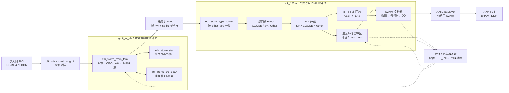

# 以太网风暴过滤与DMA当前设计说明

- Category: `ethernet`
- Source: `E:\eth_storm_project\以太网风暴过滤与DMA当前设计说明.md`
- SHA-256: `ab0d896893ee4431eb701324bb864691e82c90420571d913790c5b9e92ffad97`
- Extractor: `text`
- Tags: `dma, ethernet, rgmii, storm-filter`
- Duplicate sources:
  - none

# 以太网风暴过滤与 DMA 当前设计说明

> 适用对象：第一次接触本项目、没有读过现有 RTL 和设计文档的开发者。
> 分析基准：7 月接收/过滤 RTL、8 月 17 日 DMA Writer RTL、已解除密码的 DMA 方案 V0.1，以及寄存器表 V0.94。
> 判断原则：RTL 表示当前实际行为；DOCX 表示设计意图。两者不一致时，本文会明确指出。

## 1. 先说结论

这套代码已经具备一条清晰的数据通路：从 RGMII 接收以太网帧，完成基本合法性检查、MAC 过滤、重复帧检查和风暴限流，再把通过的帧分成 GOOSE、SV、Other 三类，最后由写 DMA 搬到外部存储器。

但它还不是一个可直接加入工程的完整 IP。当前仓库里有两个彼此独立的顶层：

- `rgmii_eth_storm_filter_top` 负责接收、过滤和分类，输出三组“数据 FIFO + 描述符 FIFO”接口。
- `eth_classified_frame_dma_writer` 消费这三组 FIFO，通过 AXI DataMover 发起 AXI4-Full 写事务。

两者的接口在概念上能够衔接，数据宽度也一致，但仓库没有把它们实例化到同一个最终顶层。AXI-Lite 寄存器模块、读 DMA、若干 Vivado IP、约束和测试平台也不在当前源码中。因此，现阶段更准确的说法是：**接收过滤核心和写 DMA 核心已有 RTL，系统集成仍未闭环。**

## 2. 整体架构



图中的虚线表示控制或状态通路。当前仓库没有实现 `SW` 对应的寄存器封装，也没有最终集成顶层；它们是系统集成时需要补上的部分。

按现有接口推断，DMA Writer 的 `clk` 应连接分类 FIFO 的读时钟 `clk_125m`。这是合理的集成方式，但目前没有顶层代码把这个关系固定下来。

## 3. 一帧报文怎样走完整条链路

### 3.1 RGMII 转 GMII

RGMII 在一个时钟周期的上升沿和下降沿各传 4 bit。`rgmii_to_gmii` 使用 Xilinx `IDDR`：

- 上升沿采样值进入 `gmii_rxd[3:0]`；
- 下降沿采样值进入 `gmii_rxd[7:4]`；
- 控制信号上升沿作为 `gmii_rxdv`，下降沿采样值与它异或后得到 `gmii_rxer`。

`clk_wiz` 和 `BUFG/IDDR` 都属于 Xilinx 器件相关资源。仓库只保留了实例，没有包含这些 IP 的生成产物或时序约束。

### 3.2 前导码和帧起点

`eth_storm_main_fsm` 不会在 `gmii_rxdv` 一出现就把数据当成以太网帧。它先等待至少 7 个连续的 `8'h55`，再等待 `8'hD5`。识别到 SFD 后，后续字节编号从 0 开始：

| 字节位置 | 内容 |
| --- | --- |
| 0～5 | 目的 MAC |
| 6～11 | 源 MAC |
| 12～13 | EtherType，或 VLAN TPID `16'h8100` |
| 14～15 | VLAN TCI，仅 VLAN 帧存在 |
| 16～17 | VLAN 帧的真实 EtherType |
| 后续 | 负载和填充 |
| 最后 4 字节 | FCS |

字段解析直接使用当前 GMII 字节，不经过延迟路径。

### 3.3 为什么有一个 4 字节 hold 缓冲

接收时并不知道当前字节是不是最后 4 字节的 FCS。代码因此保留最近 4 个字节，只把更早的字节释放到一级数据 FIFO。`gmii_rxdv` 结束时，仍留在 hold 缓冲里的 4 字节被视为 FCS，不写入 FIFO。

同一条释放路径还会删除单层 `0x8100` VLAN 标签的 TPID 和 TCI，也就是原始位置 12～15 的 4 个字节。结果如下：

- `dec_len`：接收到的 DA～负载长度，不含 FCS，但仍包含 VLAN 的 4 字节标签；
- `dec_store_len`：真正写入 FIFO 的长度，不含 FCS；VLAN 帧还会再减去 4 字节标签；
- 描述符中的 `len` 使用 `dec_store_len`，因此它与后级实际可读的数据字节数一致。

当前逻辑只识别一层 TPID 为 `16'h8100` 的 VLAN。QinQ 或其他 TPID 不会按 VLAN 标签删除。

### 3.4 CRC、长度和接收错误

`crc32_d8` 从 SFD 之后开始计算，覆盖 DA 到 FCS 的全部字节。启用 `cfg_crc_check_en` 时，最终结果必须等于以太网残数 `32'h2144_DF1C`。此外：

- 接收期间出现 `gmii_rxer`，本帧的 `dec_crc_ok` 会被清零；
- 不含 FCS 的长度小于 `MIN_FRAME_BYTES`，也会使 `dec_crc_ok=0`；
- 默认最小长度是 60 Byte，默认最大长度是 1514 Byte；
- VLAN 帧做最大长度判断时允许多出的 4 Byte 标签，但写入 FIFO 时标签会被删掉。

所以短帧最终优先记为 `DROP_CRC_ERR`，而不是 `DROP_LEN_ERR`。这是当前 RTL 的实际优先级，不是文案上的分类习惯。

### 3.5 MAC、ACL、组播和 EtherType 分类

目的 MAC 可以匹配：本地单播地址、允许的广播地址，或命中 64 bit Hash 表的组播地址。组播 Hash 使用目的 MAC 六个字节计算 CRC32，再以 `crc_result[31:26]` 选择表中的一个 bit。

源 MAC 白名单和黑名单各有 4 项。两者同时打开且同一个地址同时命中时，黑名单优先，因为丢弃判决先检查黑名单。

EtherType 最终只分成三类：

- 等于 `cfg_eth_type_goose`：GOOSE；
- 等于 `cfg_eth_type_sv`：SV；
- 其他值：Other。

EtherType 分类只决定后续进入哪组 FIFO，不改变接收侧丢弃优先级。

### 3.6 固定的丢弃优先级

一帧可能同时满足多个丢弃条件，但 RTL 只选择第一个原因：

| 优先级 | 编码 | 原因 | 当前 RTL 的含义 |
| ---: | --- | --- | --- |
| 1 | `0x0001` | `DROP_CRC_ERR` | `gmii_rxer`、短帧，或启用 CRC 检查时 FCS 不符 |
| 2 | `0x0100` | `DROP_DST_MISS` | 目的 MAC 策略开启但未命中 |
| 3 | `0x0040` | `DROP_BLACKLIST` | 源 MAC 命中黑名单 |
| 4 | `0x0080` | `DROP_NOT_WHITE` | 白名单开启但源 MAC 未命中 |
| 5 | `0x0010` | `DROP_BUF_FULL` | 一级数据 FIFO 或描述符 FIFO 资源不足 |
| 6 | `0x0020` | `DROP_LEN_ERR` | 长度溢出或超过配置最大值 |
| 7 | `0x0004` | `DROP_FRAME_STORM` | 当前窗口帧数超过阈值 |
| 8 | `0x0008` | `DROP_BYTE_STORM` | 当前窗口字节数超过阈值 |
| 9 | `0x0002` | `DROP_DUP_CRC` | 当前 epoch 中存在相同 FCS |

`cfg_filter_en=0` 不等于无条件放行。目的 MAC、ACL、风暴和重复帧策略会关闭，但接收错误、最小长度、最大长度和 FIFO 容量检查仍然有效；`cfg_crc_check_en` 也独立控制 FCS 检查。

### 3.7 统计窗口和重复帧表

`eth_storm_stat` 在 `gmii_rx_clk` 域维护窗口计数。`cfg_window_ms=0` 时使用参数 `WINDOW_MS`，否则按 `CLK_FREQ_HZ/1000 × cfg_window_ms` 计算周期数。

`frame_time_cnt_g` 每个 GMII 时钟加 8。在 125 MHz 时，这个数值可理解为以 8 ns 为步长的时间戳；如果时钟频率改变，代码仍然固定加 8，时间单位不会自动校准。

重复帧表的每项格式为 `{valid, epoch, crc[31:0]}`。复位后先把整张表清零，`crc_init_done` 置位后才允许查重。窗口翻转时 epoch 反相，后台清理旧 epoch 项；正常查表和写表优先，必要时会暂停后台清理。

## 4. 两级 FIFO 为什么这样组织

### 4.1 一级 FIFO：跨时钟域并保留判决结果

`eth_storm_tx_fsm` 中的一级数据 FIFO 和描述符 FIFO是异步 FIFO：写侧为 `gmii_rx_clk`，读侧为 `clk_125m`。这是接收域到本地处理域的主要跨时钟通道。

接收状态机先写帧数据，判决完成后再写一条 53 bit 描述符。即使帧被接收侧判定为丢弃，也会写入描述符；其中 `pass=0`，`len` 表示一级数据 FIFO 里需要排空的字节数。

### 4.2 分类路由

`eth_storm_type_router` 先读描述符，再按其中的长度处理对应数据：

- 接收侧已经丢弃的帧，只从一级数据 FIFO 排空，不写二级 FIFO；
- 通过的帧按 `eth_type_class` 写入 GOOSE、SV 或 Other；
- 若目标二级数据 FIFO 的 `full/prog_full` 或描述符 FIFO 的 `full` 已经有效，本帧同样被排空，并增加路由拥塞计数；
- 完整数据写完后才写二级描述符，避免 DMA 先看到描述符、却读不到完整数据。

`prog_full` 阈值必须预留至少一帧最大报文的空间。若复制过程中 `full` 意外拉高，状态机会暂停读取，等待它恢复；因此 FIFO IP 的阈值配置是正确运行的一部分。

### 4.3 二级 FIFO

每个通道有一组 8 bit 数据 FIFO 和一组 53 bit 描述符 FIFO，均按 FWFT（First Word Fall Through）语义使用。也就是说，只要 `empty=0`，当前 `dout` 就已经有效；`rd_en` 在时钟沿真正消费当前条目。

DMA Writer 正是按这个语义读取。如果实际 FIFO 配成标准读模式而不是 FWFT，数据和描述符都会错位。

## 5. 描述符格式

### 5.1 分类 FIFO 内部描述符：53 bit

| 位域 | 字段 | 含义 |
| --- | --- | --- |
| `[52]` | `pass` | 接收侧判决结果；进入二级 FIFO 的描述符应为 1 |
| `[51:36]` | `len` | 二级数据 FIFO 中对应帧的真实字节数 |
| `[35:34]` | `mac_class` | 00 单播、01 广播、10 组播、11 保留 |
| `[33:32]` | `eth_type_class` | 00 Other、01 GOOSE、10 SV、11 保留 |
| `[31:0]` | `timestamp` | SFD 附近锁存的接收时间戳 |

在一级 FIFO 中，bit 52 表示“通过还是丢弃”；路由器只把通过帧送入二级 FIFO。DMA 仲裁器把同一位当成描述符有效位使用，因此两个模块能够衔接，但这个位在两个阶段的叫法不同。

### 5.2 软件可见描述符：64 bit

| 位域 | 字段 | 含义 |
| --- | --- | --- |
| `[63]` | `VALID` | 固定写 1，表示数据写入已成功后发布描述符 |
| `[62:61]` | `MAC_CLASS` | 单播、广播、组播或保留 |
| `[60:48]` | 保留 | 固定为 0 |
| `[47:32]` | `FRAME_LENGTH` | 实际写入该槽位的帧长 |
| `[31:0]` | `TIMESTAMP` | 接收时间戳 |

64 bit 描述符没有保存 GOOSE/SV/Other 分类。软件通过“这条描述符位于哪一个通道的环”判断报文类型。

## 6. 写 DMA 的工作过程

### 6.1 仲裁

`eth_classified_frame_arbiter` 同时查看三路描述符 FIFO 和三路 `ring_full`。请求成立需要：

1. 描述符 FIFO 非空；
2. 描述符 bit 52 为 1；
3. 对应 DDR 环未满。

优先级写死为 **SV > GOOSE > Other**。只有 `frame_valid && frame_ready` 同时成立时，获胜通道的描述符才会被弹出。

这是帧级仲裁：一旦一帧开始写，直到数据和描述符处理结束，控制器才接受下一帧。持续不断的 SV 流量理论上可以让 GOOSE 和 Other 长期得不到服务。

### 6.2 环形缓冲区

每个通道独立维护：

- 数据区基地址；
- 描述符区基地址；
- 软件消费者 `RD_PTR`；
- 硬件生产者 `WR_PTR`；
- `ring_full`。

指针格式为：

```text
bit[31]    wrap，索引从 depth-1 回到 0 时翻转
bit[30:0]  entry index
```

当前写槽位地址为：

```text
data_addr = data_base + entry_index × FRAME_SLOT_BYTES
desc_addr = desc_base + entry_index × DESC_BYTES
```

默认 `FRAME_SLOT_BYTES=1536`，`DESC_BYTES=8`。数据命令的 BTT 使用真实帧长，所以每个 1536 Byte 槽位中未使用的尾部不会自动补零。

写指针与读指针 index 相同、wrap 不同时表示满；两个 32 bit 指针完全相同时表示空。`cfg_ring_depth[30:0]=0` 时采用参数 `CHANNEL_DEPTH`，默认 32。

环管理器一次只允许一个未决槽位。申请时记录通道和深度，成功后 `commit` 才推进写指针；`abort` 只释放内部占用，不改变写指针。

### 6.3 8 bit 数据打包为 64 bit

`eth_classified_frame_data_packer` 从获胜通道的 FWFT 数据 FIFO 严格读取 `frame_len` 个字节。第一个字节放入 `TDATA[7:0]`，随后依次填入更高 lane。

最后一拍不足 8 Byte 时，`TKEEP` 从低位连续置 1：

| 有效字节数 | TKEEP |
| ---: | --- |
| 1 | `8'h01` |
| 2 | `8'h03` |
| 3 | `8'h07` |
| 4 | `8'h0F` |
| 5 | `8'h1F` |
| 6 | `8'h3F` |
| 7 | `8'h7F` |
| 8 | `8'hFF` |

最后一拍同时置 `TLAST`。下游 `TREADY=0` 时，打包器停止读 FIFO，并保持 `TDATA/TKEEP/TLAST/TVALID` 不变。

### 6.4 S2MM 状态机

实际 RTL 使用以下状态：

```text
S_IDLE
  → S_SEND_DATA_CMD
  → S_STREAM_DATA
  → S_WAIT_DATA_STS
  → S_SEND_DESC_CMD
  → S_STREAM_DESC
  → S_WAIT_DESC_STS
  → S_COMMIT
  → S_IDLE
```

中途出现 DataMover TAG 或状态错误时：

```text
当前状态 → S_RECOVER → S_IDLE
```

顺序不能颠倒：

1. 申请槽位并锁存数据地址、描述符地址和本帧元数据；
2. 发送帧数据写命令；
3. 发送完整帧数据，等待数据写状态；
4. 数据写成功后，再发送 8 Byte 描述符写命令和描述符；
5. 描述符状态也成功，才进入 `S_COMMIT`；
6. 环管理器推进对应 `WR_PTR`，软件此时才看得到新条目。

这就是“先数据、后描述符、最后发布指针”。数据写成功但描述符写失败时，内存里可能留下一份未发布的数据，但 `WR_PTR` 不推进，软件不会把它当成有效条目；后续事务会复用并覆盖同一个槽位。

### 6.5 DataMover 命令和状态

写控制器生成 72 bit S2MM 命令，数据命令 TAG 为 `4'h1`，描述符命令 TAG 为 `4'h2`。返回的 8 bit 状态中：

- bit 7 是完成标志；
- bit `[6:4]` 是错误标志；
- bit `[3:0]` 是 TAG。

控制器只在对应的等待状态接收状态字，并同时检查完成位、错误位和 TAG。DataMover 的汇总错误输出 `s2mm_err` 只被直接导出为 `datamover_s2mm_err`，没有参与本地状态机跳转或错误计数。

### 6.6 错误记录和自动恢复

`error` 是粘滞标志，发生错误后保持为 1；`error_pulse` 每次错误只持续一个周期。`clear_error` 会清除最近错误码和各类错误计数，但不会中断当前事务，也不会清除成功帧计数。

当前 RTL **不会因为 `error=1` 停止接收后续报文**。零长度、超长等参数错误在 `S_IDLE` 中记录后仍保持空闲；已经申请槽位的 DataMover 事务若失败，则经过单周期 `S_RECOVER` 自动回到空闲。方案书中“进入 `S_ERROR` 并等待 `clear_error`”的描述已经落后于源码。

### 6.7 Other 通道中断

Other 帧成功进入 `S_COMMIT` 时，`data_irq_req` 置 1，并保持到外部给出 `data_irq_ack`。若 ACK 和新 Other 帧提交同拍发生，新提交优先，中断请求保持为 1。

这个接口表达的是“Other 环里有数据需要处理”，不是逐帧脉冲计数。多个 Other 帧在 ACK 前完成时会合并为同一个电平请求，软件应在处理中持续读取 `WR_PTR`，直到追上 `RD_PTR` 后再确认中断。

## 7. 软件怎样消费写 DMA 环

以某一个通道为例：

1. 读取硬件 `WR_PTR` 和软件保存的 `RD_PTR`；完全相同表示没有新帧。
2. 用 `RD_PTR[30:0]` 计算描述符地址和数据地址。
3. 读取 64 bit 描述符，检查 `VALID`，取得 `FRAME_LENGTH`。
4. 从数据槽位读取 `FRAME_LENGTH` 个字节；不要固定读取并解释全部 1536 Byte。
5. 处理完成后，可按寄存器文档建议把描述符 `VALID` 清零。
6. 推进 `RD_PTR`；从 `depth-1` 回到 0 时翻转 wrap 位。

对硬件环满判断来说，真正释放槽位的是软件更新 `RD_PTR`。清 `VALID` 不是环管理器判断空满的依据，但有助于软件诊断旧条目。

若 CPU 有缓存，或者寄存器和 DDR 之间存在不同总线主设备，软件还需要安排正确的缓存维护和内存屏障。当前 RTL 与寄存器文档没有定义这部分顺序。

## 8. 模块阅读地图

建议按下面的顺序读代码，不要先钻进最长的状态机。

| 顺序 | 文件 | 先看什么 |
| ---: | --- | --- |
| 1 | `rgmii_eth_storm_filter_top.v` | 接收过滤顶层端口、时钟和外部 IP |
| 2 | `eth_storm_filter.v` | 四个接收侧子模块怎样连接 |
| 3 | `eth_storm_tx_fsm.v` | 两级 FIFO 和跨时钟结构 |
| 4 | `eth_storm_type_router.v` | pass=0 如何排空，pass=1 如何分类 |
| 5 | `eth_storm_main_fsm.v` | 帧解析、4 Byte hold、丢弃判决 |
| 6 | `eth_storm_stat.v` | 窗口、时间戳和统计何时提交 |
| 7 | `eth_storm_crc_clean.v` | CRC 表初始化、epoch 和后台清理 |
| 8 | `eth_storm_multicast_hash.v` | 软件如何向 64 bit Hash 表加一项 |
| 9 | `rgmii_to_gmii.v`、`crc32_d8.v` | 器件采样和 CRC 基础单元 |
| 10 | `eth_classified_frame_dma_writer.v` | DMA 顶层互联和 DataMover 边界 |
| 11 | `eth_classified_frame_arbiter.v` | 三通道请求与固定优先级 |
| 12 | `eth_classified_frame_ring_manager.v` | 地址、wrap、满状态和提交 |
| 13 | `eth_classified_frame_data_packer.v` | FWFT 读取与 AXI 反压 |
| 14 | `eth_classified_frame_s2mm_ctrl.v` | 完整写事务和错误恢复 |
| 15 | `eth_classified_frame_desc_builder.v` | 软件描述符的最终位域 |

## 9. 当前已有、外部依赖和尚未实现的部分

### 9.1 当前 RTL 已有

- RGMII 接收转换和 GMII 帧起点识别；
- 单层 VLAN 标签删除、FCS 删除和可选 CRC 检查；
- 目的 MAC、组播 Hash、源 MAC 黑白名单；
- 帧数/字节数风暴限制和 FCS 重复帧检查；
- 两级 FIFO、GOOSE/SV/Other 分类和拥塞丢弃统计；
- 三通道 S2MM 写 DMA、环形写指针、错误计数；
- Other 写入完成的电平中断请求。

### 9.2 源码引用但仓库未提供

- `clk_wiz`；
- `eth_storm_frame_fifo`、`eth_storm_desc_fifo`；
- `eth_storm_channel_data_fifo`、`eth_storm_channel_desc_fifo`；
- `eth_storm_crc_ram`；
- `axi_datamover_rx` 及其 Vivado IP 配置/输出产物。

### 9.3 尚未看到 RTL 实现

- 把接收过滤顶层和 DMA Writer 连接起来的系统顶层；
- V0.94 寄存器表对应的 AXI-Lite/寄存器读写逻辑；
- 寄存器表第 4.26～4.34 节所描述的读 DMA；
- MAC 发送路径与读 DMA 的完整衔接；
- 工程文件、引脚/时钟约束和正式 testbench。

## 10. 文档与 RTL 的明确差异

| 项目 | 文档写法 | 当前 RTL |
| --- | --- | --- |
| DMA 错误状态 | 方案书状态表使用 `S_ERROR`，等待 `clear_error` | 使用 `S_RECOVER`，下一拍自动回 `S_IDLE`；`clear_error` 只清记录 |
| 接收新帧条件 | 方案书写“空闲且无错误” | `error` 不参与 `frame_ready`，粘滞错误不会停机 |
| Other 中断 | DMA 方案接口表未列出 | 顶层和控制器有 `data_irq_req/data_irq_ack` |
| DataMover 名称 | 一处写 `axi_datamover_0` | 顶层实例模块名为 `axi_datamover_rx` |
| `RING_DEPTH` 属性 | V0.94 小节标题写 Read Only | 汇总表和位域表写 RW，RTL也把它作为输入配置 |
| 输出描述符说明 | 方案书一处写“通道类型编码” | 实际写入的是 `frame_mac_class`；通道由所在环隐含 |
| 读 DMA | V0.94 已分配寄存器并描述流程 | 当前目录没有对应读 DMA Verilog |

另有少量编辑问题，例如 DMA 方案接口标题仍写成 `rgmii_eth_storm_filter IP`、data packer 的接口时序段落实际在描述 arbiter。这些不改变 RTL，但后续修订设计文档时应一并清理。

## 11. 需要优先确认的设计风险

### 11.1 数据 FIFO 与描述符 FIFO 可能失去对齐

DMA 控制器对 `frame_len=0`、`frame_len>FRAME_SLOT_BYTES` 或 `DESC_BYTES` 非法的描述符会直接握手并弹出，但不会启动 data packer，也不会排空该帧仍在数据 FIFO 中的字节。下一条合法描述符随后会从旧数据开始读取。

还有一种相反情况：若二级描述符 FIFO 头部的 bit 52 为 0，arbiter 不会产生请求，也不会弹出它，该通道会被堵在这个条目上。

正常接收链默认不会生成这些异常描述符，但只要参数配置、FIFO 内容或上游模块出现异常，后果就是帧边界永久错位。集成前需要明确异常描述符的排空策略。

### 11.2 没有超时

以下任一情况都可能让 `busy` 长期保持：

- 数据 FIFO 在一帧中途变空；
- DataMover 命令接口一直不 ready；
- DataMover 数据接口一直不 ready；
- 数据或描述符状态始终不返回。

当前设计依赖上游“描述符出现时完整帧已经在数据 FIFO 中”和 DataMover 最终响应。没有 watchdog 或超时中止路径。

### 11.3 环配置和地址没有硬件保护

RTL没有检查：

- `cfg_ring_depth` 是否与实际分配内存一致，或是否在运行时被缩小；
- 软件 `RD_PTR` 的 index 是否小于 depth；
- 基地址是否满足 64 bit AXI 和 `DESC_BYTES` 对齐；
- `base + index × slot_size` 是否发生 32 bit 地址回绕；
- DRE 关闭时，数据起始地址是否满足 DataMover 配置要求。

这些约束需要由寄存器逻辑和软件共同保证。

### 11.4 固定优先级与中断合并

SV 永远高于 GOOSE 和 Other，持续 SV 流量可能造成低优先级饥饿。Other 中断又是单个粘滞电平，不能表示完成了多少帧；软件必须以环指针为准批量排空。

### 11.5 配置和状态的时钟域职责尚未定义

DMA 是单 `clk` 域，接收判决运行在 `gmii_rx_clk`，路由运行在 `clk_125m`。外部配置端口从哪里产生、哪些需要同步、何时允许更新，目前没有寄存器桥来规定。除了统计清零中的局部同步，不能假设所有配置输入已经自动完成 CDC。

## 12. 集成前需要补齐的工作

1. 增加最终系统顶层，把三组二级 FIFO 接到 DMA Writer，并明确 `clk/rst`。
2. 提供并锁定所有 FIFO、CRC RAM、`clk_wiz` 和 AXI DataMover IP 的配置；FIFO 必须满足源码假设的 FWFT、宽度和 `prog_full` 语义。
3. 实现寄存器模块，决定 DMA 基地址究竟是只读固定值还是软件可配置值，并统一 `RING_DEPTH` 的访问属性。
4. 定义配置寄存器到 `gmii_rx_clk`、`clk_125m` 的 CDC 方法和运行时更新规则。
5. 规划三通道数据区、描述符区的地址范围，检查对齐、深度和 32 bit 地址溢出。
6. 明确 DataMover IP 的准确模块名、72 bit 命令格式、DRE、最大 burst 和状态接口配置。
7. 决定读 DMA 是否属于本版本；若不属于，应把 V0.94 中相应寄存器标成预留或未实现。
8. 定义 Other 中断控制器连接、ACK 时机和软件排空流程。

## 13. 后续验证重点

本文没有运行编译、综合或仿真。后续建立验证环境时，至少应覆盖：

- 7×`55`+`D5`、异常前导码、中途 `gmii_rxdv` 结束；
- 60 Byte、最大长度、越界长度，带/不带 VLAN；
- 正确/错误 FCS、`gmii_rxer`、短帧时的丢弃优先级；
- 单播、广播、组播 Hash，黑白名单同时命中；
- 风暴窗口边界、阈值为 0、窗口翻转同拍提交；
- 重复 FCS、epoch 翻转、后台清理被正常访问暂停；
- 一级和二级 FIFO 满、`prog_full`、复制中途反压；
- DMA 帧长为 `8N-1`、`8N`、`8N+1` 时的 TKEEP/TLAST；
- DataMover 命令、数据和状态三个接口分别施加反压；
- TAG 不符、数据状态错误、描述符状态错误后的 `S_RECOVER`；
- 环从 `depth-1` 回到 0、满后软件推进 RD_PTR、运行时异常指针；
- 零长度/超长/valid=0 描述符，确认不会破坏下一帧边界；
- 多个 Other 帧合并中断，以及 ACK 与新提交同拍。

## 14. 常用术语

| 术语 | 本项目中的意思 |
| --- | --- |
| FWFT | FIFO 非空时 `dout` 已有效，`rd_en` 消费当前字 |
| S2MM | Stream to Memory-Mapped，从 AXI4-Stream 写入 AXI 内存 |
| BTT | Bytes To Transfer，一条 DataMover 命令传输的真实字节数 |
| TKEEP | 当前 64 bit 数据拍中哪些 byte lane 有效 |
| TLAST | 当前数据拍是这条命令对应数据包的最后一拍 |
| commit | 数据和描述符均成功后，推进硬件 WR_PTR，对软件发布条目 |
| abort | 放弃未决槽位，WR_PTR 不变 |
| wrap | 环指针绕回 0 时翻转的代际位，用于区分空和满 |
