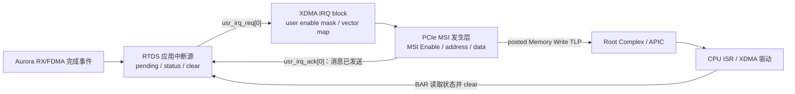

# RTDS_test_XDMA_RootPort大仿真搭建与回归记录

- Category: `pcie`
- Source: `E:\PCIE-CPU\docs\RTDS_test_XDMA_RootPort大仿真搭建与回归记录.md`
- SHA-256: `7fc8e8d7a570ead5ed7c260acfdad954cbddbd540b3644ea3ceed104cf368345`
- Extractor: `text`
- Tags: `aurora, engineering, pcie, xdma`
- Duplicate sources:
  - none

# RTDS_test-1ch XDMA Root Port 大仿真搭建与回归记录

日期：2026-07-15
工具：Vivado / XSim 2020.2
主工程：`E:\PCIE-CPU\RTDS_test-1ch\RTDS_test.xpr`
仿真目录：`E:\PCIE-CPU\RTDS_test-1ch\regression\sim_xdma_rootport`

## 1. 本轮结论与验证边界

本轮采用 `RTDS_test-1ch` 作为唯一最终 DUT。PCIe Host 侧来自已验证的官方 1ch XDMA example `xdma_0_ex`，但只提取 Root Port、TPI/USRAPP、公共 include 和时钟组件；官方 example Endpoint、`xilinx_dma_pcie_ep.sv`、原始 `board.v` 均未进入新环境。仿真顶层直接实例化生产 RTL 的 `PCIe`，没有实例化包含官方 Aurora Core 的 `TOP.v`。

Aurora 边界使用轻量 LocalLink peer BFM，而不是 Aurora 64B/66B、GT 或串行链路模型。这样做不是重验已经完成验证的 FDMA/Aurora 桥，而是给系统级大仿真提供一个确定、可检查的远端端点：

- FPGA→Aurora：BFM 消费 LocalLink 数据，最小用例不施加随机背压，后续压力回归可开启。
- Aurora→FPGA：BFM 按 SERDES 连续数据源建模，帧开始后连续发送 64 拍，不等待 FPGA `rx_dst_rdy`。若 FPGA 在输入期间撤销 ready，立即报告 `RTDS_LL_RX_NO_BACKPRESSURE`。
- FDMA、Aurora LocalLink bridge 不再单独重验；大仿真只保留协议、状态、数据和 AXI response 断言。

## 2. `reset_target all` / `generate_target all` 的含义

`fifo_AURORA_DATA64.xci` 是 FIFO IP 的配置源，`hdl/fifo_generator_v13_2_vhsyn_rfs.vhd` 是 Vivado 根据该配置生成的派生 HDL。

`reset_target all <xci>` 的作用是清除 Vivado 对该 IP 已生成 target 的状态和旧派生物登记，让随后生成不再错误地沿用一个“看起来已生成、实际文件缺失”的缓存状态。它不把 FIFO 配置恢复为默认值，也不改变 `.xci` 中的深度、位宽、时钟模式或器件配置。

`generate_target all <xci>` 按当前工程、当前 `.xci` 和 Vivado 2020.2 重新生成综合、仿真等 target，其中包括缺失的 VHDL 支撑文件。

本轮没有从 `RTDS_test` 复制该 VHDL。这样可以避免把原始 4ch 工程、旧 Vivado 产物或另一份 IP 配置混入 1ch 工程。只有在 2020.2 无法根据 1ch 工程自身的 `.xci` 重建时，`RTDS_test` 才作为环境对照，而不能替代 1ch 验收。

该文件缺失会直接影响环境建立：编译到 FIFO 时会找不到 HDL，无法完成 elaboration，更不可能进入 PCIe 链路训练。本轮已经用 2020.2 成功重建并验证文件存在：

`E:\PCIE-CPU\RTDS_test-1ch\RTDS_test.srcs\sources_1\ip\fifo_AURORA_DATA64\hdl\fifo_generator_v13_2_vhsyn_rfs.vhd`

审计脚本只在文件缺失时执行 reset/generate；文件存在时不会每次破坏性重建。

## 3. 1ch 工程审计结果

实际调用固定工具：

```powershell
& "D:\Xilinx_2020_2\Vivado\2020.2\bin\vivado.bat" -mode batch -nojournal `
  -source "E:\PCIE-CPU\RTDS_test-1ch\regression\sim_xdma_rootport\scripts\audit_and_prepare.tcl" `
  -log "E:\PCIE-CPU\RTDS_test-1ch\regression\sim_xdma_rootport\logs\audit_and_prepare.log"
```

脚本完成 IP 状态检查、`validate_bd_design`、BD/IP target 生成和关键参数锁定，日志以 `RTDS_AUDIT_PASS` 结束。

| 检查项 | 实际值 | 结论 |
|---|---:|---|
| H2C 通道 | 1 | 通过 |
| C2H 通道 | 1 | 通过 |
| PCIe 最大速率 | 8.0 GT/s | Gen3，通过 |
| PCIe 最大宽度 | X2 | 通过 |
| AXI 数据宽度 | 64 bit | 通过 |
| AXI 时钟 | 250 MHz | 通过 |
| XDMA AXI-Lite master | true | 通过 |
| XDMA/CONV_DMA 访问 BRAM | `0x0000_0000`，64 KiB | 通过 |
| XDMA AXI-Lite 访问 INFO_EXCH | `0x4000_0000`，4 KiB | 通过 |

`validate_bd_design` 报出的 AXI ID 和 BRAM 地址位宽裁剪 warning 是当前 BD 生成时已有的精确结构性 warning，已保留在日志中，未将其当作任意 warning 的模糊白名单。

## 4. 官方 Root Port 依赖固化

来源目录：`E:\PCIE-CPU\xdma_0_ex\imports`。目标目录：`vendor\xdma_rp_2020_2`。

固化文件包括：

- `pci_exp_usrapp_cfg.v`、`pci_exp_usrapp_com.v`、`pci_exp_usrapp_rx.v`、`pci_exp_usrapp_tx.v`
- `pcie3_uscale_rp_core_top.v`、`pcie3_uscale_rp_top.v`、`xilinx_pcie_uscale_rp.v`
- `sys_clk_gen.v`、`sys_clk_gen_ds.v`
- `board_common.vh`、`pci_exp_expect_tasks.vh`

每个文件的原路径、字节数、SHA-256 和官方 `board_vlog.prj` 顺序已记录在 `VENDOR_MANIFEST.md`。`xdma_0_ex` 原目录未修改。

## 5. 仿真结构

```text
board
├─ RP : xilinx_pcie3_uscale_rp（官方 Root Port + TPI/USRAPP）
├─ EP : PCIe（RTDS_test-1ch 真实生产 RTL）
│  ├─ design_1_wrapper
│  │  ├─ xdma_0（真实 1ch XDMA Endpoint）
│  │  ├─ CONV_DMA_0
│  │  ├─ INFO_EXCH_0
│  │  └─ BRAM / AXI interconnect
│  ├─ pcie_fdma_aurora_brg_adapter
│  └─ FDMA/Aurora LocalLink bridge
├─ LL_BFM : aurora_ll_peer_bfm
├─ ASSERTIONS : 协议/状态断言
├─ XDMA IRQ bind monitor
└─ CONV_DMA AXI bind monitor
```

固定时钟与复位：

- PCIe 差分参考时钟 100 MHz。
- RTDS `i_sys_clk` 250 MHz。
- Aurora LocalLink 用户时钟 156.25 MHz。
- PCIe 低有效复位保持 5 us。
- Aurora 用户复位释放后再稳定 16 个 LL 时钟，随后将 `channel_up/lane_up` 拉高。

顶层名保持 `board`，以兼容官方 TPI 对 `board.RP.tx_usrapp` 的层级访问。RP 和真实 EP 通过 x2 PCIe 串行端口直接互连。

## 6. 文件与入口

所有自建脚本、配置和 testbench 都按“语义段”写有中文注释。主要入口如下：

| 文件 | 用途 |
|---|---|
| `run_xsim.ps1` | 固定调用 Vivado/XSim 2020.2，一键审计、导出、编译、展开、仿真和日志验收 |
| `scripts/audit_and_prepare.tcl` | 修复派生 IP 文件，审计配置和地址映射 |
| `scripts/prepare_rootport_sim.tcl` | 创建独立 simulation fileset 并导出 XSim |
| `scripts/run.tcl` | 加载波形并 `run all` |
| `scripts/waves.tcl` | 按 reset/link、TLP、AXI、FDMA、LL、IRQ 分组 |
| `scripts/compare_logs.ps1` | 语义里程碑、错误和精确 warning 白名单检查，生成 JSON |
| `tb/board.sv` | 大仿真顶层、Host task、descriptor 和主用例 |
| `tb/rtds_pcie_ep_sim_wrapper.sv` | 原样实例化生产 `PCIe`，隔离官方 example-only AXI 层级依赖 |
| `tb/aurora_ll_peer_bfm.sv` | 双向 LL peer；RX 连续源不可反压 |
| `tb/pcie_cq_host_memory_monitor.sv` | 接收 RP CQ Memory Write，形成 C2H Host sink |
| `tb/rtds_rootport_assertions.sv` | LL/FDMA/复位/clear 断言 |
| `tb/xdma_irq_monitor.sv` | bind 观测 `usr_irq_req/ack`、`msi_enable` |
| `tb/conv_dma_axi_monitor.sv` | bind 观测 AXI response error |
| `tb/tests.vh` | 向官方 TX USRAPP 增加 `rtds_minimum` 测试入口 |

`prepare_rootport_sim.tcl` 导出的实际 `vlog.prj/vhdl.prj` 已确认包含真实 `PCIe`/BD/IP、adapter、FDMA bridge、RP 和 TB；不包含 `TOP.v`、官方 Aurora IP 或 example Endpoint。所有生成物均位于本仿真目录的 `work` 和 `logs` 下。

首次完整 elaboration 暴露了一个官方 example 的层级耦合：`pci_exp_usrapp_tx.v` 即使不运行 `COMPARE_DATA_H2C`，也会解析其中的 `board.EP.m_axi_*`。官方 example 的 `EP` 恰好直接暴露这些名字，而真实 RTDS `PCIe` 的 AXI 在 BD 内部。处理方式是增加仿真专用 wrapper，为未调用的 example compare task 提供同名常量占位。实际 PASS 判定来自 descriptor count/status、H2C `DATA_STORE` 数据源、C2H CQ Host sink、CONV_DMA AXI monitor 和 LL scoreboard；占位信号不能制造数据 PASS，也没有修改 RP 的枚举、BAR 或 XDMA TPI 主逻辑。

2026-07-21 根据大仿真失败证据对生产 `PCIe.v` 做了一处最小集成修复：`CONV_DMA` 的历史 `fdma_wvalid/fdma_wready` 端口名与实际语义相反，原顶层按同名连接；现完全沿用已通过 integration TB 的交叉映射，并用 `fdma_w_source_valid/fdma_w_accept` 语义网隔离。FDMA、adapter、`CONV_DMA` 本体及生产端口均未修改。

一键运行：

```powershell
powershell -ExecutionPolicy Bypass -File `
  "E:\PCIE-CPU\RTDS_test-1ch\regression\sim_xdma_rootport\run_xsim.ps1"
```

调试时可以用 `-SkipAudit`、`-SkipPrepare`、`-SkipCompile`、`-SkipElaborate` 跳过未受源文件修改影响的阶段；修改 Verilog/SystemVerilog 后必须重新编译和展开。

### 6.1 XSim snapshot、耗时和复用方法

XSim 所说的 snapshot 不是 WDB 波形截图，而是 `xelab` 对已编译设计做静态展开后生成的可执行仿真映像。展开阶段会解析完整模块层级、参数、bind、Xilinx primitive/加密库，以及官方 Root Port、真实 XDMA、BD 和 RTDS RTL 的连接关系。本工程第一次 clean elaboration 在当前机器上需要数十分钟；这段时间尚未进入 2 ms 的逻辑时间运行。

只要 RTL/TB、include/宏、参数、bind、编译顺序和 xelab 选项都未改变，后续不用重建 snapshot，可以直接运行：

```powershell
powershell -ExecutionPolicy Bypass -File `
  "E:\PCIE-CPU\RTDS_test-1ch\regression\sim_xdma_rootport\run_xsim.ps1" `
  -SkipAudit -SkipPrepare -SkipCompile -SkipElaborate
```

此时只执行 `xsim board` 和日志比对。修改 `waves.tcl`、WDB 输出名，或仅改变已经设计成 plusarg 的 `TESTNAME/seed/backpressure` 不要求重新展开。修改生产 RTL、`board.sv`、`tests.vh`、BFM、bind monitor、模块端口/参数或重新生成 IP，则必须至少重新编译和展开；IP/BD 或工程配置变化还应重新 audit/prepare。

Vivado 2020.2 导出的初始命令包含 `xelab --mt auto --debug typical`。当前机器为 4 个逻辑处理器、8 GB 内存，auto 模式启用 2 个 slave thread；一次 clean 展开在完成静态分析后、native module 编译阶段触发了 `XSIM 43-3294 EXCEPTION_ACCESS_VIOLATION`，Windows 退出码 `0xC0000374`，当时工作集约 2.6 GB。该现象属于 XSim 主机端堆损坏，不是 RTL 语法错误。`run_xsim.ps1` 因此默认使用 `-XelabMt off`，高配机器可显式选择 auto；默认 debug 保持 `typical`。`waves.tcl` 只记录选定对象，没有对全层级执行递归 wave logging。`debug wave/all` 会进一步增加大型 PCIe/XDMA 模型的展开和运行负担，不作为默认配置。

推荐保留两档工作流：日常调参和重复回归复用已验证 snapshot；修改层级或最终交付时做一次 clean compile/elaborate。XSim 增量编译可用于局部试验，但本项目曾在重新分析含 bind 的顶层后出现重复 bind 单元，因此最终验收不使用不受控的增量库状态。若机器条件允许，把 `work/.Xil` 放在本地 SSD，并只对明确的仿真工作目录配置杀毒实时扫描排除，也能减少大量小文件 I/O；这属于机器级优化，不能替代一次干净验收。

另一台电脑的命令行、Vivado GUI、XSim GUI、快速复跑和结果回传步骤见 `docs/RTDS_test_XDMA_RootPort另一台电脑运行与回归步骤.md`。

### 6.1 2026-07-17 运行加速与防卡死修复

长时间样本在通过 `RTDS_CPU_TO_AURORA_PASS` 后数小时没有新里程碑。该现象本身不能证明零时间事件风暴：真正的 delta-cycle 风暴会停在同一仿真时刻；完整 PCIe 串行模型在有时钟推进时执行大量 TLP/Completion，也会表现为单核占满且日志长期不动。因此本轮同时减少已知工作量并加入两类独立保护。

原 DMA 完成等待反复经 PCIe 读取 descriptor count。每次读都不是普通变量访问，而是完整的 Memory Read TLP、Endpoint 处理和 Completion 返回。现改为：

1. `xdma_axi_activity_monitor.sv` 观察真实 XDMA M_AXI 握手，H2C 等待写字节/BRESP，C2H 等待读字节/burst，并拒绝非 OKAY response。
2. 官方 `DATA_STORE` 不接收 C2H。新增 CQ Host sink，按 RP `m_axis_cq_*` 的地址、长度、`tkeep` 和 payload 写入 `HOST_MEMORY`；该目标窗口先填反码 sentinel。
3. 数据面确认后稀疏读取 descriptor count，要求 `count=1/status=0x6`。count 是本次完成数，不要求跨 engine 重启单调增加。
4. 新增 `RTDS_STAGE_BEGIN/END`、AXI 进度、Host drain 和 IRQ 断言日志，下一次可准确指出停在哪个阶段。
5. `board` 显式使用 1 ps 时间单位并自检 250 MHz 的 10 周期等于 40000 ps；全局 2 ms 看门狗改为真实时钟计数。
6. XSim 使用 `-maxdeltaid 10000`，同一仿真时刻超过上限会立即报告；独立的 90 分钟 OS 墙钟看门狗在 HDL 时间不能推进时保存日志并终止进程树。
7. 快速模式使用 xelab `--O3 --debug off`，不建立 WDB，但保留断言、scoreboard 和语义日志。失败复现再用 `debug typical` 和 `waves.tcl` 重建诊断 snapshot。

2020.2 本机 `xvlog` 已分析新增 monitor 和 `board` 且无 ERROR/FATAL。远端最后一次启动只暴露参数兼容问题：2020.2 实际 `xelab -help` 接受 `--O0/--O1/--O2/--O3`，不接受 `-O 3`；脚本已改为 `--O3`，按用户要求未再次展开。断点、日志和下次命令见 `RTDS_test-1ch/regression/sim_xdma_rootport/logs/NEXT_DIAGNOSTIC_2026-07-17.md`。

### 6.2 模拟器和仿真模型选型

决定速度的第一因素是模型抽象层，而不是 GUI/命令行或模拟器品牌。速度通常按下列顺序递减：

| 模型 | 覆盖内容 | 典型用途 | 相对速度 |
|---|---|---|---|
| Adapter/FDMA/LocalLink RTL + BFM | 模块协议和数据 | 每次提交 | 最快，通常秒级 |
| Endpoint AXI/TLP transaction BFM | BAR、DMA、应用数据，不跑串行训练 | 日常系统回归 | 常为秒到分钟 |
| 官方 RP ↔ 真实 EP PCIe 串行模型 | LTSSM、枚举、TLP、XDMA Hard IP 行为 | 集成门禁 | 慢，可能分钟到小时 |
| 再加入 Aurora 64B/66B/GT 串行模型 | 两条高速串行链路 | 专项 PHY/链路验证 | 最慢，本项目不需要 |

因此真正数量级的加速方案是另建 TLP/AXI 级快速回归，同时保留当前官方 RP 串行用例作较低频率的集成门禁；换 ModelSim 不会把 GT/PCIe 串行计算自动变成 transaction model。

Vivado 2020.2 官方支持的配套版本是 Questa Advanced/ModelSim 2020.2、VCS Q-2020.03、Xcelium 20.03.005 和 Riviera-PRO 2020.04。Windows 10 64-bit 可用 ModelSim SE/Questa Advanced/Riviera-PRO；VCS 和 Xcelium 在该版本表中为 Linux 64-bit。远端实际没有 `vsim/vcs/xrun/irun`，`C:\MentorGraphics` 下只有安装暂存目录，所以当前不能直接切换。

如果采购 Windows 许可证，本工程优先试配套的 **Questa Advanced 2020.2 64-bit**，其次是 ModelSim SE 2020.2；不能承诺哪一个一定比 XSim 快，需要用同一 snapshot 语义、相同无波形设置实测链路到 CPU→Aurora 的墙钟时间。VCS/Xcelium 需要 Linux、对应许可证、用 Vivado 2020.2 重新 `compile_simlib`，还要确认 XDMA/PCIe 加密模型可用。

Vivado 2024.2 的官方配套已变为 Questa 2024.1 SE、ModelSim 2024.1 DE、VCS V-2023.12-SP1、Xcelium 24.03.003。新版可能改善编译器和模拟器实现，但 AMD 没有给出能外推到本工程的加速比例；本工程 IP/BD 和官方 RP 基线锁在 2020.2，直接升级会改变 IP 生成物和模型，不能作为同一验收环境。若要评估 2024.2，应复制工程做隔离 A/B benchmark，不能升级当前基线。

版本依据：[Vivado 2020.2 支持的模拟器](https://docs.amd.com/r/2020.2-English/ug900-vivado-logic-simulation/Supported-Simulators)、[2020.2 第三方工具/OS 表](https://docs.amd.com/r/2020.2-English/ug973-vivado-release-notes-install-license/Compatible-Third-Party-Tools)、[Vivado 2024.2 支持的模拟器](https://docs.amd.com/r/2024.2-English/ug900-vivado-logic-simulation/Supported-Simulators)、[2024.2 第三方工具/OS 表](https://docs.amd.com/r/2024.2-English/ug973-vivado-release-notes-install-license/Compatible-Third-Party-Tools)。XSim 2020.2 官方只宣称 multi-threaded compilation；单个 `xsimk` 运行阶段没有可强制为 4 核的 `--mt` 开关。

## 7. `rtds_minimum` 用例

地址约定：H2C descriptor `0x100`，C2H descriptor `0x300`，Host source `0x400`，Host destination `0x800`；卡端 TX buffer `0x8000`，RX buffer `0x0000`。所有数据搬运均为 512 B，测试数据为带 seed 的确定性逐字节序列。

用例按以下顺序执行：

1. 官方 TPI 完成链路训练、配置空间检查、BAR 枚举和 XDMA BAR 搜索；自定义用例锁定 `user_lnk_up`、Gen3、x2。
2. 从配置空间 `0x34` 遍历 capability 链，发现 ID `0x05` 的 MSI capability；按 capability 的 32/64-bit 标志写入 message address `0xFEE00000`、data `0x0045` 并置 MSI Enable，要求真实 XDMA `msi_enable=1`。随后写 XDMA IRQ block `0x2004[0]=1` 并回读，打开 `usr_irq_req[0]` 的内部 enable mask。1ch 工程为单向量 MSI，MSI-X 关闭。
3. 读取 INFO_EXCH `0x00/0x04/0x08`，期望 `0x00001001/0x20260506/0x00008000`；验证 `0x24/0x28` 写回读。
4. 基础 H2C：Host `0x400` → Card `0x8000`；基础 C2H：Card `0x8000` → Host `0x800`；检查 descriptor count 前进、status `0x6` 和 512 B 逐字节一致。
5. CPU→Aurora：写地址/长度，对 `CPU_WR_DONE` 做 `0→1→0`，BFM 捕获并比较全部 512 B，同时检查 response 生命周期和 FDMA/LL 断言。
6. Aurora→CPU：BFM 连续注入另一组 512 B；检查 FPGA IRQ、INFO_EXCH 地址/长度、read-to-clear、XDMA `msi_enable/usr_irq_req`；再执行 C2H `0x0000` → Host `0x800` 并比较，最后对 `CPU_REC_STATE` 做 `1→0` 重新武装。

单次 DMA/IRQ 等待上限 200 us，全局看门狗 2 ms。任何 AXI response error、协议断言、RX 反压、越界、超时或 scoreboard mismatch 都会令用例失败。

### 7.1 MSI、`usr_irq_req` 与 `usr_irq_ack` 的边界

这里不新增第二套 MSI 发生器。当前 XDMA 已配置 `MSI_ENABLED=TRUE`、单个 user IRQ，MSI-X 关闭；真正的 MSI 报文由 XDMA/PCIe core 生成。Root Port 测试平台所做的是模拟真实主机驱动：枚举后配置 MSI message address/data 并置配置空间的 MSI Enable。硬件上机时，这一步通常由操作系统 PCIe/MSI 子系统和 XDMA 驱动完成。

三个信号不是同一层的同义信号：

| 信号 | 方向 | 含义 | 不能据此证明 |
|---|---|---|---|
| `usr_irq_req` | 用户逻辑 → XDMA | 应用向 XDMA 提交用户中断请求 | Host 已收到或 CPU ISR 已执行 |
| `usr_irq_ack` | XDMA → 用户逻辑 | XDMA 指示请求的中断已经作为 PCIe 消息发送，是本次 `req` 的硬件握手 | Root Complex 已完成某个 Completion、CPU ISR 已进入或软件已经清除应用状态 |
| `msi_enable` | XDMA → 用户逻辑 | PCIe 配置空间 MSI Enable 的运行时镜像；本地 core 源码直接由 `cfg_interrupt_msi_enable_int[0]` 赋值 | 中断请求已经发生 |

官方通用初始化在这里特指 example design 中供多种测试共用的 `TSK_SYSTEM_INITIALIZATION`、`TSK_BAR_INIT`、BAR 搜索等 TPI 流程，并不等于“官方例程完全不支持中断”。保存的基线运行的是 `dma_test0`，只做 128 B H2C/C2H，所以日志中没有 MSI 配置、`usr_irq_req` 或 `usr_irq_ack` 里程碑。相同 example design 的专用 `usr_irq_msix_test` 会额外调用 `TSK_MSIX_EN`，设置 XDMA user mask，驱动 `usr_irq_req` 并等待 `usr_irq_ack`；这说明中断使能属于具体中断用例，而不是所有用例的通用枚举步骤。该官方测试针对 MSI-X，不能把 `TSK_MSIX_EN` 原样用于本工程；RTDS_test-1ch 是单向量 MSI，因此本用例沿 capability 链配置 ID `0x05` 的 MSI 结构，且保持 MSI-X 关闭。

当前 adapter 在 RX FDMA 完成时置位 `fpga_cpu_irq_req`，在 INFO_EXCH read-to-clear 时清零，同时完全没有接收 `usr_irq_ack`。这并不能反推 MSI 必然失效，但把两个不同生命周期绑在了一起：`usr_irq_req` 在看到对应 `usr_irq_ack` 之前绝不能撤销；应用层 pending/status 则应保持到软件读取并清除。Vivado 2020.2 随附的官方专用中断测试在 ack 拉高并返回低后撤销 req。更容易验证的后续 RTL 结构是“RX 完成置 pending → FSM 拉高 req → 完成 ack 握手后撤 req，但保留 pending → 软件 clear 后清 pending 并重新武装”。本轮先用 bind monitor 收集 `req/ack/msi_enable` 证据，不因推测修改已经验证的生产 RTL；只有大仿真给出稳定可复现的握手失败，才做最小状态机修复并完整回归。

原工程 `TOP.vds` 的 `[Synth 8-7071]` 同时报告 `usr_irq_ack`、`msi_enable` 和 `msi_vector_width` 未连接。它证明的是 BD/生产逻辑没有消费这些 XDMA 输出，不是“MSI 功能已失败”的运行时证据；其中 `usr_irq_ack` 未消费会使请求握手不可诊断，`msi_enable` 未消费则使应用无法在 Host 尚未使能 MSI 时抑制或标记请求。大仿真通过 bind 读取这些内部端口，既保留生产接口，又能把配置、请求和核心受理三个阶段分开记录。

### 7.2 用 IC 前端中断设计的视角理解 XDMA

传统 SoC 中常见的是“模块事件 → pending/status/mask → 中断控制器 → CPU 中断线”。PCIe Endpoint 的前半段没有变，变化只发生在“如何把中断送到另一台主机”：MSI 不使用一根跨 PCIe 的 IRQ 线，而是 Endpoint 向 Root Complex 发送一笔特殊地址和数据的 posted Memory Write TLP。这个写请求没有 Completion，因此 XDMA 能确认“消息已经发上 PCIe”，却不可能仅凭 `usr_irq_ack` 知道 CPU ISR 是否执行。



把各层对应到熟悉的前端模块概念：

| 熟悉的中断设计概念 | XDMA/RTDS 中的对应物 | 责任归属 |
|---|---|---|
| 原始事件和 sticky pending | `rx_burst_done_fdma` 置 `rx_pending/int_state` | RTDS adapter |
| 模块内状态、清除和重新武装 | INFO_EXCH `INT_STATE` read-to-clear、`CPU_REC_STATE` | RTDS adapter + Host 软件 |
| 模块内 mask/enable | 如果需要，可在 INFO_EXCH 增加应用级 mask；当前最小设计主要靠 XDMA mask | RTDS 应用逻辑 |
| 中断汇聚/路由器 | XDMA IRQ block：user enable mask、pending/request、vector mapping | XDMA |
| 向中断控制器提交请求 | `usr_irq_req[0]` | RTDS → XDMA |
| 控制器受理/发送握手 | `usr_irq_ack[0]`，表示中断消息已发往 PCIe | XDMA → RTDS |
| 平台级中断总开关和路由参数 | PCIe MSI capability 的 Enable、Message Address、Message Data | Host OS/驱动配置，PCIe core 保存 |
| CPU 侧中断线/向量 | Root Complex/APIC 根据 MSI address/data 产生 CPU vector | Host 平台 |
| 软件读状态、清源和 EOI | ISR 读取 XDMA/INFO_EXCH 状态、清应用 pending；CPU/APIC EOI 是另一个动作 | Host 驱动/OS |

这里至少有三层容易被混成一个“中断使能”：

1. **IP 生成配置**：`pf0_msi_enabled=true` 只表示 Endpoint 在 PCIe capability 链中声明“支持 MSI”，并综合出相应硬件。它不是运行时开关。
2. **PCIe 配置空间 MSI Enable**：枚举后由 Host 分配 vector，写 Message Address/Data，再置 MSI Enable。XDMA 的 `msi_enable` 输出就是这一位的运行时镜像。真实 Linux/Windows 由 PCIe 子系统和驱动完成；纯 RTL Root Port BFM 没有 OS，所以测试平台必须手工模拟。
3. **XDMA IRQ block user mask**：XDMA control BAR 中 IRQ block 基址为 `0x2000`，`0x2004` 是 user interrupt enable mask。`usr_irq_req[0]` 只有通过这一层门控才进入 XDMA 的 user interrupt request 路径。官方专用中断测试会显式写该寄存器；本大仿真也写 `0x2004=1` 并回读，不依赖复位默认值。

如果以后再增加 RTDS 自己的 `irq_enable/irq_mask`，它会成为第四层，位置在 `rx_pending` 与 `usr_irq_req` 之间。多层 enable 并不重复：应用 mask 管“这个业务事件是否上报”，XDMA mask 管“这个 user IRQ 源是否进入 XDMA 路由器”，PCIe MSI Enable 管“这个 PCI Function 当前是否获准向 Host 发 MSI”。

一次 Aurora→CPU 中断的完整时序应这样理解：

1. Aurora 帧写入 RX BRAM，`rx_burst_done_fdma` 置应用 `pending/status`。
2. adapter 拉高 `usr_irq_req[0]`；在 ack 前必须保持，不得发一个无法保证被 XDMA采到的单周期脉冲。
3. XDMA 检查 user mask、vector mapping 和 MSI Enable，使用 Host 写入的 Message Address/Data 形成 MSI Memory Write TLP。
4. `usr_irq_ack[0]` 表示这笔中断消息已经发上 PCIe。它不是 PCIe Completion，更不是 ISR-done。
5. Root Complex/APIC 把消息数据解释成 CPU vector，OS 调用 XDMA/RTDS ISR。
6. ISR 读取设备状态来判断真正的源。MSI payload 主要承担 vector 路由，不替代 RTDS 的 `INT_STATE/RX_ADDR/RX_LEN` 寄存器。
7. 软件读取/写入 clear，adapter 清 pending/status 并重新武装。CPU/APIC 的 EOI 与设备侧 clear 是两个不同动作，驱动通常都要正确处理。

因此建议在 RTL 中始终把两类状态分开：`irq_pending` 表示“业务事件尚未被软件处理”，`irq_req_active` 表示“正在与 XDMA 完成本次消息握手”。前者由事件置位、软件 clear 清零；后者由 pending 触发、至少保持到 `usr_irq_ack`。这种写法与常规 IC 中断源设计一致，只是中央中断控制器被“XDMA IRQ block + PCIe MSI + Host APIC”这条跨总线路径替代了。

还要区分 XDMA 的两类中断源：H2C/C2H engine 自己有 descriptor/channel completion 中断；`usr_irq_req` 是留给用户 RTL 的事件入口。本轮基础 H2C/C2H 用 descriptor count/status 轮询验数据通路，Aurora RX 完成则使用 user IRQ 0，二者最终可以映射到同一个 MSI vector，但状态来源和清除寄存器不同。

仿真中的 `0xFEE00000/0x0045` 只是 Root Port BFM 模拟 Host 分配的 MSI address/data，不能硬编码进生产 RTL。最终中断证据按强弱分层记录：`msi_enable=1` 证明 Host 运行时使能；`0x2004[0]=1` 证明 XDMA user route 打开；`usr_irq_req=1` 证明应用提交；`usr_irq_ack=1` 证明 XDMA 已把消息发上 PCIe；MSI TLP/RP 侧观测证明消息越过链路。只有再结合真实 OS ISR 日志和设备状态 clear，才是完整的软件闭环。

参考：AMD [PG195 Interrupt Interface](https://docs.amd.com/r/en-US/pg195-pcie-dma/Interrupt-Interface)、[PG195 IRQ Block Registers](https://docs.amd.com/r/en-US/pg195-pcie-dma/IRQ-Block-Registers-0x2)、[PG195 User IRQ Example Design](https://docs.amd.com/r/en-US/pg195-pcie-dma/User-IRQ-Example-Design)、[PG156 MSI Mode](https://docs.amd.com/r/en-US/pg156-ultrascale-pcie-gen3/MSI-Mode)。本项目行为判断以 Vivado 2020.2 随附的 `xdma_0_ex` 源码和测试顺序优先，在线新版文档用于解释相同接口的概念。

## 8. 现有官方 example 波形图说明

参考图：`E:\PCIE-CPU\xdma_0_ex\xdma_0_ex-wave-07-15.png`。图中游标位于约 `125.134511 us`，而官方日志明确记录：

- 复位在约 `4.995 us` 释放。
- Transaction reset 在约 `142.256 us` 才释放。
- Transaction Link 在约 `192.508 us` 才 up。
- BAR 枚举约 `215.444 us` 开始。
- `dma_test0` 约 `228.852 us` 开始。

因此截图本身只显示 PCIe 链路训练过程，不能证明枚举或 DMA 成功。截图中串行线有活动只能说明 RP/EP 正在交换训练序列。

信号方向：

- `ep_pci_exp_txp/txn`：Endpoint 发往 Root Port。
- `rp_pci_exp_txp/txn`：Root Port 发往 Endpoint。
- `ep_sys_clk`、`rp_sys_clk` 为未使用的单端占位，显示 Z 不表示差分参考时钟缺失；真正参与仿真的是 `*_sys_clk_p/n`。
- `C_DATA_WIDTH=0x40` 表示内部数据宽度 64 bit。
- `LINK_WIDTH=2` 表示 x2。
- `LINK_SPEED=4` 是该官方 RP wrapper 对 Gen3 配置所用的编码；运行时还应以 `cfg_current_speed` 和日志的 8.0 GT/s check 为准。

官方日志的 `dma_test0` 中 `payload_bytes=0x80`，即 128 B；其 H2C/C2H MATCH 只能证明官方基线的 128 B example，不能作为 RTDS 512 B 闭环验收证据。

## 9. 推荐波形信号

只看 PCIe 串行差分线无法定位高层问题。`waves.tcl` 默认按语义加入以下信号：

| 分组 | 关键信号 | 用途 |
|---|---|---|
| Reset/Link | 双方 refclk/reset、`user_lnk_up`、`cfg_ltssm_state`、协商宽度/速率 | 区分复位、训练、降速/降宽和 link up |
| RP TLP | RQ/RC/CQ/CC 的 `data/keep/valid/ready/last` | 定位 BAR、descriptor 和 completion TLP |
| TPI/Host | `testname`、BAR、read-data-valid、H2C `DATA_STORE`、C2H `m_axis_cq_*`/Host sink | 区分 Host read 数据源与 posted-write 目标 |
| Endpoint AXI-MM | AW/W/B/AR/R 五通道 | 判断 H2C/C2H 是否到达 BRAM、是否有 response error |
| FDMA/adapter | 请求、地址、长度、busy/done、IRQ、clear、sticky status | 定位 INFO_EXCH 到数据桥边界 |
| Aurora LL | TX/RX `data/src_rdy/dst_rdy/SOF/EOF/rem`、channel/lane up | 检查帧边界、有效字节、停顿和非法 RX 反压 |
| XDMA IRQ | `usr_irq_req/ack`、`msi_enable`、monitor sticky evidence | 区分用户请求、MSI 使能和 XDMA 硬件受理；`ack` 不是软件服务完成 |

分析一笔传输时，建议沿同一语义链观察：TPI 写寄存器 → XDMA descriptor → AXI/BRAM → FDMA request/done → LL SOF/data/EOF → IRQ/status → C2H completion。这样能快速判定问题位于 Host/TLP、XDMA、内存、adapter 还是 LL 边界。

## 10. 日志比对方法

日志不比较绝对时间戳、临时路径、许可证信息或机器性能。比较以下语义里程碑：

- link up，运行时确认为 Gen3 x2，设备识别通过。
- BAR 枚举和 XDMA BAR 定位成功。
- H2C/C2H descriptor count 前进、status 为 `0x6`、长度为 512 B。
- INFO_EXCH、IRQ、read-to-clear 和重新武装的生命周期正确。
- CPU→Aurora 与 Aurora→CPU 两个 scoreboard 都是 512 B MATCH。
- XDMA 内部必须看到 `msi_enable`、IRQ block `0x2004[0]` enable、`usr_irq_req` 和 `usr_irq_ack` 才输出完整 `RTDS_ROOTPORT_PASS`。如果 Endpoint 仿真模型未产生 ack，本轮回归必须失败并在报告中明确 MSI/TLP 证据边界；不能只凭 INFO_EXCH 宣称完整中断闭环，也不能把 `ack` 解释为 CPU ISR 已执行。

`compare_logs.ps1` 拒绝 `ERROR/FATAL/MISMATCH/TIMEOUT`，并用精确正则逐条检查 warning。通过日志必须同时出现：

```text
RTDS_ROOTPORT_RESULT ... errors=0
RTDS_ROOTPORT_PASS
```

脚本输出 `logs/summary.json`，其中包含每个里程碑、warning、fatal 行和总 PASS/FAIL，供后续自动回归读取。

## 11. 回归结果

环境审计、HDL 编译和单线程 xelab 已完成。`board` snapshot 于 `2026-07-15 17:29:38` 成功生成，核心文件为：

```text
RTDS_test-1ch/regression/sim_xdma_rootport/work/export/xsim/xsim.dir/board/xsimk.exe
size    = 66520010 bytes
SHA-256 = 2B96B2B43192F2F980AA23037903D115DDA5189EF05EF20EE2FAF8DF95A8B8F8
```

2026-07-15 的首次运行按用户要求在 `142.259529 us` 暂停；当时 transaction reset 已释放，官方 TPI 正在执行 configuration transaction，尚未达到 link-up 里程碑。详细停止时间、进程资源、日志 hash 和恢复命令见 `RTDS_test-1ch/regression/sim_xdma_rootport/logs/PAUSE_2026-07-15.md`。

Vivado 2020.2 Windows `xsim.bat` 在本机会错误拆分 `-testplusarg TESTNAME=rtds_minimum`，并把反斜杠路径中的 `\r`/`\t` 当作 Tcl 转义。当前已通过 `scripts/select_rtds_minimum.tcl` 运行期兼容层选择用例，并把传入 XSim 的 Tcl/WDB/log 路径转成正斜杠。该层只强制官方 `testname` 寄存器，不修改 RP 链路、枚举、BAR 或 XDMA TPI 逻辑。

2026-07-16 已使用下列命令复用 snapshot 继续运行：

```powershell
& '.\run_xsim.ps1' -SkipAudit -SkipPrepare -SkipCompile -SkipElaborate
```

该次旧 snapshot 诊断运行取得了以下真实里程碑：

- `192.147504 us` PCIe link up，`194.155504 us` 官方检查 Gen3 x2 通过。
- BAR0 读到 `0x00001001`，正确识别为 RTDS 用户 BAR；BAR1 读到 `0x1fc00006`，正确识别为 XDMA BAR。
- MSI capability 位于 `0x90`，写入 `FEE00000/0045` 后 XDMA `msi_enable=1`；`0x2004` 的 user IRQ bit0 写入并读回 `1`。

同一次运行也暴露了两个 testbench 问题，因此它是诊断样本，不是 DUT 失败证据：

1. `RP.cfg_current_speed` 在该 RP 观测口上以 `4` 表示 Gen3/8.0 GT/s，原判断误写成 `3`，导致数值正确却报 `RTDS_LINK` 错误。
2. 自定义 `bar_read32` 曾并行调用 `TSK_TX_BAR_READ` 和 `TSK_WAIT_FOR_READ_DATA`。官方 TPI 注释明确要求两者紧邻串行，否则会与 `P_READ_DATA_VALID` 竞争。该竞争导致 INFO_EXCH 读误返回 `0`，并使后续 H2C 对照结果失去有效性。

两处已在 `tb/board.sv` 修正，且按语义段增加中文注释。诊断日志保存为 `logs/simulate_diag_prefixtpi_2026-07-16.log`，SHA-256 为 `9AEC4D1BE20D6D67288B53B19F31523CC3873158F9A6C0DF4538B6562CBF2ABA`。由于 testbench 源码已变更，原 snapshot 不再可用于验收；`2026-07-16 10:15`已启动重新编译/展开。

### 11.1 最终 `rtds_minimum` 回归

最终回归使用 Vivado 2020.2、真实 1ch XDMA Endpoint、显式 Gen3 x2 官方 RP、轻量 Aurora LocalLink BFM 和 FastMode：

```text
开始时间：2026-07-23 17:12:04
结束时间：2026-07-23 17:48:44
总墙钟：  36 分 40 秒
XSim 结束：274.094 us
```

功能证据：

```text
RTDS_LINK_PASS: Gen3 x2 Device=8032 Vendor=10EE
RTDS_BASE_DMA_PASS: H2C+C2H 512 bytes
RTDS_CPU_TO_AURORA_PASS: 512 bytes
RTDS_USER_IRQ_ASSERT_PASS: wait_cycles=10
RTDS_AURORA_TO_CPU_PASS: 512 bytes irq_ack_seen=1
RTDS_ROOTPORT_RESULT link=1 bar=1 msi=1 irq_route=1 base_dma=1 cpu_to_aurora=1 aurora_to_cpu=1 irq_ack=1 stalls=0 errors=0
RTDS_ROOTPORT_PASS
```

第一次 detached 状态文件记录为 exit 1，但 XSim 本身已经 PASS。根因有两层，均在回归后处理：

1. Windows PowerShell 5.1 在 `param` 默认值绑定阶段可能尚未设置 `$PSScriptRoot`；`compare_logs.ps1` 已改为在脚本正文初始化默认路径。
2. 官方 RP 外层按参数生成 x2 端口，内部 `pcie3_uscale_rp_top` 物理端口固定为 x8，因而在官方 `xilinx_pcie_uscale_rp.v:298..301` 产生四条确定的 2-bit/8-bit warning。它们已按端口名、官方文件和精确行号进入白名单；没有对白名单使用任意 warning 的模糊匹配。

对同一组最终日志重新执行比对后得到：

```text
RTDS_LOG_COMPARE_PASS: 语义里程碑、错误扫描和 warning 白名单均通过
passed=True
warning_count=118
unexpected_warnings=0
fatal_lines=0
```

最终日志、JSON 摘要和 detached 原始状态已归档到：

```text
RTDS_test-1ch/regression/sim_xdma_rootport/logs/final_remote_20260723
```

其中 `final_acceptance.json` 明确区分“XSim 功能 PASS”“修复前 detached 包装状态”和“修复后日志复比 PASS”，避免后续只看到旧 `state=failed` 而误判 DUT。

## 12. 已知限制与后续压力项

- 本轮不实例化 Aurora 64B/66B、GT 或串行通道模型，因此不覆盖 Aurora 编码、GT 初始化、串行误码和链路训练；覆盖的是已验证桥的 LocalLink 集成边界。
- 最小验收只覆盖确定性 512 B 单次双向闭环。1 KiB、32 KiB、连续多次传输和 FPGA→Aurora 随机背压留作后续压力回归。
- Aurora→FPGA 不存在可依赖的 FPGA 反压能力；后续压力测试也不得通过暂停 RX BFM 来掩盖设计吞吐问题，应检查内部 FIFO 深度、overflow sticky 和接收路径持续吞吐。
- `sim_xdma_trythrough` 保持原状，未作为本轮门槛。
- 最终验收采用 FastMode（`--debug off --O3`），因此没有生成最终 WDB；`waves.tcl` 和 Debug/GUI 入口已保留。日志、断言、CQ Host sink、scoreboard 和 IRQ monitor 已完成最小功能闭环。只有需要交付可交互波形证据时才另跑 Debug snapshot，不作为本轮功能 PASS 的追加门槛。

## 13. 验证计划和操作文档

- 本对话全部问题、证据、根因状态、修复和每日运行记录，统一维护在 `docs/RTDS_test_XDMA_RootPort问题发现与处理台账.md`。
- 完整的验证环境原理、分层 checker、测试点—用例追踪表、G0～G4 回归分级和新增用例规范，见 `docs/RTDS_test_XDMA_RootPort验证环境框架测试点与用例说明.md`。
- 另一台电脑的命令行、Vivado GUI、XSim GUI 以及 snapshot 复用步骤，见 `docs/RTDS_test_XDMA_RootPort另一台电脑运行与回归步骤.md`。
