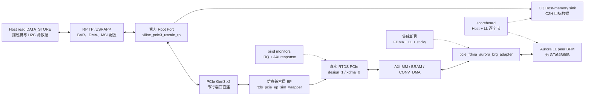

# RTDS_test_XDMA_RootPort验证环境框架测试点与用例说明

- Category: `pcie`
- Source: `E:\PCIE-CPU\docs\RTDS_test_XDMA_RootPort验证环境框架测试点与用例说明.md`
- SHA-256: `952301cad51e49c987849037b68acab579e37e1e238bb343ed66bf00f38d4f55`
- Extractor: `text`
- Tags: `aurora, engineering, pcie, xdma`
- Duplicate sources:
  - none

# RTDS_test-1ch XDMA Root Port 验证环境框架、测试点与用例说明

## 1. 文档目的

本文档说明 `RTDS_test-1ch` 的 XDMA Root Port 大仿真环境是怎样构成的、每一层验证什么、怎样运行和扩展用例，并提供可直接维护的“测试点—验证用例—检查证据”追踪表。

本文档的状态标识含义如下：

- **已实现**：激励、检查器或脚本已写入仿真环境，不等于本轮已获得 PASS。
- **正在验证**：已实现，正在等待本轮 XSim 编译、展开或仿真结果。
- **计划**：已定义测试目标，但还未写成可运行用例。
- **板卡/软件侧**：RTL 仿真无法独立证明，需要实际硬件、XDMA 驱动或 CPU 软件配合。

当前固定工具版本为 Vivado 2020.2，调用路径为：

```text
D:\Xilinx_2020_2\Vivado\2020.2\bin\vivado.bat
```

## 2. 验证范围与边界

### 2.1 本环境验证的内容

1. 真实 `RTDS_test-1ch` XDMA Endpoint 与官方 Root Port 之间的 PCIe Gen3 x2 链路训练、枚举和 BAR 访问。
2. XDMA H2C/C2H 单通道描述符发起、完成状态和逐字节数据比对。
3. CPU→FPGA→Aurora LocalLink 边界的 512 B 数据通路。
4. Aurora LocalLink→FPGA→CPU 的 512 B 数据通路、INFO_EXCH 状态、用户中断请求、MSI 发送确认、read-to-clear 和接收重新武装。
5. FDMA、LocalLink、AXI response、sticky status/CDC clear 的集成级协议断言。
6. 可复现的工程审计、源文件固化、日志语义比对、warning 白名单和 WDB 波形保存。

### 2.2 本环境不重复验证的内容

- FDMA 和 Aurora LocalLink bridge 已在模块级完成功能验证，大仿真只保留跨模块数据比对和协议断言。
- 不实例化官方 Aurora 64B/66B Core、GT、串行线路、时钟恢复或信号完整性模型。
- 不证明 Windows/Linux 驱动的 ISR 已真正运行。仿真中 `usr_irq_ack` 证明 XDMA 已把用户中断请求转换成 PCIe MSI 消息并发送，不等于 CPU 软件已进入 ISR。
- 不使用 `xdma_0_ex` 的官方示例 Endpoint 代替 RTDS Endpoint。

## 3. 环境构建原理

### 3.1 总体原则

环境以“真实产品边界 + 尽可能少的仿真兼容层”为原则：

- PCIe 主机侧使用 `xdma_0_ex` 对应 Vivado 2020.2 的官方 Root Port、TPI/USRAPP；`DATA_STORE` 提供 Host read 数据，独立 CQ sink 接收 C2H write。
- PCIe 设备侧实例化 `RTDS_test-1ch` 真实 `PCIe`/`design_1`/`xdma_0`。
- 仿真 wrapper 只做端口适配和内部观测信号别名，不改官方 RP 的枚举、BAR 和 XDMA TPI 主逻辑。生产端口不变；`PCIe.v` 仅按已通过 integration TB 修复 CONV_DMA 写侧语义映射。
- Aurora 侧停在 LocalLink 用户边界。这样既能验证 RTDS 的系统级数据闭环，又不会把已验过的 Aurora PHY/GT 带入超大仿真。
- XDMA 未导出到 BD 顶层的 `usr_irq_req`/`usr_irq_ack`/`msi_enable` 通过 SystemVerilog `bind` 只读观测。
- 比对器使用确定性字节模式，日志使用稳定的语义里程碑，不依赖绝对仿真时刻、机器路径和许可证输出。

### 3.2 逻辑架构



### 3.3 主要组件职责

| 组件 | 文件/层级 | 主要职责 | 是否修改产品 RTL |
|---|---|---|---|
| 仿真顶层 | `tb/board.sv` / `board` | 时钟复位、RP/EP 串行直连、任务调度、里程碑和总结 | 否 |
| 官方 RP | `vendor/xdma_rp_2020_2` / `board.RP` | PCIe 主机链路、配置空间、BAR、TLP 交互 | 否，按原文件固化 |
| TPI/USRAPP | `board.RP.tx_usrapp` | BAR/XDMA 访问、描述符和 H2C `DATA_STORE` 数据源 | 否，测试入口通过 `tests.vh` 接入 |
| CQ Host sink | `tb/pcie_cq_host_memory_monitor.sv` / `board.CQ_HOST` | 解码 RP CQ Memory Write 并保存 C2H payload | 否 |
| EP 兼容层 | `tb/rtds_pcie_ep_sim_wrapper.sv` / `board.EP` | 实例化真实 `PCIe`，适配 LL 边界，导出只读别名 | 否 |
| 真实 DUT | `board.EP.DUT` | RTDS PCIe/XDMA/FDMA/adapter 生产逻辑 | `PCIe.v` 仅修复已证实的写侧语义映射 |
| LL peer BFM | `tb/aurora_ll_peer_bfm.sv` / `board.LL_BFM` | 消费 FPGA→Aurora，注入 Aurora→FPGA，逐字节比对 | 否 |
| 集成断言 | `tb/rtds_rootport_assertions.sv` | FDMA 窗口/握手、LL 稳定性、连续 RX、X/Z、sticky clear | 否 |
| IRQ monitor | `tb/xdma_irq_monitor.sv` | `bind design_1_xdma_0_0`，记录 req/ack/MSI enable 是否真正出现 | 否 |
| AXI response monitor | `tb/conv_dma_axi_monitor.sv` | `bind CONV_DMA`，拒绝非 OKAY `BRESP/RRESP` | 否 |
| 波形配置 | `scripts/waves.tcl` | 按复位/链路、TLP、AXI、FDMA、LL、IRQ 分组 | 否 |
| 日志比对 | `scripts/compare_logs.ps1` | 里程碑、错误扫描、精确 warning 白名单、JSON 摘要 | 否 |

## 4. 时钟、复位和端口方向

### 4.1 时钟和复位约定

| 项目 | 当前配置 | 验证含义 |
|---|---:|---|
| PCIe RP/EP 差分参考时钟 | 100 MHz | RP 和 EP 分别由差分时钟模型驱动 |
| RTDS `i_sys_clk` | 250 MHz | FDMA/adapter 主数据处理时钟 |
| Aurora LL 用户时钟 | 156.25 MHz | 只建模 LocalLink 用户侧 |
| PCIe `sys_rst_n` | 低电平保持 5 us | 给 RP/EP 稳定的上电复位窗口 |
| Aurora 用户复位 | PCIe 复位释放后等 16 个 LL 时钟 | 模拟用户时钟域就绪 |
| `channel_up/lane_up` | Aurora 复位释放后再等 16 个 LL 时钟 | 明确表示只建模 LL 边界链路已就绪 |
| 单次 DMA/IRQ 等待 | 200 us | 超时立即记错，避免无限仿真 |
| 全局用例超时 | 2 ms | `rtds_minimum` 未结束则 `$fatal` |

### 4.2 LocalLink 方向定义

| 环境命名 | 真实数据方向 | BFM 行为 | 反压约束 |
|---|---|---|---|
| `tx_*` | FPGA→Aurora | BFM 消费并捕获数据 | BFM 可通过 `tx_dst_rdy` 施加反压；最小闭环默认关闭随机反压 |
| `rx_*` | Aurora→FPGA | BFM 连续注入数据 | **FPGA 侧不允许反压**；BFM 不等待 `rx_dst_rdy`，发送期间如果 ready 拉低立即报错 |

Aurora→FPGA 的无反压建模是硬约束，不是仿真简化的偶然结果。SERDES 已经到达的数据不会因 FPGA 内部临时不 ready 而在线上停住；FPGA 必须通过 FIFO 深度、流量预算和 overflow/sticky 策略处理这个边界。

## 5. 激励、参考模型和检查器

### 5.1 确定性数据模式

每个方向使用不同 seed 生成确定性字节序列。参考模型按“有效字节”比对：

- Host 侧：H2C 数据源放在 `DATA_STORE`；C2H 对 CQ Host sink 的 512 B 目标窗口逐字节比对。
- LocalLink 侧：中间拍固定 8 B，EOF 拍依据 `rem + 1` 确定有效字节数。
- 不假定 512 B 一定构成单个 Aurora frame；scoreboard 重点是总有效字节数和字节内容。

### 5.2 地址和描述符约定

| 用途 | 地址/长度 |
|---|---:|
| H2C descriptor | Host `0x00000100` |
| C2H descriptor | Host `0x00000300` |
| Host 源数据 | `0x00000400`，512 B |
| Host 目标数据 | `0x00000800`，512 B |
| H2C 卡端目标/CPU→Aurora 源 | `0x00008000` |
| 基础 C2H 卡端源 | `0x00008000` |
| Aurora→CPU C2H 卡端源 | `0x00000000` |
| 描述符长度 | `0x00000200` = 512 B |
| 完成条件 | descriptor count = 1，status = `0x6` |

### 5.3 分层检查机制

| 检查层 | 检查内容 | 失败表现 |
|---|---|---|
| 数据 scoreboard | H2C→C2H、CPU→Aurora、Aurora→C2H 的逐字节内容和 512 B 长度 | `MISMATCH`/`$error`，记录前 8 个差异位置 |
| DMA 完成 | H2C/C2H descriptor count 从基值增加 1，status=`0x6` | `RTDS_DMA_COMPLETE` 报错 |
| FDMA 断言 | 512 B 传输对应 64 个 64-bit word；地址 512 B 对齐且位于规定窗口；request 保持到 busy | `RTDS_ASSERT_FDMA_READ/WRITE` |
| LL TX 断言 | FPGA→Aurora 被反压时 data/SOF/EOF/rem 保持稳定 | `RTDS_ASSERT_LL_TX_STABLE` |
| LL RX 断言 | Aurora→FPGA 连续输入时 `rx_dst_rdy` 不得拉低 | `RTDS_LL_RX_NO_BACKPRESSURE` |
| LL 帧协议 | SOF/EOF 次序、capture 窗口不溢出、有效字节数正确 | `RTDS_LL_TX_PROTOCOL` |
| AXI response | CONV_DMA 的 `BRESP/RRESP` 必须为 OKAY | `RTDS_AXI_BRESP_ERROR` / `RTDS_AXI_RRESP_ERROR` |
| X/Z 检查 | 复位/链路绪后 FDMA、LL 关键控制不得为 X/Z | `$error` 并累加 assertion count |
| sticky/CDC clear | clear 之前状态保持，clear 后不能被旧 CDC 电平再次拉高 | sticky clear watchdog 报错 |
| IRQ 路由 | MSI capability enable、XDMA user IRQ mask、`usr_irq_req`、`usr_irq_ack` 均实际观测到 | 任一里程碑缺失则不能 PASS |
| 超时 | DMA/IRQ 200 us，全用例 2 ms | `$error` 或 `$fatal` |
| 日志门禁 | 里程碑完整、`errors=0`、无 ERROR/FATAL/MISMATCH/TIMEOUT、warning 精确白名单 | `RTDS_LOG_COMPARE_FAIL` |

## 6. 当前最小闭环用例 `rtds_minimum`

`rtds_minimum` 是本轮验收用例，不是压力回归。它按下列顺序执行，前级失败不能被后级 PASS 掩盖。

### 步骤 A：链路和枚举

1. 释放 PCIe 复位，等待官方 RP 完成 LTSSM 链路训练和 BAR 初始化。
2. 检查 `user_lnk_up=1`、协商宽度 x2、速率 Gen3。
3. 检查 Vendor ID `0x10EE`、Device ID `0x8032`。
4. 记录 `RTDS_LINK_PASS` 和 BAR 映射。

### 步骤 B：MSI 主机配置和 XDMA IRQ 路由

1. 从 PCIe configuration space `0x34` 沿 capability linked list 查找 ID `0x05` 的 MSI capability。
2. 写入 MSI address `0xFEE00000`、data `0x0045`，设置 MSI Enable。
3. 从真实 XDMA 内部观测 `msi_enable=1`。
4. 写 XDMA IRQ block `0x2004[0]=1`，读回检查用户中断源 0 已解屏蔽。
5. 记录 `RTDS_MSI_CONFIG_PASS` 和 `RTDS_XDMA_USER_IRQ_ENABLE_PASS`。

### 步骤 C：用户 BAR/INFO_EXCH

1. 自动区分 XDMA control BAR 和用户 AXI-Lite BAR。
2. 检查 `0x00=0x00001001`、`0x04=0x20260506`、`0x08=0x00008000`。
3. 对 `0x24/0x28` 写入卡端起始地址和 512 B 长度，再读回比对。

### 步骤 D：基础 XDMA H2C/C2H

1. 填充 Host 源数据并初始化 H2C descriptor。
2. H2C：Host `0x400` → card `0x8000`，512 B。
3. 轮询 H2C descriptor count/status。
4. C2H：card `0x8000` → Host `0x800`，512 B。
5. 轮询 C2H descriptor count/status，逐字节比对 Host 目标窗口。
6. 记录 `RTDS_BASE_DMA_PASS`。

### 步骤 E：CPU→Aurora

1. H2C 把新的 512 B 数据写到 card `0x8000`。
2. INFO_EXCH 写入起始地址和长度。
3. 对 `CPU_WR_DONE` 做 `0→1→0` 边沿操作。
4. adapter/FDMA 读取卡端数据并通过 LL TX 发出。
5. BFM 消费 LL TX，按有效字节捕获并比对 512 B。
6. 检查 `CPU_WR_DONE_resp` 曾经拉高，完成后返回低电平。
7. 记录 `RTDS_CPU_TO_AURORA_PASS`。

### 步骤 F：Aurora→CPU、MSI 和清除

1. BFM 使用另一 seed 连续发送 64 拍×64 bit，不因 `rx_dst_rdy` 停顿。
2. 检查 FPGA 全过程 ready，数据被 FDMA 写入 card `0x0000`。
3. 等待 `FPGA_CPU_irq_req`，读取 INFO_EXCH：`0x18=0x00000000`、`0x1C=512`。
4. 读 `0x10`检查中断状态并触发 read-to-clear，然后检查 IRQ 请求撤销。
5. 必须观测到 `usr_irq_req`、`msi_enable`和 `usr_irq_ack`。`ack` 表示 XDMA 已把 MSI 消息发送到 PCIe，不表示软件 ISR 已完成。
6. C2H：card `0x0000` → Host `0x800`，逐字节比对 512 B。
7. 对 `CPU_REC_STATE` 做 `1→0`，释放并重新武装接收路径。
8. 记录 `RTDS_AURORA_TO_CPU_PASS`。

### 步骤 G：总结门禁

只有以下所有条件同时成立，才输出：

```text
RTDS_ROOTPORT_RESULT ... errors=0
RTDS_ROOTPORT_PASS
```

任一 scoreboard mismatch、断言错误、LL protocol error、RX not-ready、AXI response error、超时或中断里程碑缺失，都必须导致 FAIL。

## 7. 测试点—验证用例追踪表

### 7.1 环境、构建和可复现性

| ID | 测试点 | 对应用例/步骤 | 检查方法与证据 | 状态 | 是否验收门禁 |
|---|---|---|---|---|---|
| ENV-001 | Vivado 固定为 2020.2 | audit | `RTDS_AUDIT_BEGIN: Vivado=2020.2` | 已实现 | 是 |
| ENV-002 | H2C=1、C2H=1 | audit | 读 XDMA IP properties，写入 audit log | 已实现 | 是 |
| ENV-003 | Gen3 x2、64-bit、250 MHz | audit + link | IP property 审计 + 实际链路里程碑 | 已实现/正在验证 | 是 |
| ENV-004 | 缺失 FIFO 派生文件可由 2020.2 重建 | audit | `reset_target all` + `generate_target all`，文件存在 | 已实现并已执行 | 是 |
| ENV-005 | BD 合法且 simulation target 可生成 | audit | `validate_bd_design` + `generate_target simulation` | 已实现并已执行 | 是 |
| ENV-006 | 官方 RP 依赖可追溯 | prepare | source manifest、大小、SHA-256、compile order | 已实现 | 是 |
| ENV-007 | 无官方示例 EP/board 混入 | prepare | compile list 和 manifest 审计 | 已实现 | 是 |
| ENV-008 | 所有生成物在新回归目录 | run | `work/logs` 和 export scripts 无旧绝对路径 | 已实现 | 是 |

### 7.2 PCIe 链路、枚举和 BAR

| ID | 测试点 | 对应用例/步骤 | 检查方法与证据 | 状态 | 是否验收门禁 |
|---|---|---|---|---|---|
| PCIE-001 | RP/EP 差分参考时钟正确 | minimum A | 波形 100 MHz，p/n 互补 | 已实现 | 是 |
| PCIE-002 | PCIe 复位保持 5 us 后释放 | minimum A | `RTDS_RESET` 日志 + 波形 | 已实现 | 是 |
| PCIE-003 | LTSSM 进入 L0，`user_lnk_up=1` | minimum A | `RTDS_LINK_PASS` + LTSSM 波形 | 正在验证 | 是 |
| PCIE-004 | 实际协商 Gen3 x2 | minimum A | speed/width 寄存器与波形 | 正在验证 | 是 |
| PCIE-005 | Vendor/Device ID 正确 | minimum A | `10EE:8032` | 正在验证 | 是 |
| PCIE-006 | XDMA BAR 被识别 | minimum C | `RTDS_BAR_MAP` 中 `xdma_bar` | 正在验证 | 是 |
| PCIE-007 | 用户 AXI-Lite BAR 被识别 | minimum C | 排除 XDMA BAR 后查找可用 memory BAR | 正在验证 | 是 |
| PCIE-008 | INFO_EXCH 常量正确 | minimum C | `0x00/0x04/0x08` 读值比对 | 正在验证 | 是 |
| PCIE-009 | INFO_EXCH 可写寄存器可读回 | minimum C | `0x24/0x28` write/readback | 正在验证 | 是 |

### 7.3 XDMA DMA 数据通路

| ID | 测试点 | 对应用例/步骤 | 检查方法与证据 | 状态 | 是否验收门禁 |
|---|---|---|---|---|---|
| DMA-001 | H2C 512 B 描述符可完成 | minimum D/E | descriptor count=1，status=`0x6` | 正在验证 | 是 |
| DMA-002 | C2H 512 B 描述符可完成 | minimum D/F | descriptor count=1，status=`0x6` | 正在验证 | 是 |
| DMA-003 | 基础 H2C→C2H 数据无误 | minimum D | Host 512 B 逐字节比对 | 正在验证 | 是 |
| DMA-004 | DMA 长度与 byte count 一致 | minimum D/E/F | descriptor 长度、DMA status/count、scoreboard 总长度 | 正在验证 | 是 |
| DMA-005 | 非 OKAY AXI response 不被忽略 | minimum 全程 | bind monitor 拒绝 `BRESP/RRESP != 0` | 已实现 | 是 |
| DMA-006 | 1 KiB 传输 | `rtds_sizes` | count/status + byte compare | 计划 | 否，压力回归 |
| DMA-007 | 32 KiB 传输 | `rtds_sizes` | count/status + byte compare + BFM capture 边界 | 计划 | 否，压力回归 |

### 7.4 CPU→Aurora 方向

| ID | 测试点 | 对应用例/步骤 | 检查方法与证据 | 状态 | 是否验收门禁 |
|---|---|---|---|---|---|
| C2A-001 | `CPU_WR_DONE` `0→1→0` 边沿可启动传输 | minimum E | BAR 写序列 + FDMA request | 正在验证 | 是 |
| C2A-002 | FDMA 读请求尺寸/地址正确 | minimum E | `rsize=64 words`，512 B 对齐和窗口断言 | 已实现 | 是 |
| C2A-003 | FDMA request 保持到 busy | minimum E | 时序断言 | 已实现 | 是 |
| C2A-004 | LL 输出 512 B 数据无误 | minimum E | 有效字节 scoreboard | 正在验证 | 是 |
| C2A-005 | `CPU_WR_DONE_resp` 生命周期正确 | minimum E | 必须看到 high，后续回 low | 正在验证 | 是 |
| C2A-006 | LL TX 受反压时 payload 保持 | `rtds_tx_backpressure` | data/SOF/EOF/rem 稳定断言 + scoreboard | 断言已实现，用例计划 | 否，压力回归 |

### 7.5 Aurora→CPU 方向和无反压约束

| ID | 测试点 | 对应用例/步骤 | 检查方法与证据 | 状态 | 是否验收门禁 |
|---|---|---|---|---|---|
| A2C-001 | BFM 连续发送 512 B，不等待 ready | minimum F | 64 个连续 LL 拍，BFM 任务无 ready wait | 已实现 | 是 |
| A2C-002 | FPGA 不对 Aurora RX 反压 | minimum F | `rx_not_ready_errors=0` + 断言 | 正在验证 | 是 |
| A2C-003 | FDMA 写请求尺寸/地址正确 | minimum F | `wsize=64 words`，512 B 对齐和窗口断言 | 已实现 | 是 |
| A2C-004 | INFO_EXCH 地址/长度反映实际接收 | minimum F | `0x18=0`、`0x1C=512` | 正在验证 | 是 |
| A2C-005 | 接收数据经 C2H 回传无误 | minimum F | Host 512 B 逐字节比对 | 正在验证 | 是 |
| A2C-006 | `CPU_REC_STATE 1→0` 重新武装 | minimum F + repeat | 单次控制写已实现；第二次传输证明重武装 | 单次已实现，连续用例计划 | 本轮检查写序列；压力用例检查功能 |
| A2C-007 | 输入超过消费能力时错误状态可见 | `rtds_rx_overrun` | overflow/overrun sticky、IRQ 与 clear | 计划 | 否，负向/压力用例 |

### 7.6 MSI/用户中断和状态清除

| ID | 测试点 | 对应用例/步骤 | 检查方法与证据 | 状态 | 是否验收门禁 |
|---|---|---|---|---|---|
| IRQ-001 | Endpoint 暴露 MSI capability | minimum B | capability list 查找 ID `0x05` | 正在验证 | 是 |
| IRQ-002 | Host 写入 MSI address/data 并 enable | minimum B | config readback + `RTDS_MSI_CONFIG_PASS` | 正在验证 | 是 |
| IRQ-003 | XDMA 内部 `msi_enable` 真正拉高 | minimum B/F | bind monitor `seen_msi_enable` | 正在验证 | 是 |
| IRQ-004 | XDMA user IRQ source 0 在 `0x2004` 解屏蔽 | minimum B | write/readback bit 0 | 正在验证 | 是 |
| IRQ-005 | RX 完成后 `usr_irq_req` 置位并保持 | minimum F | bind monitor `seen_req` + 波形 | 正在验证 | 是 |
| IRQ-006 | XDMA 已把 MSI 消息发送到 PCIe | minimum F | bind monitor `seen_ack` | 正在验证 | 是 |
| IRQ-007 | INFO_EXCH 中断状态 read-to-clear | minimum F | 读 `0x10`后 IRQ 在 200 us 内撤销 | 正在验证 | 是 |
| IRQ-008 | clear 后不被旧 CDC 电平重新置位 | minimum F | sticky clear watchdog | 已实现 | 是 |
| IRQ-009 | IRQ mask=0 时不发 MSI，恢复 enable 后可发 | `rtds_irq_mask_rearm` | req/pending/ack 顺序和次数 | 计划 | 否，压力回归 |
| IRQ-010 | CPU 驱动真正进入 ISR 并处理 | 板卡驱动测试 | OS 中断计数、driver log、应用状态 | 板卡/软件侧 | 量产验收需要，不属于 RTL 仿真 PASS |

### 7.7 健壮性、断言和可调试性

| ID | 测试点 | 对应用例/步骤 | 检查方法与证据 | 状态 | 是否验收门禁 |
|---|---|---|---|---|---|
| ROB-001 | 复位后关键控制无 X/Z | minimum 全程 | 断言 error count=0 | 已实现 | 是 |
| ROB-002 | 任意 AXI response error 被立即捕获 | minimum 全程 | bind monitor | 已实现 | 是 |
| ROB-003 | DMA/IRQ 不会无限等待 | minimum 全程 | 200 us 局部 timeout + 2 ms global timeout | 已实现 | 是 |
| ROB-004 | 连续多次双向传输 | `rtds_repeat` | 至少 16 轮，每轮变 seed，IRQ/clear/rearm 次数一致 | 计划 | 否，压力回归 |
| ROB-005 | 用户复位后可恢复传输 | `rtds_reset_recovery` | reset 前后各一次完整闭环 | 计划 | 否，压力回归 |
| ROB-006 | 新 warning 不被模糊白名单掩盖 | build + compare | 精确文本匹配，新 warning 进入 JSON/report | 已实现 | 是 |
| ROB-007 | WDB 包含分层关键信号 | minimum | `waves.tcl` 分组 + GUI 检查 | 已实现 | 是 |

## 8. 后续用例目录

下列用例为后续回归框架，当前不作为 `rtds_minimum` 首次大仿真的验收门禁。实现时建议优先把长度、seed、轮数和反压作为 plusarg，尽量复用同一个 elaborated snapshot。

| 用例名 | 目标 | 关键参数 | 主要检查 | 建议回归级别 |
|---|---|---|---|---|
| `rtds_sizes` | 覆盖 1 KiB、32 KiB 和边界长度 | `LEN`、`SEED` | descriptor/status、有效字节、REM、边界地址 | G3 |
| `rtds_tx_backpressure` | 验证 FPGA→Aurora 反压能力 | `TX_BP=1`、固定随机 seed | stall 期间 payload 稳定，结果数据无误 | G3 |
| `rtds_repeat` | 发现 sticky/CDC/rearm 和计数累积问题 | `ITER=16` 起 | 每轮双向 scoreboard、IRQ/ack/clear 次数 | G3 |
| `rtds_irq_mask_rearm` | 区分中断源、mask、pending 和 MSI 发送 | mask off/on | req 可保持，mask off 不 ack，enable 后发送 | G3 |
| `rtds_reset_recovery` | 验证复位后链路/用户路径恢复 | reset 位置、宽度 | reset 前后各一次完整闭环、无旧 sticky | G3 |
| `rtds_rx_overrun` | 验证无反压输入超载的可观测错误策略 | 连续多帧/缩短帧间隔 | overflow/overrun sticky、IRQ、clear 后恢复 | G3 负向 |
| `rtds_hw_irq_isr` | 证明真实 Host 驱动/ISR 闭环 | 板卡、OS、XDMA driver | MSI 计数、ISR 读清、应用层数据 | G4 |

## 9. 回归分级和完成准则

| 级别 | 名称 | 执行内容 | 建议触发时机 | PASS 条件 |
|---|---|---|---|---|
| G0 | 工程审计 | IP 完整性、1ch/Gen3 x2/位宽/时钟、BD validate、source hash | 首次搭建、IP/BD 更改后 | `RTDS_AUDIT_PASS` |
| G1 | 构建门禁 | xvlog/xvhdl/xelab，warning 白名单 | RTL/IP/仿真环境源文件更改后 | 生成 `board` snapshot，无未处理错误和新 warning |
| G2 | 最小验收 | `rtds_minimum` | 每次提交前或稳定基线 | link/BAR/MSI/基础 DMA/双向 512 B/IRQ/clear/断言全部通过 |
| G3 | 压力/夜间回归 | sizes/backpressure/repeat/mask/reset/overrun | 夜间或重要版本节点 | 所选用例全部 PASS，无新 warning |
| G4 | 板卡/驱动验收 | 真实 PCIe Root Complex、OS driver、ISR、Aurora 实物链路 | 上板、发版前 | 硬件数据和中断计数与软件协议一致 |

## 10. 使用说明

### 10.1 首次或干净回归

在 PowerShell 中执行：

```powershell
Set-Location 'E:\PCIE-CPU\RTDS_test-1ch\regression\sim_xdma_rootport'
powershell -ExecutionPolicy Bypass -File .\run_xsim.ps1 -XelabMt off -XelabDebug typical
```

对 8 GB/4 逻辑 CPU 的当前机器，建议保持 `-XelabMt off`。多线程展开曾在 XSim native compile 阶段出现访问冲突/堆损坏异常，不属于 RTL 语义错误。

高配远端的无波形快速门禁可使用：

```powershell
powershell -ExecutionPolicy Bypass -File .\run_xsim.ps1 `
  -SkipAudit -FastMode `
  -VivadoBin C:\Xilinx\Vivado\2020.2\bin `
  -XelabMt auto -XelabOptimize 3 `
  -XsimMaxDeltaId 10000 -WallClockTimeoutMinutes 90
```

DMA checker 不再持续发 PCIe 寄存器读。它先观察真实 XDMA M_AXI 数据握手，C2H 再观察 RP CQ Host sink 的 sentinel 被覆盖，最后稀疏读取 descriptor count/status 并要求 `count=1/status=0x6`。这仍覆盖软件可见完成状态，但不会把 testbench polling 本身变成主要 TLP 流量。`maxdeltaid` 是零时间风暴的硬失败保护，墙钟看门狗则覆盖 HDL 时间完全不推进；二者都不能替代失败后的阶段日志和波形根因定位。

### 10.2 已有 snapshot 时只重跑仿真

`snapshot` 是 xelab 把所有 HDL、IP 和层次展开后生成的可执行仿真模型，当前名为 `board`。如果 RTL、IP、BFM、断言、compile options 都没改，可以跳过审计、准备、编译和展开：

```powershell
powershell -ExecutionPolicy Bypass -File .\run_xsim.ps1 `
  -SkipAudit -SkipPrepare -SkipCompile -SkipElaborate
```

仅修改 `TESTNAME`、长度、seed、轮数等运行时 plusarg，可复用 snapshot。修改 Verilog/SystemVerilog/VHDL、IP 生成物、bind、include 或 xelab 选项后，必须重新编译/展开。

### 10.3 打开 XSim GUI

```powershell
powershell -ExecutionPolicy Bypass -File .\open_xsim_gui.ps1
```

GUI 会加载已有 `board` snapshot、`rtds_minimum` plusarg、WDB 和 `scripts/waves.tcl`。详细的 GUI/命令行交接步骤参见：

`docs/RTDS_test_XDMA_RootPort另一台电脑运行与回归步骤.md`

### 10.4 最小结果检查

必须同时检查：

1. `logs/simulate.log` 中存在所有语义里程碑和 `RTDS_ROOTPORT_PASS`。
2. `RTDS_ROOTPORT_RESULT` 最后为 `errors=0`。
3. `logs/summary.json` 中所有必需 milestone 为 true。
4. audit/prepare/xvlog/xvhdl/xelab/simulate 日志无未白名单化 warning，无 ERROR/FATAL/MISMATCH/TIMEOUT。
5. Debug/WDB 回归时，WDB 可打开且关键波形能对应日志中的语义阶段；FastMode 最小回归以日志、断言、monitor 和 scoreboard 为证据。

## 11. 如何新增一个回归用例

### 11.1 用例定义步骤

1. 先在本文档的追踪表中新增测试点 ID，写清激励、预期结果、证据和回归级别。
2. 优先把长度、seed、轮数和反压策略做成 plusarg，以复用 snapshot。
3. 在 `tb/board.sv` 中增加可复用 task，在 `tb/tests.vh` 中增加 `TESTNAME` 分支。
4. 对每条新数据路径配置确定性参考数据和 scoreboard，不只检查 done/status。
5. 对协议、跨时钟域、sticky 和错误路径增加断言，不把正常功能时序全部写成 testbench 轮询。
6. 每个主阶段输出唯一、稳定、可搜索的 `RTDS_*_PASS` 里程碑，并在 `compare_logs.ps1` 中列为必须项。
7. `waves.tcl` 只增加能定位新测试点的关键信号，避免不加选择地 dump 整个超大层次。
8. 单用例跑通后加入 G2 或 G3 清单，最后回写本表的“状态”和实际证据路径。

### 11.2 源文件中文注释约定

新增或修改环境文件时，按语义段使用中文注释，不要对每行做机械翻译。推荐格式：

```systemverilog
// ---------- 语义段 N：本段要验证的协议/数据生命周期 ----------
// 说明硬件约束、方向定义和为什么这样建模。
```

```tcl
# ---------- 语义段 N：此步对工程/导出物的影响 ----------
# 说明输入、输出、是否可复用和失败后的定位入口。
```

```powershell
# ---------- 语义段 N：运行阶段与跳过条件 ----------
# 说明什么条件下可以使用 -Skip*，什么改动会使 snapshot 失效。
```

## 12. 波形与失败定位入口

| 失败现象 | 首先查看 | 关键信号/证据 |
|---|---|---|
| link 不起 | Reset/link 波形组 + RP/EP log | 差分 refclk、`sys_rst_n`、LTSSM、`user_lnk_up`、width/speed |
| BAR 读回错 | RP TLP + CQ/CC + AXI-Lite | BAR address、read-data-valid、AXI-Lite AW/W/B/AR/R |
| H2C/C2H 超时 | TPI state + XDMA RQ/RC/CQ/CC + descriptor memory | descriptor 内容、count/status、DMA engine status、byte count |
| CPU→Aurora 数据错 | Endpoint AXI-MM + FDMA read + LL TX | fdma_raddr/rsize/request/busy/done、TX data/SOF/EOF/rem/ready |
| Aurora→CPU 数据错 | LL RX + FDMA write + C2H | 连续 RX 拍、`rx_dst_rdy`、fdma_w*、Host destination |
| 有 req 没 ack | MSI config + XDMA IRQ block + IRQ monitor + RP TLP | `msi_enable`、`0x2004`、`usr_irq_req/ack`、MSI Memory Write TLP |
| clear 后又置位 | INFO_EXCH + adapter sticky/CDC | `CLEAR_INTER_R`、sticky status、CDC synchronized level、`CPU_REC_STATE` |
| xelab 崩溃 | `logs/xelab.log` + Windows 进程/内存 | 区分 HDL error 与 XSim native compile 异常；小内存机使用 `-XelabMt off` |

## 13. 当前实施状态（2026-07-24）

- G0 工程审计：已完成；1ch、Gen3 x2、64-bit/250 MHz、MSI enabled/MSI-X disabled 和地址映射已写入审计日志。
- FIFO 缺失派生文件：已由 Vivado 2020.2 对 `RTDS_test-1ch` 自身 IP 执行 reset/generate 重建，未从 `RTDS_test` 复制。
- 官方 RP 依赖固化、仿真 wrapper、LL BFM、scoreboard、bind monitors、断言、波形和日志比对框架：已实现。
- G1 构建：最终 FastMode xvlog/xvhdl/xelab 成功，官方 RP 明确配置为 Gen3 x2；118 条 warning 全部按精确来源分类，`unexpected_warnings=0`。
- G2 `rtds_minimum`：已完成。link、Gen3 x2、BAR、MSI/user IRQ route、基础 H2C/C2H、CPU→Aurora、Aurora→CPU、read-to-clear、`usr_irq_ack`、断言和两个 512 B scoreboard 全部通过；最终 `errors=0`、`RTDS_ROOTPORT_PASS`、`RTDS_LOG_COMPARE_PASS`。
- G3/G4：保留为后续压力回归和板卡/软件验证，未宣称完成。

## 14. 相关文档

- `docs/RTDS_test_XDMA_RootPort问题发现与处理台账.md`：本对话全部问题、修复状态、证据和每日维护记录。
- `docs/RTDS_test_XDMA_RootPort大仿真搭建与回归记录.md`：本次实际搭建、配置审计、波形/日志解释和最终执行记录。
- `docs/RTDS_test_XDMA_RootPort另一台电脑运行与回归步骤.md`：命令行、Vivado GUI、XSim GUI 和结果交接步骤。
- `RTDS_test-1ch/regression/sim_xdma_rootport/README.md`：仿真目录内的快速入口和文件说明。
