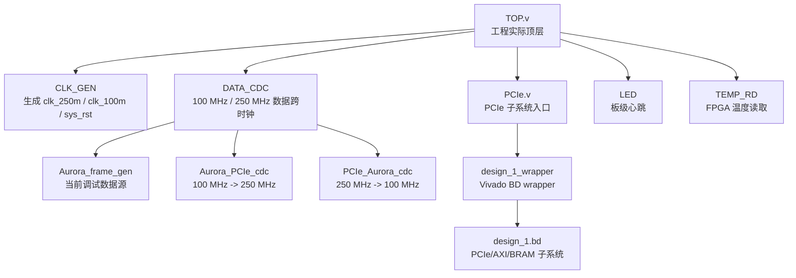
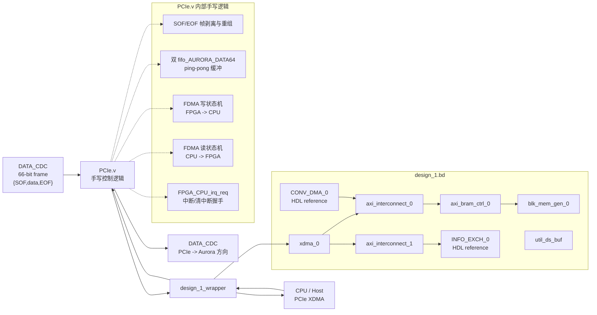

# RTDS_test_code_hierarchy

- Category: `pcie`
- Source: `E:\PCIE-CPU\docs\RTDS_test_code_hierarchy.md`
- SHA-256: `07f6eb4d6fbf56f40c4241ff92fe7878df89cb15bfba9cc2df47b59ac94b3e2e`
- Extractor: `text`
- Tags: `aurora, engineering, pcie, xdma`
- Duplicate sources:
  - none

# RTDS_test 联调工程代码层次说明

## 结论

`RTDS_test` 不是纯 Vivado IP / Block Design 集成工程，而是：

- Vivado Block Design / Xilinx IP 负责 PCIe、AXI、BRAM、FIFO、ILA 等基础设施；
- `PCIe.v`、`DATA_CDC.v`、`CONV_DMA.v`、`INFO_EXCH.v` 等文件中有少量但关键的手写逻辑；
- 当前工程更准确地说是“BD 集成骨架 + 手写 PCIe/FDMA 胶水逻辑 + 联调调试逻辑”。

Vivado 工程实际顶层是 `TOP.v`，不是 `PCIe.v`，也不是 `design_1.bd`。

## 代码层次

```text
TOP.v
├─ CLK_GEN
│  └─ clk_wiz_0
├─ DATA_CDC
│  ├─ Aurora_frame_gen
│  ├─ Aurora_PCIe_cdc
│  │  └─ fifo_cdc_pcie
│  └─ PCIe_Aurora_cdc
│     ├─ fifo_cdc_aurora
│     └─ ila_0
├─ PCIe
│  ├─ fifo_AURORA_DATA64 U1
│  ├─ fifo_AURORA_DATA64 U2
│  ├─ ila_FDMA
│  └─ design_1_wrapper
│     └─ design_1.bd
│        ├─ xdma_0
│        ├─ axi_interconnect_0
│        ├─ axi_interconnect_1
│        ├─ axi_bram_ctrl_0
│        ├─ blk_mem_gen_0
│        ├─ util_ds_buf
│        ├─ CONV_DMA_0
│        └─ INFO_EXCH_0
├─ LED
└─ TEMP_RD
   ├─ sys_mon
   └─ ila_temp
```

## 系统顶层框图

这张图画的是整个 `TOP.v` 的层次。



## PCIe.v 子系统框图

这张图画的是 `PCIe.v` 下面的 PCIe 数据搬运子系统。`design_1.bd` 应该放在 `PCIe.v` 下面，而不是直接当作整个顶层来画。



## 数据流

### FPGA -> CPU

```text
Aurora/debug 侧 66-bit 帧
    -> DATA_CDC
    -> PCIe.v
       1. 识别 SOF / EOF
       2. 取出 64-bit payload
       3. 写入双 FIFO
       4. FDMA 写状态机产生 fdma_wareq / fdma_waddr / fdma_wdata
    -> design_1_wrapper
    -> CONV_DMA_0
    -> AXI interconnect
    -> BRAM / XDMA
    -> CPU / Host
```

写完一帧或一段缓冲后，`PCIe.v` 拉起 `FPGA_CPU_irq_req`，CPU 通过 `INFO_EXCH` 读取状态并清中断。

### CPU -> FPGA

```text
CPU / Host
    -> XDMA / BRAM
    -> INFO_EXCH 写 CPU_WR_DONE
    -> PCIe.v 收到 r_RD_START
       1. FDMA 读状态机产生 fdma_rareq / fdma_raddr
       2. 接收 fdma_rdata / fdma_rvalid
       3. 重新拼成 66-bit {SOF,data,EOF}
    -> DATA_CDC
    -> Aurora 方向
```

当前 `PCIe_Aurora_cdc` 的输出在 `DATA_CDC.v` 中没有继续接到真实 Aurora TX，因此 CPU -> FPGA 方向更像是预留/联调通路。

## 哪些是集成，哪些是手写

| 类别 | 文件/模块 | 说明 |
|---|---|---|
| 工程顶层手写 RTL | `TOP.v` | 板级 I/O、时钟复位、PCIe、CDC、LED、温度模块汇总 |
| PCIe 子系统手写 RTL | `PCIe.v` | 帧处理、双 FIFO、FDMA 读写状态机、中断/握手 |
| CDC 手写封装 | `DATA_CDC.v`、`Aurora_PCIe_cdc.v`、`PCIe_Aurora_cdc.v` | 封装异步 FIFO，完成 100 MHz / 250 MHz 跨时钟 |
| 调试数据源 | `Aurora_frame_gen.v` | 当前用于代替真实 Aurora 输入产生测试帧 |
| BD 内手写 HDL reference | `CONV_DMA.v` | 简单 `fdma_*` 接口到 AXI4 burst 的转换 |
| BD 内手写 HDL reference | `INFO_EXCH.v` | AXI-Lite 寄存器、状态读写、中断清除、读启动触发 |
| Xilinx IP / BD 集成 | `xdma_0`、`axi_interconnect_*`、`axi_bram_ctrl_0`、`blk_mem_gen_0`、`util_ds_buf` | PCIe、AXI、BRAM、时钟缓冲等基础设施 |
| 调试/辅助 IP | `ila_*`、`fifo_*`、`clk_wiz_0`、`sys_mon` | 调试、FIFO、时钟、温度采集 |

因此，这个工程不能称为“纯集成”。虽然 PCIe/AXI/BRAM 主体依赖 BD 和 IP，但决定数据何时搬运、如何打包、何时中断、何时响应 CPU 的逻辑主要在手写 RTL 中。

## 为什么 block diagram 放在 PCIe.v 下面

`design_1.bd` 是 `PCIe.v` 内部实例化的 PCIe/AXI/BRAM 子系统，不是整个工程顶层。

如果把 block diagram 直接画成顶层，会有两个问题：

1. 会误导读者以为整个 FPGA 设计都在 Vivado Block Design 里；
2. 会隐藏 `PCIe.v` 里的关键手写逻辑，比如 FDMA 状态机、双 FIFO、SOF/EOF 处理和中断握手。

正确的层次应该是：

```text
TOP.v
└─ PCIe.v
   └─ design_1_wrapper
      └─ design_1.bd
```

也就是说，BD 图放在 `PCIe.v` 下面，是因为 `PCIe.v` 才是这个 PCIe 子系统的 RTL 边界。`TOP.v` 是更大的板级顶层，里面还有 CDC、时钟、LED、温度读取等模块。

如果文档需要同时表达全局和细节，建议画两张图：

- 第一张：`TOP.v` 系统顶层图，只说明模块归属；
- 第二张：`PCIe.v` 子系统图，展开 `design_1.bd` 里的 XDMA、AXI、BRAM、`CONV_DMA`、`INFO_EXCH`。

这样既不会误认 BD 是整个顶层，也能突出真正的数据搬运逻辑在哪里。
