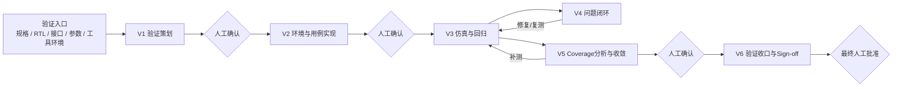
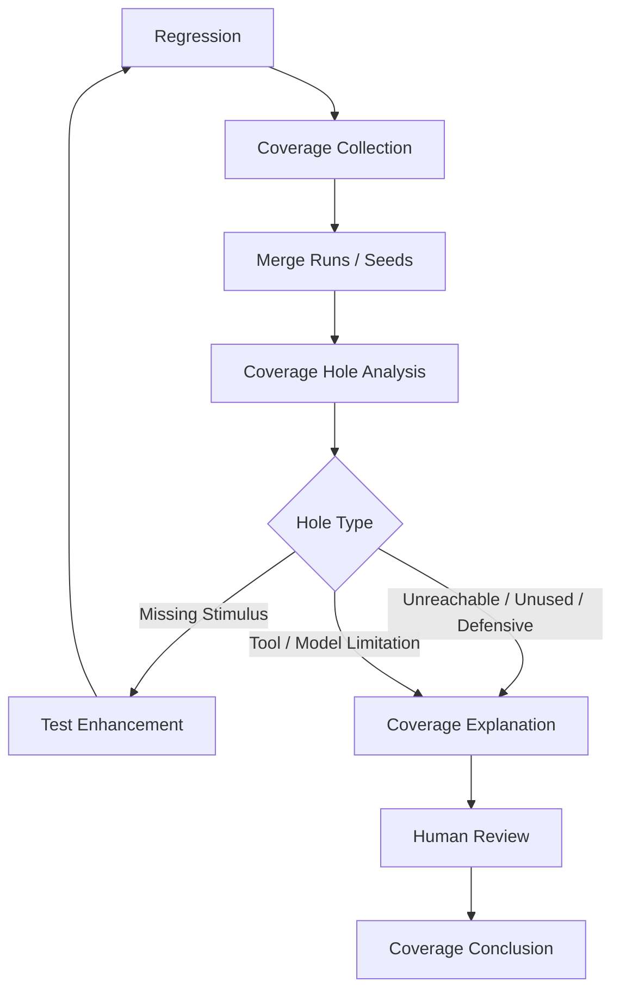

# FPGA 前端模块级验证流程规范与完整交付包研究报告

## 执行摘要

基于你已经确认的约束、GitHub 仓库 `maibobo/creative_factory` 中的 **Kimi、FPGA研发知识库_V2、FPGA研发知识库-10-14**，以及 AMD、紫光同创、安路和 Siemens 的官方工具资料，本报告建议把新体系定位为：

> **《FPGA 前端模块级验证流程规范 V1.0》：面向 RTL 动态仿真的中心级轻量验证 SOP，以测试策划、验证实现、仿真回归、问题闭环、代码覆盖率收敛和 Sign-off 为主线。**

Kimi 中最值得继承的不是原有 S1～S5 结构，而是中心级 SOP 的治理要求：**输入资料、执行步骤、工具/Skills、人工审核点、输出成果、验收标准**，同时要求轻量化、可裁剪、可执行并明确人机边界。fileciteturn4file0L2-L2 V2 和 10-14 则已经形成了测试点分解、Basic TB / SV / UVM 环境选型、回归、失败复现和模板资产，可以作为工程方法基础，但需要从完整 FPGA 研发流程中“抽离验证”，删除 implementation、时序、板级、CDC/Lint 等本次范围外内容。fileciteturn8file0L2-L2 fileciteturn9file0L2-L2

本版建议锁定以下规范边界：

| 项目 | 本规范结论 |
|---|---|
| 验证对象 | FPGA 单模块 RTL，默认模块级/UT，不再展开 UT/IT/TOP/ST 层级体系 |
| 验证类型 | RTL 动态功能仿真 |
| 不包含 | CDC、Lint、Formal、综合实现、布局布线、时序收敛、板级测试 |
| 环境等级 | 基础 TB；轻量级 SV；完整 SV / 轻量级 UVM |
| Python/cocotb | 不支持 |
| Code Coverage | **Line + Condition + FSM** 为规范关注项；Toggle 按模块需要选用；不建设 Functional Coverage |
| Assertion | 可选开关，仅动态仿真 SVA；Assertion Failure = Test Failure |
| 随机验证 | 对主要功能、边界、协议时序组合等**适用场景要求使用 Constrained Random**，但不强制所有测试随机化 |
| Regression | Smoke、Targeted、Full 为规范基本类型；CI 作为项目具备条件时的执行方式 |
| Coverage门槛 | **不设置公司级统一硬百分比门槛**；重点是覆盖率采集、合并、Hole 分析以及未覆盖项可解释 |
| Waiver | 不绑定某一工具的“Waiver”功能，统一采用 **Coverage Explanation / Exclusion Record**；工具支持原生 exclusion 时再使用 |
| 核心项目交付物 | 测试点/测试用例 Excel、验证方案 Word、最终仿真回归报告 Word；Coverage 纳入最终报告 |
| AI | AI 可以起草、生成、分析和提出建议；**每个阶段均需人工确认，方案、代码、Coverage解释和Sign-off尤其如此** |

这里有一个重要的工具研究结论：截至 AMD Vivado/XSim 2026.1，XSim 官方已经明确支持 **Line/Statement、Branch、Condition、Toggle** 代码覆盖率，能够把不同运行的 Coverage DB 合并，还支持通过 `-ccExclusionFile` 对 signal、instance、module、directory、file 进行 exclusion；因此“Vivado 完全不能做排除”在当前版本上已经不准确。但 AMD 当前官方列出的原生 XSim Code Coverage 类型中**没有 FSM Coverage**，所以不能为了统一流程虚构一个 XSim FSM 百分比。因此本规范最核心的设计原则应是：

> **规范统一验证方法与证据，而不是强制所有 FPGA IDE 产生完全相同的 Coverage 报告。**

这将使体系既能适配 Vivado/XSim，也能适配紫光同创 PDS、安路 TangDynasty 搭配第三方仿真器的环境，而不退化成“Verdi 专用流程”。

## 研究结论与规范基线

### 从 Kimi、V2 和 10-14 应继承什么

现有三套材料各有不同价值。

Kimi 已经把中心级 SOP 管理框架表达得很清楚，并强调 AI 产出必须进入人工审核点；这非常适合保留为新规范的“治理层”。fileciteturn4file0L2-L2

V2 的测试方法更接近应该保留的工程底座：测试应从**实际规格和模块上下文**出发，拆成可观察、可判断的行为；预期结果不能只写“运行正常”；验证方案需要描述环境、数据流、Checker/RM 等职责；而且明确指出 **Coverage 数字本身不等于功能正确**。fileciteturn10file0L2-L2 V2 对回归的复现要求也值得直接吸收：固定源文件、参数、工具/IP 库、filelist、配置和入口，每轮保存输入、命令、Seed、日志和结果；遇到随机失败应固定 Seed 复现，而不能无限重跑直到 PASS。fileciteturn11file0L2-L2

10-14 则对验证环境分级和定向/随机组合描述得更简洁：Basic TB、轻量 SV、完整 SV、UVM 按复杂度选择；测试先明确要检查的行为，再组合 directed 与 random，不应依赖随机“碰巧”命中关键故障。fileciteturn14file0L2-L2 其环境文档也已明确 Checker、Scoreboard、Monitor、RM、Assertion 的职责边界以及正常结束条件。fileciteturn15file0L2-L2

因此新体系不应该复制旧目录，而应重组为：

**中心级 SOP 治理层 → 六阶段主流程 → 工程细则 → 模板 → Skills → Word/图示素材 → 质量与发布。**

### 推荐的范围声明

正式规范首页建议使用接近下面的表述：

> 本规范适用于 FPGA 单模块 RTL 前端动态功能仿真，自验证输入资料准备完成起，经验证策划、环境与测试实现、仿真回归、问题闭环、代码覆盖率分析与收敛，至验证 Sign-off 结束。
>
> 本规范不包含 Lint、CDC 静态检查、Formal Verification、Functional Coverage、综合实现、布局布线、静态时序分析及板级测试。上述活动由其他流程独立管理。

这样可以避免现有 V2 `fpga-simulation-regression` Skill 中“功能验证结束后进入 implement 与时序收敛”的职责越界；现有 Skill 确实包含这一内容，新版需要明确删掉。fileciteturn13file0L2-L2

### Coverage 的规范定义

我建议不要把“90%”写成中心级 SOP 的硬门槛，而采用以下结构：

**规范要求必须采集并分析 Coverage，但项目退出依赖“结果 + Hole 解释”，不依赖单个百分比。**

核心指标：

| 指标 | 规范定位 | 备注 |
|---|---|---|
| Line / Statement | 必做 | 表示 RTL 是否执行到 |
| Condition | 必做 | 关注逻辑条件 True/False 组合是否得到激励 |
| FSM | 必须关注 | 原生百分比是否可采集取决于仿真器能力 |
| Toggle | 可选推荐 | 控制、状态、关键接口信号有价值；大数据总线不必机械追求 |
| Branch | 工具附加项 | XSim 原生支持，可以保留在报告中，但不作为本版中心指标 |
| Functional Coverage | 不做 | 本期明确排除 |
| Assertion Coverage | 不作为 Sign-off 指标 | Assertion 本期定位为动态检查机制 |

AMD XSim 2026.1 原生覆盖类型是 Line/Statement、Branch、Condition、Toggle，并支持多次 Run 合并；没有在官方 Code Coverage 类型列表中列 FSM。Siemens 的 QuestaSim 官方资料则列出了 statement、expression、condition、toggle、FSM，并提供代码覆盖率排除能力；ModelSim DE 的官方资料同样列出了 statement、expression、condition、toggle 和 FSM，但实际工程中仍应确认当前使用的产品 Edition、版本和 License。所以正式规范应增加一个非常实用的概念：

> **Coverage Capability Profile（覆盖率工具能力档案）**

每个项目启动时只记录：

`IDE / Simulator / Version / 可采集Coverage类型 / Merge支持 / Exclusion支持 / FSM支持`

而不是假定任何 IDE 都能生成同样的数字。

### 不建议建设独立“Waiver 审批大流程”

你前面提出“不希望流程太繁琐”是合理的。建议把 Waiver 弱化成一个通用的：

**Coverage Explanation / Exclusion Record（未覆盖说明/排除记录）**

Coverage Hole 只分成几个工程上足够使用的原因：

`激励不足 → 补测试`

`规格/配置下不可达 → 说明`

`无效/未使用功能 → 说明`

`防御性逻辑 → 说明`

`仿真模型或工具限制 → 说明`

`需进一步处理 → 保留未关闭`

如果仿真器支持原生 exclusion，就同步到工具数据库；不支持也不影响规范执行，只需要在最终仿真报告中保留人工批准的解释。

这比将“Waiver”本身作为一个额外管理流程更适合当前团队规模。XSim 2026.1 已经支持 exclusion file，且最终报告可以反映排除项；因此 Vivado 项目可以逐步利用它，但流程本身不应依赖它。## 推荐流程与工具适配

### 入口加六阶段，而不是七阶段

你此前对 V0 的判断是对的：**它应该是 Entry，不应该和实际验证阶段并列。**



入口只检查是否具备：已确认规格、待测 RTL/参数、接口和时钟复位信息、测试环境、仿真工具及版本、已有测试资产。它不需要形成一个庞大的“V0 文档”。

六个主阶段建议如下：

| 阶段 | 核心工作 | 简要输入 | 主要输出 | 人工确认 |
|---|---|---|---|---|
| **V1 验证策划** | 分解主要功能、边界、异常和组合场景；形成测试点与测试用例；确定 Directed/Random 策略、Assertion 是否启用、环境等级、Coverage 方案、回归和退出原则 | 规格、RTL上下文 | 测试矩阵、验证方案 | **必须**：测试内容和方案 |
| **V2 环境与用例实现** | 按复杂度选择 Basic TB / 轻量 SV / 完整 SV或轻量UVM；实现激励、检查、必要 RM/Monitor；实现定向用例与适用的随机用例；可选加入 SVA | 已确认方案 | 可运行验证环境、用例 | **必须**：AI生成代码/环境走查 |
| **V3 仿真与回归** | Compile/Elaborate、Smoke、单例运行、随机 Seed、Targeted/Full Regression；保存版本、Seed、日志、结果；统一 PASS/FAIL 判据 | 环境、用例、RTL | Regression结果 | 异常和阶段结果确认 |
| **V4 问题闭环** | 简要区分 DUT、TB/用例、需求/判据、环境问题；严重/一般两级管理；修复后单例复测并执行必要回归 | Failure | 修复/复测结论 | 问题关闭由人工确认 |
| **V5 Coverage分析与收敛** | 收集 Line/Condition/FSM能力范围内数据；必要时 Toggle；多Run/Seed合并；Hole 分析；补测试或记录解释；重新回归 | Regression Coverage | Coverage结论，写入最终报告 | 未覆盖解释必须人工确认 |
| **V6 验证收口与Sign-off** | 检查计划内用例、回归结果、严重问题、Coverage及解释、版本一致性；形成最终报告 | 前五阶段结果 | 最终仿真回归报告 | **人工 Sign-off** |

这里故意没有把详细“规格→测试点→用例→代码→结果反标”放进总流程。V2 原资料非常强调反标，这仍可以作为细则保留；但不应该把主 SOP 画成复杂追溯系统。fileciteturn8file0L2-L2 fileciteturn12file0L2-L2

### 随机验证规则

建议将 Random 定义成**适用场景必做，而不是所有用例随机化**。

主要数据通路、边界组合、反压/等待、顺序组合、连续事务、参数合法组合等，至少要具有 Directed + Constrained Random 的组合；固定初始化、单一寄存器行为或非常简单的控制逻辑，可以只做 Directed。

所有随机测试至少必须能够记录并重新使用 Seed。XSim 当前提供 `-sv_seed` 控制 SystemVerilog constrained-random seed，因此 Vivado/XSim 项目可以满足这种可复现要求。这也延续 V2 中“失败保留 Seed、同 Seed 复现”的方法，而不是用反复随机运行把原来的失败覆盖掉。fileciteturn11file0L2-L2

### Regression 建议标准化到四种

| 类型 | 什么时候用 | 内容 |
|---|---|---|
| **Smoke** | RTL/TB有较大修改后 | 编译展开 + Reset/初始化 + 代表性主功能，快速确认环境可用 |
| **Targeted Regression** | Bug修复或局部功能修改 | 被影响功能用例 + 相关随机场景 |
| **Full Regression** | 验证阶段收口、较大 RTL 变更后 | 当前计划内全部有效测试 + 规定的随机 Runs/Seeds |
| **CI Regression** | 项目已经具备 CI 时 | Commit/合并触发 Smoke 或 Targeted；周期性 Full，可按项目能力裁剪 |

CI 不应该成为 V1 的强制基础设施要求；主规范只定义“有 CI 时如何映射”，避免把验证 SOP 演变为 DevOps 建设项目。

PASS 不能只依赖日志里出现 `PASS`；V2 已要求正常结束、实际检查通过、无失败标志并满足方案规定条件，这一规则建议原样继承其精神。fileciteturn11file0L2-L2

### Assertion 的位置

Assertion 建议作为验证方案里的一个开关：

```text
Assertion Enable: YES / NO
```

启用后：

`SVA Failure → 当前 Test Case = FAIL`

而不是 Warning。

只允许将 SVA 用于动态仿真检查，不延伸到 Formal；也不要求 Assertion Coverage。XSim 2026.1 官方文档包含 SystemVerilog immediate 与 concurrent assertions，所以在 Vivado/XSim 路径下具备实现基础。推荐 Assertion 只覆盖特别适合局部时序检查的内容，例如握手稳定性、有界响应、FIFO 禁止 overflow/underflow、非法状态、复位期间禁止行为；Scoreboard/RM 仍负责端到端功能正确性。

### Vivado、紫光同创和安路的实际适配结论

| 工具路径 | 本规范如何适配 | Coverage结论 |
|---|---|---|
| **Vivado + XSim** | 可直接作为完整 RTL 动态仿真路径；支持 SV Random、SVA、Coverage DB、Merge、HTML/Text报告 | 原生 Line/Branch/Condition/Toggle；支持 exclusion；**未发现官方原生 FSM Coverage** |
| **Pango PDS + 外部Simulator** | PDS 负责 FPGA 工程/IP资产；实际仿真能力按所接 Simulator 记录 | PDS 官方支持 Verilog/VHDL/SystemVerilog；官方 IP 文档提供 ModelSim `sim.tcl` 等仿真入口，但没有足够官方依据把“FSM Coverage/merge/exclusion”归因于 PDS 本身，应按外部 simulator 能力判定。|
| **TangDynasty + 外部Simulator** | TD 用于安路 FPGA 工程；仿真由外部工具承担 | 安路官方说明 TD 安装目录提供器件仿真模型，可在 ModelSim 中编译并进行 RTL 功能仿真；因此 Coverage 能力应归属于所用外部 simulator，而非 TD IDE。|
| **ModelSim/Questa 类外部Simulator** | 可作为国产 FPGA IDE 的仿真后端之一，具体按实际版本/License | Siemens 官方材料表明 ModelSim DE/QuestaSim 可提供 Condition、Toggle、FSM 等 Code Coverage；工程使用前仍要核实实际安装 Edition。|

紫光同创自己的资料也曾明确说明其 FPGA 开发流程的仿真环节可借助第三方工具，当前 PDS IP 文档仍保留 ModelSim 仿真脚本路径。因此新 SOP 最稳妥的抽象不是“Vivado Coverage规则 / PDS Coverage规则 / TD Coverage规则”，而是：

> **FPGA IDE + Simulator Capability Profile + 统一验证流程。**

这是这次体系设计中我认为最值得固定下来的一个架构点。

## 完整交付包设计

建议 GitHub 新目录直接命名：

```text
skill_konwledge/
└─ FPGA前端模块验证流程规范_V1/
```

不复制 V2 的 `knowledge / sources / references / examples` 架构，而采用面向 SOP 使用者的组织方式：

```text
FPGA前端模块验证流程规范_V1/
│
├─ README.md
│   └─ 整套规范入口；六阶段索引；三个核心项目交付物；使用方法
│
├─ 00_体系说明/
│   ├─ 适用范围与裁剪规则.md
│   │   └─ RTL动态仿真范围；明确排除CDC/Lint/Formal/实现/时序/板级；
│   │      Basic TB/轻量SV/完整SV或轻量UVM裁剪原则
│   ├─ 角色职责与人机边界.md
│   │   └─ 验证负责人/设计人员/AI/工具职责；所有AI结果人工确认
│   └─ 工具能力与版本适配.md
│       └─ Vivado/XSim、PDS、TangDynasty、外部Simulator能力档案规则
│
├─ 01_流程规范/
│   ├─ 前端验证总流程.md
│   │   └─ Entry + V1~V6；Gate；主流程Mermaid图
│   ├─ 验证入口与基线.md
│   │   └─ 规格、RTL、接口、参数、工具、既有资产的最小入口条件
│   ├─ V1_验证策划.md
│   │   └─ 测试点/用例、环境选型、随机策略、Assertion、Coverage及退出原则
│   ├─ V2_环境与用例实现.md
│   │   └─ 三档环境；激励/检查/RM/Monitor职责到流程级，不展开SV/UVM语法
│   ├─ V3_仿真与回归.md
│   │   └─ Compile/Elaborate/Smoke/Targeted/Full/CI、Seed和结果保存
│   ├─ V4_问题闭环.md
│   │   └─ DUT/TB/判据/环境简易分类；严重/一般；复测与关闭
│   ├─ V5_覆盖率分析与收敛.md
│   │   └─ Line/Condition/FSM、可选Toggle；Merge、Hole、解释、补测
│   └─ V6_验证收口与Signoff.md
│       └─ 三份交付件、未关闭问题、Coverage解释和人工Sign-off
│
├─ 02_工程规则/
│   ├─ 验证环境分级与裁剪.md
│   │   └─ Basic TB / Lightweight SV / Full SV-Lightweight UVM选择表
│   ├─ 测试点与用例设计规则.md
│   │   └─ 功能、边界、异常；细则级映射和反标，不进入主流程
│   ├─ 随机验证规则.md
│   │   └─ 何时必须Constrained Random；Seed、约束、失败复现
│   ├─ Assertion使用规则_可选.md
│   │   └─ Enable开关；动态SVA；Failure=Test Fail；禁止扩展Formal
│   ├─ 回归与结果判定规则.md
│   │   └─ Smoke/Targeted/Full/CI及统一PASS/FAIL
│   ├─ Code_Coverage规则.md
│   │   └─ Line/Condition/FSM、可选Toggle；工具能力差异
│   ├─ Coverage解释与排除规则.md
│   │   └─ Hole分类、解释记录、工具原生Exclusion的可选映射
│   ├─ 问题分类与复测规则.md
│   │   └─ 严重/一般两级；Open→Fix→Retest→Closed轻量流程
│   └─ 仿真结果与复现信息规则.md
│       └─ RTL版本、配置、Seed、命令、日志、结果目录的最小保存要求
│
├─ 03_项目模板/
│   ├─ 验证方案模板.docx
│   │   └─ 正式项目交付件
│   ├─ 测试点_测试用例矩阵模板.xlsx
│   │   └─ 正式项目交付件
│   ├─ 仿真回归报告模板.docx
│   │   └─ 正式项目交付件；Coverage章节包含在本报告
│   ├─ Coverage分析工作表.xlsx
│   │   └─ 内部辅助工作表，不要求作为第四份正式项目交付件
│   └─ 模板字段说明.md
│       └─ 四类模板字段、必填/可选及示例
│
├─ 04_Skills/
│   ├─ verification-planning/
│   │   └─ SKILL.md
│   ├─ verification-implementation/
│   │   └─ SKILL.md
│   ├─ simulation-regression/
│   │   └─ SKILL.md
│   ├─ coverage-analysis/
│   │   └─ SKILL.md
│   └─ signoff-review/
│       └─ SKILL.md
│
├─ 05_Word与图示素材/
│   ├─ Word章节映射.md
│   ├─ 图示提示词.md
│   └─ mermaid/
│       ├─ 前端验证总流程.mmd
│       ├─ Coverage闭环.mmd
│       ├─ Regression分层.mmd
│       └─ 人机协同流程.mmd
│
└─ 06_质量与发布/
    ├─ 交付验收检查表.md
    ├─ GitHub提交与PR说明.md
    ├─ PR_TEMPLATE.md
    └─ CHANGELOG.md
```

这套结构约 **37 个实际文件**，但真正日常使用的主入口只有 `README + 六阶段 + 三份正式模板`，其余是按需要查阅的细则，因此不会让工程师每次验证都执行 37 个步骤。

### Skills 建议从两个扩展为五个，但保持轻量

V2 已经有 `fpga-verification-planning` 和 `fpga-simulation-regression`，并明确要求测试策划完成后等待人工确认再生成验证代码。fileciteturn12file0L2-L2 新版建议将职责拆得更准确：

| Skill | AI主要工作 | 强制人工点 |
|---|---|---|
| `verification-planning` | 规格→测试点/用例初稿；验证方案初稿 | 测试矩阵、验证方案批准 |
| `verification-implementation` | 基于批准方案生成/修改 TB/SV/UVM 骨架与用例 | **所有生成代码人工 Review** |
| `simulation-regression` | 组织运行、Seed/日志汇总、失败初筛 | Failure分类及复测策略确认 |
| `coverage-analysis` | 读取报告、Merge结果、寻找 Coverage Hole、建议补测/解释 | **不得自行批准 Exclusion/解释** |
| `signoff-review` | 核对三份交付物和退出条件、生成 Sign-off 清单 | **最终结论只由人批准** |

每个 `SKILL.md` 建议统一只有六部分：

`触发条件 → 输入 → 执行步骤 → AI允许做什么 → 人工确认点 → 输出`

不需要在 Skill 中重复 SV/UVM 教程。

## 核心模板与图示设计

### 验证方案模板

建议控制在适合 Word 阅读的七个主体内容，不做“大而全验证计划”。

| 章节 | 主要字段 |
|---|---|
| 文档与基线 | 项目/模块、RTL版本、规格版本、仿真工具和版本、责任人 |
| 验证范围 | 模块功能、接口、参数；明确不验证内容 |
| 验证方法 | Basic TB / 轻量SV / 完整SV或轻量UVM；Directed + Random策略 |
| 环境与检查 | DUT连接、Stimulus、Driver/BFM、Monitor、RM、Checker/Scoreboard职责 |
| 用例与随机策略 | 主要功能、边界、异常；哪些功能要求Constrained Random；Seed策略 |
| Assertion与Coverage | Assertion Enable；Line/Condition/FSM；Toggle是否启用；Simulator Capability Profile |
| 回归与退出条件 | Smoke/Targeted/Full；问题处理；Coverage Hole解释；人工Sign-off |

V2 原本要求验证方案说明目的、方法、环境组件、架构和数据流、组件职责、代表用例，这部分仍应保留，但改造成更适合当前纯模块级流程的结构。fileciteturn10file0L2-L2

### 测试点与测试用例矩阵模板

建议一个 Excel 就同时承担“测试点分解 + testcase 管理”，符合你确认的三份核心交付物体系。

| 字段 | 用途 |
|---|---|
| Test ID | 唯一编号 |
| 功能分类 | 主功能/边界/异常等 |
| 测试点 | 要验证的行为 |
| Test Case | 实际用例名称 |
| Test Method | Directed / Random / Mixed |
| 前置条件 | DUT配置与环境条件 |
| 激励/输入 | 本例关键输入，不复制全部接口 |
| Random Strategy | 约束、随机对象或 N/A |
| Expected / Check | 明确可观察的预期结果 |
| Assertion | YES / NO / N/A |
| Regression Group | Smoke / Targeted / Full |
| Result | PASS / FAIL / NOT RUN |
| Evidence | log、wave、Seed、结果目录 |
| Remark | 问题号或补充说明 |

规格编号反标可以保留一个可选列，而不是让主流程围绕反标运转。这样兼顾 V2 原有可追溯思想，又符合你“不把流程做得太重”的要求。fileciteturn14file0L2-L2

### 仿真回归报告模板

最终报告建议成为真正的 Sign-off 文件，并把 Coverage 收进去：

```text
一、验证对象与版本
二、验证范围与环境
三、回归执行概况
    - Smoke
    - Targeted
    - Full
    - Random Runs / Seeds
四、测试结果
    - 总数 / PASS / FAIL / NOT RUN
    - 主要结果
五、问题及复测
    - 严重
    - 一般
六、Code Coverage
    - Simulator Capability Profile
    - Line
    - Condition
    - FSM
    - Toggle（如启用）
    - Coverage Hole及解释
七、遗留项与风险
八、验证结论与Sign-off
```

这里 Coverage 不形成第四份正式报告，而只是内部有一个分析工作表帮助 V5 阶段收敛，最终结论写入仿真回归报告。

### Coverage分析工作表

内部辅助表建议保持非常简单：

| Module/File | Metric | Result | Runs/Seeds | Uncovered Item | 原因 | Action | Tool Exclusion | Human Review |
|---|---|---:|---|---|---|---|---|---|
| xxx | Line | xx% | reg_001 | line xxx | 未激励 | 补用例 | No | Pending |
| xxx | Condition | xx% | reg_001 | cond xxx | 配置不可达 | 解释 | Optional | Approved |
| xxx | FSM | N/A | — | XSim无原生FSM指标 | 工具能力 | 测试证据说明 | N/A | Approved |

特别是最后一种情况很重要：**工具不支持时填 N/A，而不是伪造数字。**

### Word 图示及生成提示词

正式 Word 建议保留四张正文图，另两张备用。下面的提示词可以直接作为后续图像生成输入。

**前端验证总流程图**

> 绘制一张企业级 FPGA 前端 RTL 模块验证 SOP 流程图，白底、蓝灰色专业工程风格、16:9 横向、适合 Word。流程为：Verification Entry → V1 验证策划 → Human Review → V2 环境与用例实现 → Human Review → V3 仿真与回归 → V4 问题闭环并返回 V3 → V5 Code Coverage 分析与收敛并可返回 V3 补测 → Human Review → V6 Sign-off → Final Human Approval。边界区域明确标注“不包含 Lint、CDC、Formal、Implementation、Timing、Board Test、Functional Coverage”。中文文字清晰，不要芯片装饰图标过多。

**验证环境架构图**

> 绘制 FPGA 单模块 RTL 动态仿真验证环境框图。包含 Test/Stimulus、Driver/BFM、DUT、Monitor、Reference Model、Checker/Scoreboard；Assertion 以虚线框表示 Optional；Code Coverage 从 DUT RTL 采集；Random Stimulus 标注 Constrained Random。显示 Basic TB、Lightweight SystemVerilog、Full SystemVerilog/Lightweight UVM 为三种可裁剪等级。不要展开 UVM 类层级，不包含 Formal 和 Functional Coverage，适合工程规范 Word。

**Coverage Closure 图**

> 绘制工具无关的 RTL Code Coverage Closure 流程图：Regression → Coverage Collection → Multi-run/Seed Merge → Hole Analysis → 分成 Missing Stimulus、Unreachable by Specification/Configuration、Unused Feature、Defensive Logic、Model/Tool Limitation → Missing Stimulus 回到 Test Enhancement/Regression；其他进入 Coverage Explanation/Exclusion Record → Human Review → Coverage Conclusion。指标标注 Line、Condition、FSM，Toggle Optional。强调工具支持原生 exclusion 时可同步，否则保留人工解释。专业 FPGA 验证流程风格。

对应 Mermaid 草图可直接存入仓库：



**Regression 分层图**

> 绘制 FPGA RTL Verification Regression Pyramid。底部为 Smoke Test：快速、每次主要修改后；中层 Targeted Regression：Bug修复或特定功能变更；上层 Full Regression：全部计划用例 + Required Random Seeds；侧边标注 CI 可以自动触发 Smoke/Targeted/周期性 Full，但 CI 为项目可选基础设施。强调所有层次记录 RTL Version、Configuration、Seed、Log、Result。

**AI 与人工协同泳道图**

> 绘制四泳道 FPGA 验证 SOP：Design Engineer、Verification Engineer、AI/Skill、Simulation Tool。展示测试点起草、方案生成、人工确认、验证代码生成、Code Review、仿真、回归、Failure分析、Coverage分析、Coverage解释建议、Sign-off。所有 AI 输出后增加 Human Approval 节点，尤其突出 Verification Plan、Generated Code、Coverage Explanation、Final Sign-off。AI不得自行批准。

**三份交付物关系图**

> 绘制简洁工程文档关系图：功能规格输入 → 测试点与测试用例矩阵 Excel → 验证方案 Word → TB/SV/UVM与Regression → 最终仿真回归报告 Word。Coverage Analysis、Issue Records、Logs/Seeds 作为支撑证据输入最终报告，不单独作为正式项目交付件。适合中心级SOP汇报。

## 验收与 GitHub 交付

### 文件体系验收清单

正式生产完文件后建议按下表一次性验收，而不是逐个文件零散讨论。

| 检查项 | 验收标准 | 审核 |
|---|---|---|
| Scope | 不出现 CDC/Lint/Formal/Implement/Timing/Board 作为本 SOP 必做环节 | 人工 |
| Flow | Entry + V1～V6 前后闭环；V4/V5可返回回归 | 人工 |
| 环境裁剪 | 三档环境定义清楚且没有强制复杂化简单模块 | 人工 |
| Random | 适用的主要功能要求 constrained-random；Seed 可复现 | 人工 |
| Assertion | 明确 Optional；Failure=Test Fail；无 Formal 扩展 | 人工 |
| Coverage | Line/Condition/FSM明确；Toggle可选；无 Functional Coverage | 人工 |
| Tool Accuracy | XSim/PDS/TD能力描述不虚构；版本差异可记录 | 人工 |
| Coverage Hole | 必须分析或解释；不能只给总体百分比 | 人工 |
| Regression | Smoke/Targeted/Full 清晰；CI可裁剪 | 人工 |
| Result | PASS 不依赖单一 PASS 字符串，Failure 有日志/Seed/证据 | 人工 |
| Defect | 只有“严重/一般”两级，流程不过度复杂 | 人工 |
| Deliverables | Excel、验证方案、最终报告三份核心产物完整 | 人工 |
| Skills | 每个 SKILL.md 有触发、输入、步骤、人工点、输出 | 人工 |
| AI Boundary | AI 无最终方案批准、代码批准、Coverage解释批准和Sign-off权限 | 人工 |
| 文档质量 | 无空白章节、TODO占位、失效相对链接、明显重复内容 | 自动+人工 |
| Office文件 | DOCX/XLSX实际能够打开，字段与 MD 规范一致 | 自动+人工 |
| Word图示 | 流程图与正文阶段命名完全一致 | 人工 |
| Release | ZIP目录与 GitHub目录一致，版本号和 CHANGELOG 一致 | 自动+人工 |

### GitHub 提交策略

这套规范应该**新建分支、PR 审核后合并，不直接覆盖 main**。GitHub 官方推荐的标准协作过程也是建立独立 branch，在该 branch 做 commit，再建立 Pull Request 供 Review，处理反馈后合并。推荐分支：

```text
docs/fpga-frontend-verification-v1
```

推荐目标目录：

```text
skill_konwledge/FPGA前端模块验证流程规范_V1/
```

推荐分成三个逻辑 Commit，而不是几十个零碎 Commit：

```text
docs: add FPGA frontend verification SOP and six-phase flow

templates: add verification plan test matrix and regression report

skills: add verification workflow skills diagrams and release checks
```

PR 描述应该至少列明：

```text
Purpose:
建立 FPGA 单模块 RTL 动态验证规范。

Scope:
包含测试策划、TB/SV/UVM环境选型、仿真、回归、
Coverage、可选SVA、问题闭环和Sign-off。

Explicit exclusions:
CDC / Lint / Formal / Functional Coverage /
Implementation / Timing / Board Test。

Primary references:
Kimi SOP governance
FPGA研发知识库_V2
FPGA研发知识库-10-14
AMD / Pango / Anlogic official tool documentation

Human review required:
Verification Plan
Generated verification code
Coverage explanation
Final Sign-off
```

GitHub 官方 PR 流程支持在 Review 中 Comment、Approve 或 Request Changes，并且后续同一分支的新 Commit 会自动进入该 PR；这正适合本项目采用“先生成整包→一次人工审阅→集中修订→合并”的方式。### ZIP 交付原则

即使 GitHub 可直接落库，也建议发布时额外生成：

```text
FPGA前端模块验证流程规范_V1.zip
```

ZIP 应是 GitHub 目录内容的快照，不要另外维护一套不同内容。

如果未来在没有 GitHub 写权限的环境执行，ZIP 就成为主交付方式；取得权限后再原样解压入 `skill_konwledge`，避免出现“ChatGPT版”和“GitHub版”两套分叉。

## 实施里程碑与历史下载件状态

### 推荐的生产实施里程碑

下面的 Milestone 按“可审核成果”而不是时间划分，这样最适合你下一轮直接交给 Codex 或文件生产型 Agent。

| Milestone | 实际工作 | 交付 | 人工 Gate |
|---|---|---|---|
| **Baseline** | 固化本报告范围、六阶段、Coverage定义和工具兼容原则 | README、范围/角色/工具规则 | 确认体系方向 |
| **Process Package** | 写完整六阶段正文和工程细则 | `00_`、`01_`、`02_` 全部 MD | 流程规范审核 |
| **Project Templates** | 生产 Excel、验证方案 Word、回归报告 Word、Coverage辅助表 | `03_项目模板` | 模板审核 |
| **Skills Package** | 建立五个 SKILL.md，并确保每个 AI 节点具有人审 Gate | `04_Skills` | AI边界审核 |
| **Word Assets** | 建立 Mermaid、图示 Prompt、Word 章节映射 | `05_Word与图示素材` | 汇报呈现审核 |
| **Release Candidate** | 检查链接、重复、范围越界、DOCX/XLSX、目录一致性 | `06_质量与发布` + ZIP | 最终人工 Sign-off |
| **GitHub Delivery** | 新分支 Commit、PR、Review、修订 | GitHub PR | Approve 后 Merge |

这里不建议在这一轮顺便建设“一键跑 XSim/PDS/TD 的通用自动化框架”。流程规范和自动化执行器应该分两层：本轮把**规范、模板、Skill 契约和数据字段**定义稳定；后续真正拿到各项目的 XSim/PDS/TD 环境、安装版本和测试工程后，再建设适配脚本。这可以避免生成大量没有在真实 FPGA 工具链验证过的伪自动化脚本。

### 最终建议的 Sign-off 条件

最终 Sign-off 不应只写“所有 Case PASS”，也不需要过度专业化成复杂 Verification Closure 系统。

建议只确认五件事：

**测试计划内功能已经执行；计划内回归无未解释失败；严重问题已经关闭；Coverage 已完成采集和 Hole 分析且未覆盖项有人工认可的解释；最终报告、版本和实际结果一致。**

这比“Coverage ≥ 固定百分比”更稳健，也符合 V2 已经强调的“Coverage 数字本身不代表功能正确”。fileciteturn10file0L2-L2

### 前一次 Deep Research 所谓三个下载链接

经核对当前对话记录，前一轮回复**提到了**“ZIP、Word、Excel 下载入口”，但当前会话中实际上没有可恢复的三个真实文件附件或 `sandbox:` 下载地址。因此不能诚实地重新提供三个旧链接；继续给出任何链接都会是虚构的。

当前状态如下：

| 上次声称的交付物 | 当前可访问状态 |
|---|---|
| 完整验证规范 ZIP | **不可访问：当前会话中没有真实生成文件链接** |
| 主规范 Word | **不可访问：当前会话中没有真实生成文件链接** |
| 测试点/测试用例 Excel | **不可访问：当前会话中没有真实生成文件链接** |

下一次进入**生产交付阶段**时，应实际生成并验证以下文件，然后才能返回真实下载入口：

```text
FPGA前端模块验证流程规范_V1.zip
FPGA前端模块验证流程规范_V1.docx
测试点_测试用例矩阵模板.xlsx
验证方案模板.docx
仿真回归报告模板.docx
Coverage分析工作表.xlsx
```

其中 ZIP 是整包；Word 主规范用于汇报和阅读；GitHub 文件夹中的 Markdown、模板与 `SKILL.md` 才是长期维护的源资产。

**最终推荐架构可以概括成一句话：**

> **以 Kimi 的中心级 SOP 治理要求为框架，以 V2/10-14 的验证方法为工程基础，以“Entry + 六阶段”为主流程，以 Line/Condition/FSM 为 Coverage 核心、Toggle 可选，以工具能力档案解决 Vivado/PDS/TD 差异，以三份项目核心交付物完成 Sign-off，并让 AI 贯穿全过程但不拥有任何最终批准权。**

这套结构既比当前 Kimi SOP 完整，又不会退回到 V2 那种完整 FPGA 研发知识库的重量级目录；同时能够在不引入 Synopsys/Cadence、Formal 和 Functional Coverage 的前提下，对 Vivado/XSim 与国产 FPGA IDE 的实际仿真生态保持技术上可执行、可解释和可扩展。