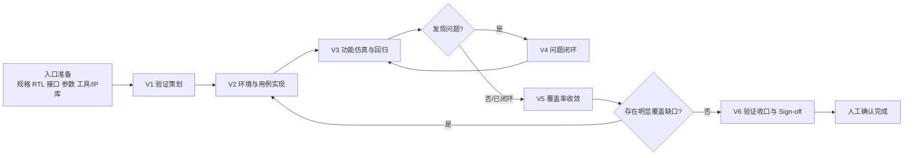

# FPGA 前端模块验证流程规范：深度研究结论与 V1.0 草案交付

## 规范边界已经可以定稿

结合你对十四个问题的确认，以及 AMD Vivado/XSim、紫光同创 PDS、安路 TangDynasty 和 Accellera UVM 的官方资料，我建议这一版正式把体系定位为：

> **面向 FPGA RTL 模块级前端功能仿真的统一验证流程规范。**

这里不再引入 UT、IT、TOP、ST 等验证层级术语，默认就是**模块级 RTL 仿真**。同时明确排除 Lint、CDC、Functional Coverage、Formal、综合实现、时序收敛、板级验证以及 Python/cocotb 验证体系。

验证环境正式划分为三档，而不是按“是不是 UVM”来划分成熟度：

| 环境等级 | 推荐定位 | 主要适用情况 |
|---|---|---|
| 基础 TB | 最轻量 | 接口简单、功能路径清楚、用例数量不大 |
| 轻量级 SV | 默认增强型 | 存在事务、约束随机、Driver/Monitor/Checker 需求 |
| 完整 SV / 轻量级 UVM | 复杂模块型 | 并发、队列、复杂协议、Scoreboard 或复用需求明显 |

这种分级是合理的。Accellera 对 UVM 的定位本身就是标准化、可复用验证环境和验证 IP 的方法学，并不意味着所有模块都必须采用 UVM；AMD 当前 XSim 也确实支持 UVM，Vivado 2026.1 文档说明其自带预编译 UVM 1.2 库。所以我建议以后规范里明确写一句：

> **验证环境应选择满足当前 DUT 复杂度的最轻方案，不以采用 UVM 作为验证成熟度评价标准。**

这会比把所有 FPGA 模块强行套成 UVM 更符合你们实际业务。

## 六阶段流程已经收敛

你提出 V0 不应作为主阶段，我赞同。最终设计成“**入口准备 + 六阶段**”。



入口准备只要求规格、RTL、接口、参数、限制条件、工具/IP 仿真库和责任人达到基本可验证状态，不给它单独编号。

六个阶段的正式口径建议如下。

| 阶段 | 核心工作 | 主要输出 |
|---|---|---|
| **V1 验证策划** | 理解 DUT 边界；分解主要功能、边界、复位、配置、时序/握手、必要异常场景；形成测试点和用例；确定三类环境之一；规划定向、随机、Assertion、Coverage、Regression；人工评审 | 测试点与用例 Excel、验证方案 |
| **V2 环境与用例实现** | 建立时钟/复位/DUT/激励；建立直接比较、Checker、Scoreboard 或必要的 Reference Model；实现定向和随机测试；Seed 可配置可记录；接入可选 Assertion；统一 PASS/FAIL、Timeout 和日志；关键代码人工审查 | 验证环境、Testcase、运行脚本 |
| **V3 功能仿真与回归** | Compile/Elaborate、Smoke；逐功能验证；主要功能执行随机测试；保存 Seed；功能通过后执行单条、影响范围或全量 Regression；最终全量 Regression 用于收口 | Regression 结果、日志、Seed |
| **V4 问题闭环** | 保存 testcase/Seed/log；简单区分 DUT、TB、规格理解、工具环境问题；只分“严重/一般”两档；修复后复测和必要回归 | 问题记录、复测结论 |
| **V5 覆盖率收敛** | 采集并尽量合并 Code Coverage；关注 Line、Condition、FSM；找未覆盖；能补则补测，不能或不需补则解释；人工确认 | Coverage 结论，直接写入最终仿真报告 |
| **V6 验证收口** | 核对最终 RTL Baseline、测试点、随机验证、问题、Assertion、Coverage 和最终全量 Regression；生成报告；人工 Sign-off | 仿真回归报告 |

这里我保留了你之前认可的六阶段结构，但是刻意没有把“反标”“Gate A/B/C/D”“大量审核节点”继续放在主流程图里。

反标可以放在后续细则中，但不应成为这张中心级主流程图的负担。这与“**主流程稳定简洁、细节规则下沉**”的思路是一致的。

## Coverage 是这一版最需要特殊处理的地方

深度调研后，这里有一个很重要的工具事实需要纠正和利用。

### Vivado/XSim 比预想的 Coverage 能力更完整

AMD Vivado Simulator 2026.1 官方资料明确列出的原生 Code Coverage 是：

**Line/Statement、Branch、Condition、Toggle。**

它支持 Coverage 数据库保存、多次仿真结果 Merge，以及 HTML/Text 报告。因此你要求的 **Line 和 Condition 在 XSim 里没有问题**。

但 AMD 当前官方列出的 XSim Code Coverage 类型中**没有 FSM Coverage**。截至 Vivado 2026.1，官方仍只列 Line/Statement、Branch、Condition、Toggle。这意味着规范里不应该写成：

> 所有工具必须生成 Line / Condition / FSM 三个百分比。

否则一切换到 XSim，这个规范自己就执行不下去了。

我建议把标准定义成：

| 指标 | 规范要求 |
|---|---|
| Line | 必看 |
| Condition | 必看 |
| FSM | 必看；优先采用工具原生 FSM Coverage |
| 工具不支持 FSM 时 | 明确记录“原生 FSM Coverage 不支持”，以状态/状态转换测试结果作为补充证据 |
| Branch / Toggle | 工具自动提供时可附带，不作为统一强制指标 |
| Functional Coverage | 本期不做 |

这样 **FSM 仍然属于规范关注项**，但不会为了工具兼容性制造一个假的 FSM 百分比。

### Vivado 实际上已有 Exclusion 能力，但不建议把它升级成强制 Waiver 流程

你提到 Vivado 报告似乎“不好 waive”。这个判断有一半是对的，但 AMD 目前已经提供 Code Coverage Exclusion。

XSim/xcrg 2026.1 支持 `-ccExclusionFile`，可以对 signal、instance、module、directory、file 等对象进行 include/exclude。不过它和一些专业验证工具的精细 Coverage Waiver 管理不是一回事，粒度和使用方式都更偏工具级 exclusion。因此你的第七条“**暂时不要建立正式 Waiver 流程**”我认为是正确选择。

正式规范我已经调整为：

> 不强制建立独立 Coverage Waiver 数据库或审批流程。未覆盖项通过“补测试”或“在最终仿真报告中解释原因与风险”闭环。工具自身提供 Exclusion 时可以使用，但不是流程前提。

这对 Xilinx 和国产平台都更稳。

### 约 90% 应该定义成期望值，而不是 Gate

我建议不要出现：

> Coverage 必须 ≥90%，否则不能 Sign-off。

更不建议出现：

> 原始 82%，经过 Waiver 后折算为 93%。

因为在你们要同时兼容 XSim、PDS/第三方仿真器、TangDynasty/第三方仿真器的情况下，这种“统一修正百分比”很难长期保持一致。

建议正式文字使用：

> **可量化 Code Coverage 工程上期望达到约 90% 或以上，但不设硬性退出门槛。低于期望水平时，应分析主要未覆盖项，能合理补测的继续补测；无法覆盖、当前项目不适用或受工具能力限制的，应说明原因与风险，并经人工确认。**

也就是说，Sign-off 看的是：

**Coverage 数字 + Hole 分析 + 工程解释**

而不是只看一个 90%。

这个定义也更适合你“不想让流程过重”的要求。

## 随机、Assertion、Regression 和工具适配的最终规则

### 随机验证

这一版我把随机测试从“推荐”提升成了**正式流程要求**，但没有要求“所有用例随机化”。

规则是：

> **主要功能必须存在合理的随机验证；关键边界、特殊异常、明确协议场景仍可以采用定向测试。**

随机维度可以是输入数据、长度、地址、间隔、顺序、合法参数组合、握手等待周期等。

同时将 **Seed 可复现**列成基础工程规则。AMD XSim 本身支持 SystemVerilog constrained random，并可通过 `-sv_seed` 控制随机种子；官方文档也明确描述了同一 Seed 的随机稳定性和改变 Seed 获得不同随机序列的行为。所以以后无论实际仿真器是什么，流程统一要求最终 Regression 至少记录：

`testcase + seed + RTL baseline + simulator version + PASS/FAIL`

这是非常值得保留的一条规范。

### Assertion

按照你的要求，Assertion 保持**可选并可开关**。

最终规则已经定成：

> Assertion 可以不用；使用时必须可以打开/关闭；一旦开启，有效 Assertion Failure 直接判定对应 Testcase FAIL。

这非常适合 FPGA 项目，不需要进一步引入 Formal。Vivado Simulator 当前支持 SystemVerilog immediate assertion 和 concurrent assertion，XSim 也提供控制 Assertion 是否生效的运行选项，因此这一规则对 Xilinx 流程本身可落地。Assertion Coverage 不进入本期 Sign-off。

### Regression

Regression 不需要复杂地规定 Nightly、CI、覆盖率排名之类机制。

我把它压缩为三个层级：

| 回归类型 | 用途 |
|---|---|
| 单条回归 | 快速确认一个 Testcase 或一个 Bug 修复 |
| 影响范围回归 | 修改后确认相关功能没有被破坏 |
| 全量回归 | 最终 Baseline 收口，Sign-off 前必须执行 |

正常执行节奏就是：

```text
单用例调通
    ↓
同功能用例通过
    ↓
主要功能随机测试
    ↓
主要功能全部 PASS
    ↓
全量 Regression
    ↓
Coverage
    ↓
Sign-off
```

这比引入一整套 CI/夜间回归制度更符合你当前要求。

### 国产 FPGA 工具最好采用“IDE 与 Simulator 解耦”

这是这次调研中另一个比较关键的结论。

紫光同创 PDS 官方说明它是 FPGA 综合开发环境，支持 Verilog、VHDL、SystemVerilog 等设计输入。紫光同创公开资料同时表明其仿真体系可以与第三方仿真工具协同；2025 年其还与合见工软合作，使 UVS+ 能读取 PDS 中的加密 IP，进一步说明“FPGA IDE + 外部仿真器”是实际存在的使用模式。安路更加明确。TangDynasty 官方将其描述为带有第三方设计验证工具接口的 FPGA IDE；安路 FAQ 直接说明 TD 没有内嵌仿真工具时，可以使用安装目录中的器件行为模型，在 ModelSim 等第三方仿真器中建立器件库进行 RTL 功能仿真。因此，我在新规范里没有定义：

`Vivado / PDS / TD = 仿真器`

而是正式拆成两个字段：

```text
FPGA IDE
+
Actual Simulator
+
FPGA/IP Simulation Library
```

例如：

```text
AMD 项目
FPGA IDE      : Vivado 2026.x
Simulator     : XSim
Device/IP Lib : Vivado自带库

国产项目
FPGA IDE      : PDS / TangDynasty
Simulator     : 项目实际采用的Simulator
Device/IP Lib : PDS/TD对应器件与IP仿真模型
```

这个设计可以让以后换国产仿真器、ModelSim/Questa 或其他环境时，**V1～V6 流程完全不用改，只增加工具适配文件。**

这也是为什么我没有继续深入 Synopsys/Cadence 专用规则——与你本次明确的范围一致。

## 新文件夹已经生成

我没有沿用之前那种简单的 `knowledge / templates / skills` 分类，而是按“**体系 → 流程 → 工程规则 → 交付物 → Skill → 工具适配 → Word图示**”重新组织。

```text
FPGA前端模块验证流程规范_V1.0/
│
├─ README.md
├─ FPGA前端模块验证流程规范_V1.0.docx
│
├─ 00_体系说明/
│   ├─ 00_范围与原则.md
│   ├─ 01_入口条件与交付物.md
│   └─ 02_角色职责与AI边界.md
│
├─ 01_流程规范/
│   ├─ 00_验证总流程.md
│   ├─ 01_V1_验证策划.md
│   ├─ 02_V2_环境与用例实现.md
│   ├─ 03_V3_功能仿真与回归.md
│   ├─ 04_V4_问题闭环.md
│   ├─ 05_V5_覆盖率收敛.md
│   └─ 06_V6_验证收口与Signoff.md
│
├─ 02_工程规则/
│   ├─ 00_验证环境分级规则.md
│   ├─ 01_随机验证规则.md
│   ├─ 02_Assertion使用规则_可选.md
│   ├─ 03_Code_Coverage规则.md
│   ├─ 04_Regression规则.md
│   └─ 05_结果判定与日志规则.md
│
├─ 03_交付模板/
│   ├─ 测试点与用例模板.xlsx
│   ├─ 验证方案模板.md
│   ├─ 仿真回归报告模板.md
│   └─ 问题记录模板.md
│
├─ 04_Skills/
│   ├─ verification-planning/
│   ├─ verification-execution/
│   ├─ regression-analysis/
│   ├─ coverage-analysis/
│   └─ report-generation/
│
├─ 05_工具适配/
│   ├─ 00_工具适配总则.md
│   ├─ 01_AMD_Vivado_XSim.md
│   ├─ 02_紫光同创_PDS.md
│   ├─ 03_安路_TangDynasty.md
│   └─ 04_工具调研摘要.md
│
└─ 06_图示与Word呈现/
    ├─ 00_Word呈现建议.md
    ├─ 01_流程图_Mermaid.md
    └─ 02_图示生成提示词.md
```

总计已经生成 **35 个文件**。

其中三个正式交付物与你最新要求完全对应：

**测试点分解 Excel，同时包含 Testcase；验证方案；最终仿真回归报告。**

Coverage 没有另起第四份正式报告，而是直接放进《仿真回归报告》。

问题管理也已经简化为“严重 / 一般”两档，没有再做复杂的 Blocker/Critical/Major/Minor。

AI 规则也改成了你要求的更严格口径：**每一步都要人工确认，尤其方案和代码；Coverage 解释、问题关闭以及 Sign-off 也必须人工决定。**

可直接下载：

[下载完整文件夹 ZIP](sandbox:/mnt/data/FPGA前端模块验证流程规范_V1.0.zip)

[下载主规范 Word](sandbox:/mnt/data/FPGA前端模块验证流程规范_V1.0/FPGA前端模块验证流程规范_V1.0.docx)

[下载测试点与用例 Excel 模板](sandbox:/mnt/data/FPGA前端模块验证流程规范_V1.0/03_交付模板/测试点与用例模板.xlsx)

Word 最终展示所需的五类图提示词也已经放入 `06_图示与Word呈现/02_图示生成提示词.md`，包括总流程、环境分级、Regression 闭环、Coverage Closure 和 AI/人工协同图。

## 当前 GitHub 状态与建议定稿口径

本轮我尝试通过已连接的 GitHub 读取你所说的 `Skill Knowledge` 内容，但当前连接没有把目标仓库暴露为可检索的 installed repository；本会话中提供的 GitHub 动作也没有可用的文件写入接口。因此我没有冒充“已经同步 GitHub”，而是先生成了一套**可直接作为新子目录提交的完整文件夹**。

建议最终 GitHub 子目录就使用：

```text
Skill Knowledge/
└─ FPGA前端模块验证流程规范_V1.0/
```

这次调研后，我认为有三项内容已经无需再讨论，可以直接成为 V1.0 的基线原则：

> **第一，流程只做模块级前端动态仿真，不扩大边界。**

> **第二，Coverage 统一关注 Line、Condition、FSM，但以“工具原生能力 + 未覆盖分析”而不是统一硬百分比或强制 Waiver 为闭环方式；约 90% 只是期望值。**

> **第三，FPGA IDE 和 Simulator 必须解耦。这样 Vivado/XSim、紫光同创 PDS、安路 TangDynasty 乃至未来国产仿真器都能进入同一套流程，而不需要改主规范。**

尤其是第三点，我认为会让这一版比“围绕某个仿真器写 SOP”更适合做中心级规范。