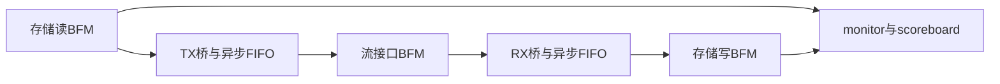

# 总线桥

本例设计和主要验证策划采用人工输入，AI辅助模板；验证代码、仿真和回归可交AI执行。

## 参数与数据流

64 bit数据，512 B存储突发包含64拍，1536 B帧包含三个突发。TX FIFO512深度、提前停止阈值448；RX FIFO2048深度；使用FWFT读模式及独立时钟域。存储域250 MHz，用户侧BFM156.25 MHz。时钟数值表示验证接口配置。

发送侧允许反压，接收侧连续输入。4 KiB区域按512 B步进，九个突发展示一次回绕。初始参数由人工输入，示例保持各接口的字节、拍和帧单位一致。

## 功能规格

| 编号 | 功能类别 | 功能 | 要求 |
|---|---|---|---|
| BRG-S01 | 存储事务 | 512 B突发 | 数据64 bit，每个存储突发64拍即512 B；按真实握手推进数据与计数。 |
| BRG-S02 | 帧传输 | 帧边界 | 演示帧1536 B，由三个512 B突发组成；首拍SOF、末拍EOF，完整拍尾字段REM=7。 |
| BRG-S03 | 流控缓存 | TX反压 | TX异步FIFO深度512、提前停止阈值448；发送反压期间valid、data和帧字段保持。 |
| BRG-S04 | 接收路径 | 不可反压接收 | RX连续接收64 bit数据，经深度2048的异步FIFO写回；满时抑制FIFO写入并观察丢数据行为。 |
| BRG-S05 | 地址管理 | 4 KiB回绕 | 演示存储区4 KiB，地址按512 B递增，完成第八突发后回到区域起点。 |
| BRG-S06 | 跨时钟 | FIFO与复位 | 存储域与用户域通过异步FIFO传输，使用FWFT模式；复位busy期间禁止实际读写。 |
| BRG-S07 | 链路控制 | 启动与恢复 | 按同步到相应域的链路就绪条件启动；恢复按事务与帧边界重新组织工作。 |

## 测试点与用例

| 测试点 | 类别 | 功能点 | 用例名称 | 规格反标 |
|---|---|---|---|---|
| BRG.001.001 | 基本功能/数据闭环 | 三个突发组成一帧并正确写回 | 三突发帧闭环 | BRG-S01＋数据64 bit，每个存储突发64拍即512 B；按真实握手推进数据与计数。；BRG-S02＋演示帧1536 B，由三个512 B突发组成；首拍SOF、末拍EOF，完整拍尾字段REM=7。 |
| BRG.002.001 | 接口交互/发送反压 | 反压期间流接口字段保持 | 发送中持续反压 | BRG-S02＋演示帧1536 B，由三个512 B突发组成；首拍SOF、末拍EOF，完整拍尾字段REM=7。；BRG-S03＋TX异步FIFO深度512、提前停止阈值448；发送反压期间valid、data和帧字段保持。 |
| BRG.003.001 | 缓存边界/TX阈值 | 提前停止阈值保护完整存储突发 | TX水位与停止余量 | BRG-S01＋数据64 bit，每个存储突发64拍即512 B；按真实握手推进数据与计数。；BRG-S03＋TX异步FIFO深度512、提前停止阈值448；发送反压期间valid、data和帧字段保持。 |
| BRG.002.002 | 接口交互/写回停顿 | 存储写接收停顿时保持当前字 | 写回反压保持 | BRG-S01＋数据64 bit，每个存储突发64拍即512 B；按真实握手推进数据与计数。；BRG-S04＋RX连续接收64 bit数据，经深度2048的异步FIFO写回；满时抑制FIFO写入并观察丢数据行为。 |
| BRG.003.002 | 缓存边界/RX拥塞 | 不可反压输入下区分接收、存储和丢弃 | RX满与数据计数 | BRG-S04＋RX连续接收64 bit数据，经深度2048的异步FIFO写回；满时抑制FIFO写入并观察丢数据行为。 |
| BRG.004.001 | 地址管理/回绕 | 第九突发使用区域起点且数据仍正确 | 九突发地址回绕 | BRG-S01＋数据64 bit，每个存储突发64拍即512 B；按真实握手推进数据与计数。；BRG-S05＋演示存储区4 KiB，地址按512 B递增，完成第八突发后回到区域起点。 |
| BRG.005.001 | 跨时钟/频率与相位 | 不同域速率下数据和帧边界守恒 | 异步频率与相位组合 | BRG-S06＋存储域与用户域通过异步FIFO传输，使用FWFT模式；复位busy期间禁止实际读写。；BRG-S01＋数据64 bit，每个存储突发64拍即512 B；按真实握手推进数据与计数。；BRG-S02＋演示帧1536 B，由三个512 B突发组成；首拍SOF、末拍EOF，完整拍尾字段REM=7。 |
| BRG.005.002 | 跨时钟/复位busy | 复位忙期间抑制FIFO真实访问 | 复位busy访问保护 | BRG-S06＋存储域与用户域通过异步FIFO传输，使用FWFT模式；复位busy期间禁止实际读写。 |
| BRG.001.002 | 基本功能/空队列 | 空队列不产生有效发送或写回 | 空FIFO和首字恢复 | BRG-S03＋TX异步FIFO深度512、提前停止阈值448；发送反压期间valid、data和帧字段保持。；BRG-S04＋RX连续接收64 bit数据，经深度2048的异步FIFO写回；满时抑制FIFO写入并观察丢数据行为。；BRG-S06＋存储域与用户域通过异步FIFO传输，使用FWFT模式；复位busy期间禁止实际读写。 |
| BRG.006.001 | 异常场景/链路 | 链路启动和恢复不混淆旧新事务 | 链路就绪门控与恢复 | BRG-S07＋按同步到相应域的链路就绪条件启动；恢复按事务与帧边界重新组织工作。；BRG-S06＋存储域与用户域通过异步FIFO传输，使用FWFT模式；复位busy期间禁止实际读写。 |

## 代表用例

### 发送中持续反压

测试点：BRG.002.001＋反压期间流接口字段保持

准备与输入：

tx_ready（发送接收就绪）由流接口BFM在首拍、中间拍和末拍分别拉低。

checker保存tx_data、SOF、EOF、REM及valid快照，覆盖BRG.002.001。

停止长度由test给定，再恢复接收。

预期结果：反压期间有效拍字段保持，恢复后接受恰好一次，帧长与顺序不变。

## 分阶段提示

1. 模板辅助：“使用设计Skill，把本例人工设计内容放入设计方案及规格表，保持64 bit、512 B突发与1536 B帧的关系。”
2. 代码支持：“使用代码Skill，检查TX/RX桥和接口连接，依次完成语法编译、代码检视、综合检查；重点核对反压和FWFT采样。”
3. 策划辅助：“使用验证策划Skill，整理人工测试点及用例，验证方案说明BFM、monitor、RM、checker和scoreboard职责。”
4. 验证执行：“使用验证实施Skill，按测试表建立十个用例入口，运行定向与适用的随机回归，回填Excel和仿真报告。”

## 输出文件

- [设计方案](设计方案.docx)
- [规格测试表](规格测试表.xlsx)
- [验证方案](验证方案.docx)
- [仿真报告](仿真报告.docx)：已填写测试配置与判据，实际现象及结论栏由运行填写。
